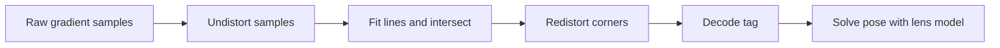

# Spot Vision

Spot Vision is Team 581's Jetson Orin AprilTag service. Python owns camera
capture, scheduling, pose solving, NetworkTables, health, and deployment. The
CUDA detector is a direct, attributed import of Team 766's standalone Team 971
implementation, exposed to Python through pybind11.

The current contract is the
[offseason integration plan](docs/Offseason%20Spot%20Integration%20Simplification%20Plan.md).
See [implementation and qualification status](docs/Beta%20Implementation%20Status.md)
for completed software checks and remaining work. Beta uses a distinct v2
protocol, durable robot profiles, and local Java integration in
`offseason-2026/offseason-bot/src/main/java/frc/robot/vision`. One Vision subsystem
owns four fixed camera roles and alliance-hub selection; Localization owns fusion
and capture-time trust. Fusion defaults off; measured mounts and modes remain a
commissioning gate. The service advertises runtime tag-policy support.
The [original design](docs/Vision%20Solution%20(Spot)%20Specs.md) and
[alpha verification](docs/Alpha%20Verification.md) provide historical context.

The camera commands and Jetson NT server configuration below describe alpha
development. They do not certify beta robot operation; beta robot mode uses the
roboRIO as NT server and Jetson as client. See [v2 schema/API notes](apps/vision/proto/README.md).

## Local development

Install mise and a C++ compiler (Xcode Command Line Tools on macOS), then run:

```sh
mise install
mise run setup
```

This installs the root pnpm workspace, builds the React dashboard and offline Astro/Starlight docs,
and uses uv to compile and install `_spot_cuda` with the CPU detector in `.venv`.
No CUDA installation is needed for local development. Python source stays editable;
`uv run` and `uv sync` rebuild the native module when its CMake/C++ inputs change.
Run `pnpm build:jetson` after editing bundled docs. Setup is safe to rerun.

```sh
mise run format
mise run lint
mise run typecheck
mise run test
```

Use `mise run format:fix` and `mise run lint:fix` to apply automatic fixes.
JavaScript dependencies share the root `pnpm-lock.yaml`; run `pnpm install` from
the root. The uv workspace contains `apps/vision`, shares one root `.venv` and
`uv.lock`, and installs the application through the root development group.
`uv run --package spot-vision spot-vision --help` selects the vision application.

Applications live in `apps/vision`, `apps/dashboard`, `apps/docs`,
`apps/vscode-camera-preview`, and `apps/robot-tester`. Python tests and tools stay
with the vision service; each JavaScript application owns its own tests and checks.
`packages/camera-viewer` is shared by the dashboard and extension through pnpm
`workspace:*` dependencies; Vite+ bundles the renderer into the dashboard.
The workspace packages are `spot-docs`, `spot-camera-preview`, and `spot-dashboard`.
Run `pnpm --filter spot-dashboard check`, `lint`, or `test` to check just the
embedded dashboard. Its React/TypeScript source lives in `apps/dashboard/src`;
Vite+ builds `dist/dashboard`, which CMake installs with the offline docs.
See the [dashboard development guide](apps/dashboard/README.md) for hot reload,
architecture, and browser behavior checks.

ty checks the service against the Python 3.10 minimum. `ty-baseline.json` records
existing type errors, including missing generated/native type information, so new
errors fail checks without hiding an entire rule or module. Fix existing findings
and then run `uv run --no-sync ty check --update-baseline` to shrink the baseline;
review baseline changes rather than accepting new errors into it.

On a Jetson with the prerequisites below, use `mise run setup:jetson` to select
CUDA explicitly. Plain local builds default to CPU. The production installer also
selects CUDA explicitly. Python 3.12 is used for development; Python 3.10 remains
the minimum supported runtime. Node is only required to build the dashboard and bundled docs.
After a CUDA setup, preserve that selection with
`uv run -Ccmake.define.SPOT_BUILD_CUDA=ON ...` when syncing through uv.

## Beta setup and review

The installed beta runs with `spot-vision beta --installation
/etc/spot-vision/beta.json` and serves its offline GUI on port 5808. Use the
[operator guide](apps/docs/src/content/docs/operator/connect.md) for connection, code-defined camera
names, calibration and verification; [deployment and rollback](apps/docs/src/content/docs/operator/deployment.md)
describes immutable CUDA releases and explicit activation. Offline setup can use
a cached robot profile, while current robot session/disabled eligibility gates
mutations and valid output. Supply measured mounts in robot code before rollout.

The [software verification report](docs/beta-verification/Software%20Verification.md)
contains the installed CPU host checks and light/dark GUI comparisons. Follow the
[remaining hardware trials](docs/beta-verification/Hardware%20Qualification.md)
before declaring beta robot-ready or enabling fusion, heading or revised trust.

See the [camera configuration reference](apps/docs/src/content/docs/operator/camera-configuration.md)
for the SWYFT/Arducam pixel counts, Java settings, control values and units.

For a bare roboRIO and Jetson without a switch, follow the
[robot integration session](apps/docs/src/content/docs/operator/robot-integration-session.md):
bring-up, setup friction, disconnect/restart recovery, and evidence-driven agent repairs.

## Jetson prerequisites

- JetPack with CUDA development tools and compute capability 8.7 support
- Python 3.10 or newer
- [uv](https://docs.astral.sh/uv/getting-started/installation/)
- CMake 3.24+, Ninja, a C++20 compiler, `libgoogle-glog-dev`, and `libgflags-dev`
- GStreamer with V4L2, JPEG decode, and OpenCV GStreamer support
- `v4l-utils`

On Ubuntu/Jetson, install the system prerequisites:

```sh
sudo apt install cmake ninja-build python3-dev python3-venv \
  libgoogle-glog-dev libgflags-dev v4l-utils \
  gstreamer1.0-tools gstreamer1.0-plugins-base \
  gstreamer1.0-plugins-good gstreamer1.0-plugins-bad
```

Before a source installation, [set up the docs tooling](apps/vision/tools/README.md#operator-documentation)
and run `pnpm build && pnpm build:jetson`. The generated `dist/dashboard/` and
`dist/jetson-docs/` must accompany the checkout used for the wheel build. Node and pnpm are build
tools; installed Jetson releases serve the bundled site without them.

Build and install into a virtual environment:

```sh
CMAKE_ARGS="-DSPOT_BUILD_CUDA=ON -DSPOT_CUDA_ARCHITECTURES=87" uv sync --locked --extra systemd
```

NT4 publishing (including the typed `Pose3d` topics) requires the `nt` extra.
Install it for the default alpha configuration:

```sh
CMAKE_ARGS="-DSPOT_BUILD_CUDA=ON -DSPOT_CUDA_ARCHITECTURES=87" uv sync --locked --extra nt --extra systemd
```

The CUDA build downloads the pinned CCCL 2.3.2 headers. For an offline build,
pre-clone that revision and add `-DSPOT_CCCL_ROOT=/path/to/cccl` to
`CMAKE_ARGS`.

For a host-only Python installation with the production CPU detector and shared
edge-geometry diagnostics, but without CUDA:

```sh
uv sync --locked -Ccmake.define.SPOT_BUILD_CUDA=OFF
```

## First camera test

Edit `apps/vision/config/spot.json` with the camera's persistent `/dev/v4l/by-id` name,
then enumerate what the driver actually supports:

```sh
.venv/bin/spot-vision camera-modes --config apps/vision/config/spot.json --camera 1
```

Run the headless proof. Each output line contains tag IDs, corners, hamming,
decision margin, FPS, timing, and drops:

```sh
.venv/bin/spot-vision probe --config apps/vision/config/spot.json --camera 1
```

Run the service:

```sh
.venv/bin/spot-vision daemon --config apps/vision/config/spot.json
```

The alpha configuration starts an NT4 server on the Jetson. For each camera,
`/Spot/1/output/robot_pose` through `/Spot/4/output/robot_pose` are typed
WPILib `Pose3d` topics. Add all four topics to an AdvantageScope 3D Field tab and
select the 2026 REBUILT field. A frame with two or more known tags is solved
jointly from all tag corners and emits one pose; single-tag IPPE ambiguity is
retained in the protobuf diagnostics while the lowest-error candidate is used
for the typed pose. The calibration files shipped in `apps/vision/config/` are explicitly
provisional and should be replaced after camera calibration.
Set each mount's `image_rotation_deg` to `0` or `180` in `apps/vision/config/spot.json`.
Spot corrects capture frames before detection, pose solving, and preview,
and transforms raw-sensor calibration intrinsics into the corrected pixel frame.
`robot_from_camera` describes that corrected camera frame. Use the actual
code-provided mount orientation. Changing a USB port or replacing a camera
on the same mount does not change this setting. Recheck it if the physical mount
changes.
The tag geometry is copied from WPILib 2026.2.2's official
[`2026-rebuilt-welded.json`](https://github.com/wpilibsuite/allwpilib/blob/v2026.2.2/apriltag/src/main/native/resources/edu/wpi/first/apriltag/2026-rebuilt-welded.json),
which matches AdvantageScope's welded 2026 field model.

For a step-by-step check of all four camera feeds and their Pose3d outputs at the
same time, see the [Pose3d test guide](docs/Pose3d%20Test%20Guide.md).

For temporary four-camera alpha testing from the Mac checkout, run one command.
It manages the installed Jetson service for the duration of the session, shows
per-camera terminal telemetry, and opens the camera and pose dashboard automatically:

```sh
python3 apps/vision/tools/probe_dashboard.py --alpha
```

The normal pose publisher continues running while the wizard uses its shared camera
frames, so no second process competes for the USB devices. The dashboard at `/`
shows calibration status, live tag outlines and projected 3D orientation axes,
and a field pose map. Its workspace controls save layout and overlay preferences
in the browser. Open the wizard at `/calibration` or the simple grid at `/viewer`. This alpha web interface is never started by
systemd and must only be used on a trusted network. See [`apps/vision/tools/README.md`](apps/vision/tools/README.md).

## ChArUco calibration

Install the contrib OpenCV dependency, serve the guided four-camera wizard,
and capture a folder of sharp board views for each camera. The headless solver
is also available for repeatable runs:

```sh
python3 apps/vision/tools/calibration_ui.py
.venv/bin/spot-vision calibrate-charuco --input-dir captures/camera-1 \
  --output apps/vision/config/calibration-1.json --camera-id 1 --width 1280 --height 720
```

Board dimensions, dictionary, distortion model, minimum frame count, and
quality gates are adjustable in the wizard/CLI. See
[`docs/Charuco Calibration Plan.md`](docs/Charuco%20Calibration%20Plan.md) for
the objective, quality gates, JSON schema, and four-camera save behavior.

## Offline tools

```sh
spot-vision replay --config apps/vision/config/spot.json --camera 1 --input recording.mp4
spot-vision compare --config apps/vision/config/spot.json --camera 1 --input recording.mp4
spot-vision benchmark --config apps/vision/config/spot.json --camera 1 --input recording.mp4
spot-vision validate-calibration --config apps/vision/config/spot.json --camera 1
```

Recordings must match the configured resolution and contain raw camera orientation.
Replay converts decoded BGR frames to packed YUYV and applies the configured
orientation before invoking the same detector boundary.

## Image regression and distortion diagnostics

Run fixed images through orientation correction, the native detector, pose
solving, mount conversion, and protobuf serialization:

```sh
PYTHONPATH=apps/vision/src .venv/bin/python -m pytest tests
.venv/bin/python -m spot_vision image-regression \
  --manifest apps/vision/tests/data/regression/manifest.json --backend cpu \
  --repeats 20 --output /tmp/spot-regression.json
```

On the Orin, repeat with `--backend cuda`. CUDA regression disables CPU fallback
so a failed GPU cannot masquerade as a passing GPU test. The checked-in synthetic
PNG fixtures cover central/peripheral distortion, multiple tags, rotated sensor
capture, and no tags. Their independent OpenCV projection oracle and generator
are in `apps/vision/tests/data/regression/`. Reports contain corner, translation, rotation and
reprojection errors plus mean/p95 pipeline timings and detector/solver timings.
Accuracy uses explicit per-case gates; timings are measurements, not brittle
cross-machine pass/fail thresholds. Add real camera images with measured ground
truth to the manifest as they become available.

`TagObservation.distortion_factor_px` is the mean raw-to-undistorted corner
pixel displacement; it is absent without calibration. Pose candidates include
mean distortion and camera-to-tag distance. The alpha NT outputs expose the same
candidate metrics alongside Pose3d. The roboRIO retains responsibility for tuning
standard deviations and resolving heading; the reference inflation formula is
in `spot_vision.uncertainty.standard_deviations` and the design contract.
Refinement fits edges in ideal coordinates and returns raw corners so decoding,
previews and solvePnP continue using the same pixel frame. Nonzero calibration
coefficients beyond the CUDA refiner's five-coefficient model cause an explicit
CPU fallback (or an error when fallback is disabled).

The CUDA decode refinement follows this coordinate path:



The Slack thread's deferred optimizations are tracked in
[direct V4L2 capture](https://github.com/team581/buddy-2026/issues/1) and
[cached field-zone exposure](https://github.com/team581/buddy-2026/issues/2).
Use the field rig to tune exposure with the official layout; generating custom
FMAPs is not a prerequisite.

## Important buffer behavior

Live GStreamer capture yields a packed `uint8` NumPy array with shape
`(height, width, 2)`. The pybind11 layer validates the exact strides and passes
that pointer directly to Team 766's detector while retaining the Python object
and releasing the GIL. This removes a Python-to-C++ copy. The detector's
required host-to-device CUDA transfer still occurs.

## Hardware validation still required

The expanded test suite, repeatable live verifier, latest alpha results, and
remaining checks are documented in [Alpha Verification](docs/Alpha%20Verification.md).
`PYTHONPATH=apps/vision/src .venv/bin/python -m pytest` runs both the core and alpha-tool
tests. Run `pnpm --filter spot-dashboard test` for the dashboard JavaScript tests.

CUDA execution and Linux UVC qualification require the target Orin. CPU detector,
pose, fixture and local NT4/HTTP tests run on the development Mac.
Before robot use, run the imported GPU tests, a live known-tag/no-tag probe,
MJPEG/YUYV comparisons, reconnect tests, a 30-minute thermal run, and the
four-camera fairness test on the target Orin.

## Offline camera preview

See the [VS Code camera preview guide](apps/docs/src/content/docs/operator/vscode-camera-preview.md) for split-screen mount inspection, private installation, and automatic updates during robot builds.
