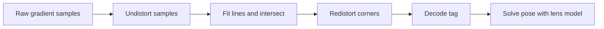

# Spot Vision

Spot Vision is Team 581's Jetson Orin AprilTag service. Python owns camera
capture, scheduling, pose solving, NetworkTables, health, and deployment. The
CUDA detector is a direct, attributed import of Team 766's standalone Team 971
implementation, exposed to Python through pybind11.

The current contract is the
[offseason integration plan](docs/Offseason%20Spot%20Integration%20Simplification%20Plan.md).
See the [documentation index](docs/README.md) for current operator instructions
and dated implementation/qualification evidence. Robot communication uses
[WPILib structs and native NT topics](docs/NetworkTables.md), durable robot profiles, and local Java integration in
`offseason-2026/offseason-bot/src/main/java/frc/robot/vision`. One Vision subsystem
owns four fixed camera roles and alliance-hub selection; Localization owns fusion
and capture-time trust. Fusion defaults off; measured mounts and modes remain a
commissioning gate. The service advertises runtime tag-policy support.
The [original design](<docs/Vision%20Solution%20(Spot)%20Specs.md>) and
[alpha verification](docs/Alpha%20Verification.md) provide historical context.

The config-file camera commands below are headless development tools and do not
publish NetworkTables topics. They do not certify robot operation; the installed service uses the
roboRIO as NT server and Jetson as client. See the [transport notes](docs/NetworkTables.md).

## Local development

Install mise, then run:

```sh
mise install
mise run setup
```

This installs the root pnpm workspace, builds the React dashboard and offline Astro/Starlight docs,
and uses uv to install the application and published RobotPy AprilTag CPU detector in `.venv`.
No C++ compiler or CUDA installation is needed for ordinary CPU development.
Python source stays editable.
Run `pnpm build:jetson` after editing bundled docs. Setup is safe to rerun.

```sh
mise run format
mise run lint
mise run typecheck
mise run test
```

Run `mise run check:application` to also compile and test the CUDA geometry diagnostics
with a C++ compiler (Xcode Command Line Tools on macOS). The diagnostics share the
production CUDA geometry code and are excluded from ordinary CPU installs.

Use `mise run format:fix` and `mise run lint:fix` to apply automatic fixes.
JavaScript dependencies share the root `pnpm-lock.yaml`; run `pnpm install` from
the root. The uv workspace contains `apps/vision`, shares one root `.venv` and
`uv.lock`, and installs the application through the root development group.
`uv run --package spot-vision spot-vision --help` selects the vision application.

Applications live in `apps/vision`, `apps/dashboard`, `apps/docs`,
and `apps/vscode-camera-preview`. Python tests and tools stay
with the vision service; each JavaScript application owns its own tests and checks.
`packages/camera-viewer` is shared by the dashboard and extension through pnpm
`workspace:*` dependencies; Vite+ bundles the renderer into the dashboard.
The workspace packages are `spot-docs`, `spot-camera-preview`, and `spot-dashboard`.
Run `pnpm --filter spot-dashboard check`, `lint`, or `test` to check just the
embedded dashboard. Its React/TypeScript source lives in `apps/dashboard/src`;
Vite+ builds `dist/dashboard`, which CMake installs with the offline docs.
See the [dashboard development guide](apps/dashboard/README.md) for hot reload,
architecture, and browser behavior checks.

ty checks the service against the Python 3.10 minimum without a diagnostic baseline.

Vulture checks Python application code, tests, and tools at 60% confidence, including
unused functions and classes. It runs in `mise run lint` and `mise run check:application`;
run `mise run deadcode` for just this check. Reviewed dynamic API usage and shared
protocol fields are documented in [`vulture_whitelist.py`](vulture_whitelist.py).
The whitelist is parsed by Vulture, never executed.
It suppresses names globally, not individual locations.

To review the findings without the baseline:

```sh
uv run --no-sync vulture apps tools check_cameras.py --sort-by-size
```

This command exits with status 3 when it finds candidates. Tests count as usage;
a passing scan does not prove that every definition is reachable in production.
Review each candidate before deleting it: HTTP callbacks, serialized fields, and
native-library attributes can appear unused. Remove obsolete whitelist entries as
cleanup progresses, retain documented false positives, and rerun `mise run deadcode`.
Do not regenerate the baseline to suppress new findings.

For Jetson deployment, use the [NixOS appliance configuration](nix/README.md).
Plain local builds default to CPU; Nix selects CUDA for the Orin appliance.
Python 3.12 is used for development; Python 3.10 remains
the minimum supported runtime. Node is only required to build the dashboard and bundled docs.

## Application setup and review

The installed application runs with `spot-vision run --installation
/etc/spot-vision/installation.json` and serves its offline GUI on port 5800. Use the
[operator guide](apps/docs/src/content/docs/operator/connect.md) for connection, code-defined camera
names, calibration and verification; [deployment and rollback](apps/docs/src/content/docs/operator/deployment.md)
describes NixOS test/switch deployments and generation rollback. Offline setup can use
a cached robot profile, while current robot session/disabled eligibility gates
mutations and valid output. Supply measured mounts in robot code before rollout.

The [software verification report](docs/verification/Software%20Verification.md)
contains the installed CPU host checks and light/dark GUI comparisons. Follow the
[remaining hardware trials](docs/verification/Hardware%20Qualification.md)
before declaring Spot robot-ready or enabling fusion, heading or revised trust.

See the [camera configuration reference](apps/docs/src/content/docs/operator/camera-configuration.md)
for the SWYFT/Arducam pixel counts, Java settings, control values and units.

For a bare roboRIO and Jetson without a switch, follow the
[robot integration session](apps/docs/src/content/docs/operator/robot-integration-session.md):
bring-up, setup friction, disconnect/restart recovery, and evidence-driven agent repairs.

## Jetson deployment

The production Jetson configuration uses NixOS, defined by [the root flake](flake.nix) and
[the J401 host configuration](nix/hosts/spot/configuration.nix). The system
build includes JetPack 7.2.1/CUDA 13.2, Spot's native module, locked Python runtime,
dashboard, offline docs, systemd services, Ethernet controls, and discovery.

```sh
# From any checkout; uses the shared maintenance key, without Nix or internet.
bash tools/jetson-ssh.sh
# For an existing NixOS installation: test, qualify with a disabled robot, persist.
nix run .#deploy -- test
bash tools/jetson-ssh.sh spot-vision check-health --robot
nix run .#deploy -- switch
```

See [NixOS setup, offline deployment, and recovery](nix/README.md) before first
installation. Generation rollback preserves calibration and other writable
state. The Seeed reComputer Robotics J401 module preserves Seeed's firmware and
supplies board-specific Ethernet naming and power/fan settings. Hardware boot
qualification is still required. Firmware updates remain separate. The old Ubuntu deployment scripts and
application release symlink are no longer used.

## First camera test

Edit `apps/vision/config/spot.json` with the camera's persistent `/dev/v4l/by-id` name,
then enumerate what the driver actually supports:

```sh
.venv/bin/spot-vision camera-modes --config apps/vision/config/spot.json --camera 1
```

Run the headless proof. Each output line contains tag IDs, corners, hamming,
decision margin, FPS, timing, and drops:

```sh
.venv/bin/spot-vision probe --config apps/vision/config/spot.json --camera 1
```

The probe uses the installed service's bounded V4L2 capture owner and verified
control writes. Detector failures are reported without switching backends.
Start a local robot-integrated service with `spot-vision run --installation
apps/vision/config/installation.json --state-root /tmp/spot-state`; it serves the dashboard and connects to
the roboRIO's NT4 server. The calibration files shipped in `apps/vision/config/`
are provisional and should be replaced after camera calibration.
Set each mount's `image_rotation_deg` to `0` or `180` in `apps/vision/config/spot.json`.
Spot corrects capture frames before detection, pose solving, and preview,
and transforms raw-sensor calibration intrinsics into the corrected pixel frame.
`robot_from_camera` describes that corrected camera frame. Use the actual
code-provided mount orientation. Changing a USB port or replacing a camera
on the same mount does not change this setting. Recheck it if the physical mount
changes.
The tag geometry is copied from WPILib 2026.2.2's official
[`2026-rebuilt-welded.json`](https://github.com/wpilibsuite/allwpilib/blob/v2026.2.2/apriltag/src/main/native/resources/edu/wpi/first/apriltag/2026-rebuilt-welded.json),
which matches AdvantageScope's welded 2026 field model.

## Live preview and calibration

Use the installed dashboard for live feeds, naming, tuning, geometry inspection,
and ChArUco capture/validation. It shares camera ownership with the vision
runtime. See the [connection guide](apps/docs/src/content/docs/operator/connect.md)
and [calibration guide](apps/docs/src/content/docs/operator/calibrate.md).
The old alpha viewer and standalone calibration web servers have been retired.

For repeatable offline calibration from saved board images:

```sh
uv run --no-sync spot-vision calibrate-charuco --input-dir captures/camera-1 \
  --output apps/vision/config/calibration-1.json --camera-id 1 --width 1280 --height 720
```

Run `spot-vision calibrate-charuco --help` for board dimensions, dictionary, lens
model, and quality gates. Historical alpha calibration files are not promoted
into the installed application without matching physical identity and mode.

## Offline tools

```sh
spot-vision replay --config apps/vision/config/spot.json --camera 1 --input recording.mp4
spot-vision compare --config apps/vision/config/spot.json --camera 1 --input recording.mp4
spot-vision benchmark --config apps/vision/config/spot.json --camera 1 --input recording.mp4
spot-vision validate-calibration --config apps/vision/config/spot.json --camera 1
```

Recordings must match the configured resolution and contain raw camera orientation.
Replay converts decoded BGR frames to packed YUYV and applies the configured
orientation before invoking the same detector boundary.

## Image regression and distortion diagnostics

Run fixed images through orientation correction, the native detector, pose
solving, mount conversion, and result serialization:

```sh
uv run --no-sync pytest apps/vision/tests
.venv/bin/python -m spot_vision image-regression \
  --manifest apps/vision/tests/data/regression/manifest.json --backend cpu \
  --repeats 20 --output /tmp/spot-regression.json
```

On the Orin, repeat with `--backend cuda`. CUDA regression never selects CPU fallback
so a failed GPU cannot masquerade as a passing GPU test. The checked-in synthetic
PNG fixtures cover central/peripheral distortion, multiple tags, rotated sensor
capture, and no tags. Their independent OpenCV projection oracle and generator
are in `apps/vision/tests/data/regression/`. Reports contain corner, translation, rotation and
reprojection errors plus mean/p95 pipeline timings and detector/solver timings.
Accuracy uses explicit per-case gates; timings are measurements, not brittle
cross-machine pass/fail thresholds. Add real camera images with measured ground
truth to the manifest as they become available.

`TagObservation.distortion_factor_px` is the mean raw-to-undistorted corner
pixel displacement; it is absent without calibration. Pose candidates include
mean distortion and camera-to-tag distance. The frame structs expose these
candidate metrics alongside Pose3d. The roboRIO retains responsibility for tuning
standard deviations and resolving heading; the reference inflation formula is
in `spot_vision.uncertainty.standard_deviations` and the design contract.
Refinement fits edges in ideal coordinates and returns raw corners so decoding,
previews and solvePnP continue using the same pixel frame. Nonzero calibration
coefficients beyond the CUDA refiner's five-coefficient model cause an error.
The installed runtime alone owns optional CPU fallback and bounded GPU retries;
recording diagnostics and regression checks always use the requested backend.

The CUDA decode refinement follows this coordinate path:



The Slack thread's deferred optimizations are tracked in
[direct V4L2 capture](https://github.com/team581/buddy-2026/issues/1) and
[cached field-zone exposure](https://github.com/team581/buddy-2026/issues/2).
Use the field rig to tune exposure with the official layout; generating custom
FMAPs is not a prerequisite.

## Important buffer behavior

Live capture uses bounded V4L2 reads and provides owned, read-only packed `uint8`
NumPy arrays with shape `(height, width, 2)`. The pybind11 layer validates the exact strides and passes
that pointer directly to Team 766's detector while retaining the Python object
and releasing the GIL. This removes a Python-to-C++ copy. The detector's
required host-to-device CUDA transfer still occurs.

## Hardware validation still required

Historical alpha results are recorded in [Alpha Verification](docs/Alpha%20Verification.md).
Use the [current qualification checklist](docs/verification/Hardware%20Qualification.md)
for remaining checks. `uv run --no-sync pytest` runs the retained Python tests. Run `pnpm --filter spot-dashboard test` for the dashboard JavaScript tests.

CUDA execution and Linux UVC qualification require the target Orin. CPU detector,
pose, fixture and local NT4/HTTP tests run on the development Mac.
Before robot use, run the imported GPU tests, a live known-tag/no-tag probe,
MJPEG/YUYV comparisons, reconnect tests, a 30-minute thermal run, and the
four-camera fairness test on the target Orin.

## Offline camera preview

See the [VS Code camera preview guide](apps/docs/src/content/docs/operator/vscode-camera-preview.md) for split-screen mount inspection and manual VSIX installation.
