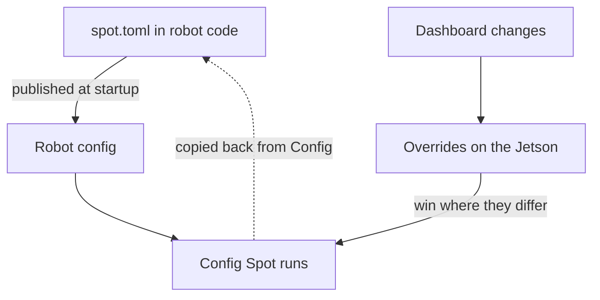
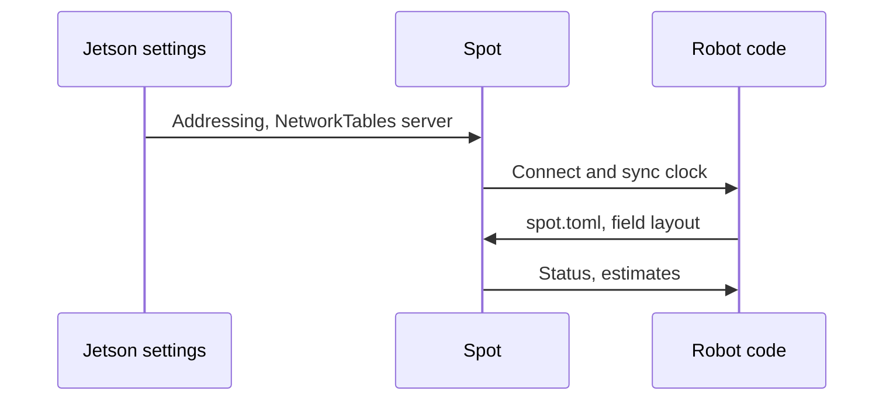

## Robot code owns the config

A Spot's camera serials, mounts, and calibrations belong to a specific robot, not to a specific Jetson.
Keeping them in `spot.toml` in the robot project means they're reviewed and versioned with the code that depends on them, and that swapping a Jetson is a matter of plugging in a new one.
Robot code publishes the file at startup and Spot applies whatever arrives.

Spot caches the last config it received, so bench work on a Jetson with no robot attached still has the cameras it last knew about.

## Why overrides exist

Some settings are only practical to find with live feedback: which serial is which camera, what exposure works under these lights, a calibration.
Editing TOML and redeploying robot code for each attempt would be slow, so the dashboard writes those changes as overrides stored on the Jetson.
Overrides sit on top of robot code's config and win wherever they differ.

Overrides are meant to be temporary.
The **Config** page shows the merged result so it can be copied back into `spot.toml`.
Once robot code's config matches an override, Spot deletes it.
`overrides_active` in Spot's status, and the dashboard's warning, make it hard to go to a match with changes that only live on one Jetson.

## Settings that stay on the Jetson

Team number, Ethernet addressing, and the NetworkTables server aren't in `spot.toml` because Spot needs them before it can receive `spot.toml`.
They are the only settings that live only on the Jetson.

## Spot only listens

Apart from its inputs, Spot knows nothing about the robot.
It doesn't read robot state, accept commands, or negotiate which tags to use.
Data flows one way, and Spot leans on NT4 for what it already provides, such as timestamps, instead of adding a protocol of its own.
Fewer ways to talk to Spot means fewer ways for robot code and Spot to disagree.

## What Spot leaves out

Spot started as a rewrite of a Python proof of concept, and dropped much of its feature set to be more robust.
It deliberately doesn't support CSI cameras or raw image formats, fusion or filtering across cameras, more than one Spot per robot, or any authentication.
Each of these would add a failure mode at competition for a benefit the team hasn't needed.
