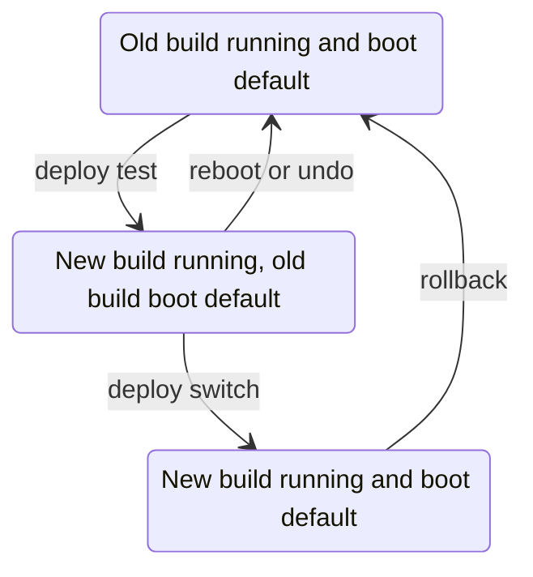

These commands run from a checkout of this repository on a laptop with Nix.
They reach Spot at `10.5.81.11`; set `SPOT_HOST` to use another address.



## Deploy a new build

1. Commit or `git add` new files.
   Nix ignores untracked files.
2. Build on the Jetson and start the new system without making it the boot default:

   ```sh
   nix run .#deploy -- test
   ```

3. Check that Spot reports `ready` and that every camera is streaming, on the dashboard or with:

   ```sh
   curl http://10.5.81.11:5800/api/status
   ```

4. Make it the boot default, without changing the checkout in between:

   ```sh
   nix run .#deploy -- switch
   ```

## Undo a test deploy

Reboot the Jetson, or restore the boot default without rebooting:

```sh
mise run jetson:ssh -- sudo /nix/var/nix/profiles/system/bin/switch-to-configuration test
```

## Undo a switch

```sh
mise run jetson:ssh -- sudo nixos-rebuild switch --rollback
```

If SSH doesn't work, pick an older generation from the Jetson's boot menu.

Rolling back doesn't restore Spot's saved state in `/var/lib/spot-vision`.
Copy that directory off the Jetson first if the new build might change it.

## Read the service logs

```sh
mise run jetson:ssh -- sudo journalctl -u spot-vision -b
```
