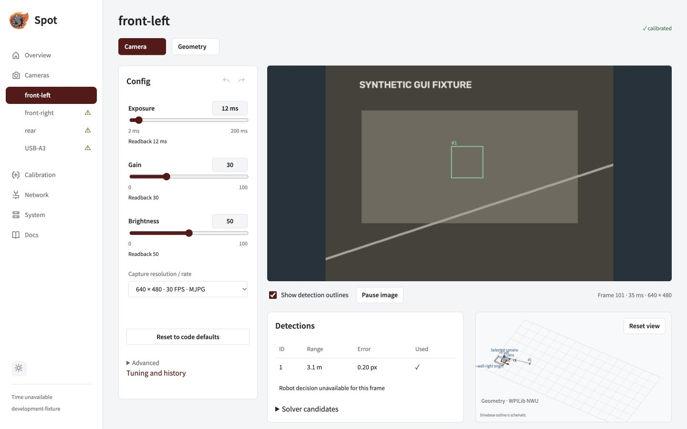

Define measured mounts, capture requests and control policies in `VisionConfig.java`. Robot builds publish the profile; Spot stores physical USB bindings and intrinsic calibration.

## Add a camera

Edit `offseason-bot/src/main/java/frc/robot/vision/VisionConfig.java` in `offseason-2026`.

```java
public static final SpotCameraConfig FRONT = new SpotCameraConfig(
    "front",
    true, // required camera
    mount(.10, 0, .30, 0, 0, 0), // x/y/z metres; roll/pitch/yaw degrees
    0, // image rotation: 0 or 180
    new CaptureSettings(640, 480, 30, PixelFormat.MJPEG),
    List.of(
        Control.pinned("auto_exposure", 1),
        Control.pinned("exposure_time_absolute", 5000), // µs
        Control.tunable("gain", 20)));

public static final List<SpotCameraConfig> CAMERAS = List.of(FRONT);
```

Import `SpotCameraConfig.Control` and `java.util.List` for the short names. Replace the example mount with measurements and verify the requested capture combination and control values on the actual device.

> **Register the camera.** A named constant alone is not enough: add it to `CAMERAS`. The production profile intentionally stays empty until measurements exist. The offseason roles are `left`, `right`, `front`, `back`, chassis-fixed and required, in that order.

Inspect saved mounts with the [VS Code preview](../vscode-camera-preview), then build/deploy robot code and [bind physical feeds](../name) in Spot.

## Camera settings

| `SpotCameraConfig` field | Meaning                                                                                            |
| ------------------------ | -------------------------------------------------------------------------------------------------- |
| `name`                   | Unique logical role, such as `front`; bind the physical USB feed to it in Spot                     |
| `required`               | Missing/unusable camera fails all-required-camera health; other valid cameras can still contribute |
| `robotToCamera`          | Measured `Transform3d` in WPILib NWU: X forward, Y left, Z up                                      |
| `imageRotationDeg`       | Exactly 0 or 180; image orientation is separate from mount rotation                                |
| `capture`                | One explicit, non-null `CaptureSettings` request                                                   |
| `controls`               | Up to 64 unique control policies; `List.of()` leaves controls unpinned                             |

`mount(xM, yM, zM, rollDeg, pitchDeg, yawDeg)` converts degrees to WPILib radians. All six values must be finite. Positive pitch points the forward lens down. Rotations compose as yaw × pitch × roll. This helper supports fixed mounts; it supplies no joint-history configuration.

Names use `[A-Za-z0-9][A-Za-z0-9_.-]{0,63}`. Renaming a role is not a USB-device selector.

## Capture settings

Use `new CaptureSettings(width, height, fps, pixelFormat)` with a combination the camera actually advertises.

| Option              | Bounds / meaning                                                 |
| ------------------- | ---------------------------------------------------------------- |
| `width`             | Even integer, 1–4096 pixels                                      |
| `height`            | Integer, 1–4096 pixels                                           |
| `fps`               | Integer, 1–240; requested acquisition cadence, not detection FPS |
| `PixelFormat.MJPEG` | Compressed USB stream; normalized to MJPG internally             |
| `PixelFormat.YUYV`  | Uncompressed USB, 2 bytes/pixel; also called YUY2                |

Only MJPEG and YUYV are supported by this Java helper. Software bounds do not establish device support: even a lower FPS may be unsupported for a particular size/format. MJPEG can be decoded to YUYV in Jetson memory without sending raw YUYV over USB.

Changing capture settings changes the generated mode ID/signature. Calibration and timing must match. Changing focus or physical optics still requires recalibration even if capture settings stay the same.

## Control policy

| Helper / field                                      | Effect                                                                              |
| --------------------------------------------------- | ----------------------------------------------------------------------------------- |
| `Control.pinned(name, value)`                       | Required control; enforce robot default                                             |
| `Control.tunable(name, value)`                      | Required control; permit saved GUI override                                         |
| `new Control(name, value, required, allowOverride)` | Explicit required/optional and pinned/tunable policy                                |
| `name`                                              | Exact advertised V4L2 key, using the same bounded identifier syntax as camera names |
| `value`                                             | Finite double; exposure uses µs, other controls use driver units/menu indices       |
| `required=false`                                    | Skip an absent control; an invalid value on a present control is still rejected     |
| `allowOverride=true`                                | Permit a saved GUI value while editing is eligible                                  |

Omitted controls remain editable in the GUI and retain saved values across deployments and Jetson restarts. Pinned entries always take precedence. A saved override can survive a new Java default; use **Reset to code defaults** to restore that default. Values must satisfy the device's range, step and menu. Optional tunable example: `new Control("sharpness", 0, false, true)` only if that camera allows zero.



_Use Config / Advanced for your device's actual names, units, menus, limits, readback and locks. This screenshot uses demonstration values._

## Exposure quick reference

| Control                                                       | Values / units                                                            |
| ------------------------------------------------------------- | ------------------------------------------------------------------------- |
| `auto_exposure` or `exposure_auto`                            | Common fixed-lens menu: 1 manual, 3 automatic; verify the advertised menu |
| `exposure_time_absolute` or `exposure_absolute`               | Spot/Java use µs: 1000 = 1 ms; 5000 = 5 ms                                |
| Raw V4L2 exposure                                             | 100 µs ticks: native 10 = 1000 µs                                         |
| `autogain`                                                    | 0 manual, 1 automatic, if advertised                                      |
| `white_balance_automatic` or `white_balance_temperature_auto` | 0 manual, 1 automatic                                                     |
| `power_line_frequency`                                        | 0 disabled, 1 = 50 Hz, 2 = 60 Hz, 3 automatic; use advertised entries     |

Use the exact alias the device reports. Set manual mode before manual exposure, gain or white balance. Spot orders automatic controls before dependent writes. OpenCV fractional auto-exposure values such as 0.25/0.75 do not apply here.

| Capture rate | Maximum exposure with 100 µs steps |
| ------------ | ---------------------------------- |
| 30 FPS       | 33,300 µs                          |
| 60 FPS       | 16,600 µs                          |
| 120 FPS      | 8,300 µs                           |

Exposure must also meet the driver range and step. Shorter reduces blur; longer collects more light. See [Camera tuning](../tuning) for live adjustment and history.

## Hardware reference

| Camera                       | Sensor / connection                                           | Documented formats       |
| ---------------------------- | ------------------------------------------------------------- | ------------------------ |
| SWYFT USB AprilTag Camera    | 1280 × 800, mono global shutter, USB 2.0                      | MJPEG only               |
| Arducam UC-844 Rev.B / B0332 | OV9281, 1280 × 800, 3 µm pixels, mono global shutter, USB 2.0 | MJPEG; limited-rate YUY2 |

Both full-resolution images have 1,024,000 pixels (1.024 MP). Advertised or requested FPS is separate from delivered FPS and detector cadence. Test all cameras together on their actual USB topology.

<details>
<summary>Published modes and historical team observations</summary>

The [SWYFT specifications](https://shop.swyftrobotics.com/products/swyft-usb-camera) advertise MJPEG up to 210 FPS at 160×120, 320×240, 352×288 and 640×400; up to 120 FPS at 640×480, 800×600, 1024×768, 1280×720 and 1280×800.

The [Arducam B0332 datasheet](https://uctronics.com/download/Amazon/B0332_OV9281_Global_Shutter_UVC_Camera_Datasheet.pdf) lists MJPEG at 100 FPS for 1280×800, 800×600, 640×480 and 320×240; YUY2 at 10 FPS for 1280×800 and 1280×720. Older documentation differs: inspect your firmware's descriptors.

Historical team logs used MJPEG 640×480 at requested 120 FPS for a Swift/Generic USB camera; higher advertised resolutions timed out. Attached Arducams were logged as UC762 at MJPEG 1280×720, requested 120 FPS. These are not UC-844 capability evidence. Historical exposure readings found a 5,000 µs minimum on the Generic camera and used 1,000 µs on attached Arducams; neither is a universal preset.

The earlier hardware reference was checked October 18, 2026, without access to the Jetson. Current firmware ranges and menu subsets still need per-device enumeration.

</details>

<details>
<summary>Image-control glossary</summary>

Use actual advertised ranges, steps and units, not an assumed 0–100 scale. Standard meanings come from the [Linux user controls](https://docs.kernel.org/userspace-api/media/v4l/control.html) and [camera controls](https://docs.kernel.org/userspace-api/media/v4l/ext-ctrls-camera.html).

| Control                     | Meaning                                                                                   |
| --------------------------- | ----------------------------------------------------------------------------------------- |
| `gain`                      | Amplification; higher usually brightens and adds noise. No universal dB scale.            |
| `brightness`                | Black-level/luminance offset; does not collect more light. Zero need not be the midpoint. |
| `black_level`               | Separate control if advertised; do not invent it as an alias for brightness.              |
| `contrast`                  | Bright/dark separation; excess can clip tag edges and highlights.                         |
| `gamma`                     | Midtone response on a firmware-specific scale; 1 need not mean linear.                    |
| `sharpness`                 | Edge enhancement; standard minimum disables the filter. Excess creates halos.             |
| `backlight_compensation`    | Brighten subjects against bright backgrounds; standard minimum disables it.               |
| `white_balance_temperature` | Kelvin, with automatic white balance off; may not affect mono output.                     |
| `saturation`                | Color intensity; standard zero removes chroma if available. Usually unhelpful on mono.    |
| `hue`                       | Color adjustment, not image rotation or camera heading; usually unhelpful on mono.        |

Standard exposure-mode menu entries are 0 automatic exposure/iris, 1 manual exposure/iris, 2 manual exposure with automatic iris, 3 automatic exposure with manual iris. Select only advertised entries. Power-line frequency is anti-flicker control, not capture FPS.

</details>

<details>
<summary>Other controls and unsupported settings</summary>

Discovery supports advertised scalar `int`, `bool`, `menu` and `intmenu` controls. Booleans usually use 0/1; menus use exact listed integers, possibly with gaps. Inactive, read-only, disabled or grabbed flags can block edits. Button, string, array and write-only action controls are unsupported here.

Other cameras may advertise `exposure_dynamic_framerate` / `exposure_auto_priority` (0 holds FPS, 1 permits variation), `focus_automatic_continuous` / `focus_auto` (0 manual, 1 automatic), driver-specific `focus_absolute`, `zoom_absolute`, pan, tilt or iris. Use actual enumeration, not these example spellings. An M12 lens does not establish motorized control; SWYFT lists focus/zoom/pan/tilt/iris as unsupported.

`convert_rgb` / `CAP_PROP_CONVERT_RGB` is a host OpenCV property, not a portable UVC policy. Detector backend, decimation, preview encoding and detector FPS are not `Control` entries. RGB, GRAY8 and H.264 are not additional `PixelFormat` choices in this helper.

</details>

<details>
<summary>Read raw device capabilities on the Jetson</summary>

These read descriptors and controls without starting another capture stream. Choose an image-capture node, not a metadata node; `/dev/video0` is only an inspection example.

```sh
v4l2-ctl --list-devices
v4l2-ctl --device=/dev/video0 --list-formats-ext
v4l2-ctl --device=/dev/video0 --list-ctrls-menus
```

For exposure, `min=50 max=10000 step=1 default=166 value=50` means 5,000–1,000,000 µs, 100 µs steps, 16,600 µs device default and 5,000 µs current. The capture interval can impose a smaller maximum. Other integer controls retain advertised units. Legal values satisfy `min ≤ value ≤ max` and `(value - min) % step == 0`; menu values must also be listed. Device default, robot default and saved GUI override are distinct.

</details>

<details>
<summary>Profile settings and commissioning</summary>

| Setting          | Purpose                                                                                |
| ---------------- | -------------------------------------------------------------------------------------- |
| `ROBOT_ID`       | Bounded profile ID identifying the offseason robot                                     |
| `CAMERAS`        | Registered constants; 32-camera software/protocol bound is not a Jetson capacity claim |
| `CAMERA_NAMES`   | Planned role names/order; does not register cameras                                    |
| `FIELD_LAYOUT`   | WPILib AprilTag layout, default team 2026 welded; use surveyed poses for home prints   |
| `TAG_SIZE_M`     | Black-square size excluding white margin; >0 and ≤1 m, default 0.1651 m                |
| `FUSION_ENABLED` | Default false; still subject to validation/DS suppression when enabled                 |

Field layout assets can be JSON; camera settings remain Java. Keep the blue-wall-right field frame consistent. Localization uses the robot's drivetrain/IMU history; fusion needs hardware qualification and heading remains disabled.

Bind feeds, verify delivered capture/readback, calibrate with independent validation and qualify timing before robot fusion. Mode, orientation and optical controls can invalidate calibration; timing also depends on control readback. Rebuild/redeploy after code edits. These examples do not commission a physical camera.

</details>
