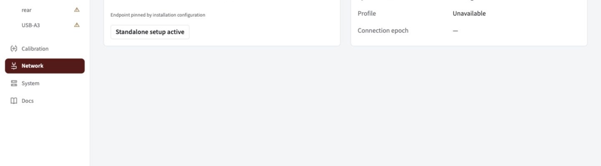
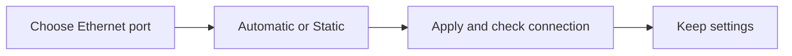

Open the dashboard, check the robot link, and find your cameras. Start here when Spot is already installed on the Jetson.

## Open the dashboard

1. Make sure the Jetson is on, then connect to the robot.
2. Open [spot.local:5800](http://spot.local:5800). If the hostname does not resolve, use the Jetson's local IP address and port.
3. Select **Network** to check the connection, then **Cameras** to find the physical feeds.



_Network shows the robot endpoint, local addresses, clock and profile. This example is disconnected; screenshots in these guides use demonstration data._

## Check you are ready

| Check           | What to look for                                                            |
| --------------- | --------------------------------------------------------------------------- |
| Robot endpoint  | Team 581 discovery, or the explicit server configured for this installation |
| NetworkTables   | Connected to the roboRIO, which runs the NT4 server                         |
| Synchronization | A current synchronized clock                                                |
| Profile         | The current robot profile                                                   |
| Cameras         | A live feed for each connected USB camera                                   |

> **Editing locked?** Disable the connected robot. For bench work with the link known disconnected, click **Begin standalone setup** on Network. Unknown robot state never unlocks edits automatically; connecting a robot ends standalone setup.

## Set the Jetson address

Open **Network → Jetson address**. The port list shows each Ethernet interface and its current IP address. Pick the port you want to change.

- **Automatic (DHCP)** gets an address from your router or robot network. It needs a DHCP server.
- **Static** keeps the address you enter. For team 581, a free address such as **10.5.81.11/24** works on the robot subnet. Keep the roboRIO at its own address, usually **10.5.81.2**.

Click **Apply for 90 seconds**. If needed, open the new address, then click **Keep settings**. If the connection fails or you do not confirm, Spot restores the previous connection automatically. **Revert now** restores it immediately. Confirmed settings survive a reboot.



For the two-cable bench, keep the Mac-facing port at **192.168.69.170/24** and change only the robot-facing port. The two ports must use different subnets. A cable directly to the roboRIO usually needs **Static** because neither end supplies DHCP. Wi-Fi and the internet default route are preserved.

**Find Spot:** open [spot.local:5800](http://spot.local:5800/) from the same local network. Network shows the actual local name and current IP addresses. If another device already uses `spot.local`, the displayed name may be `spot-2.local`. Discovery is advertised through the Jetson's Ethernet ports so a separate Jetson Wi-Fi link cannot divert name lookup from the robot or maintenance network. Local-name discovery does not cross routers or the Jetson's two Ethernet links; use the address on the link connected to your computer.

If address controls are unavailable, the installation needs its network helper; see [deployment](../deployment). The **Jetson address** is separate from the **Robot endpoint**, which is the roboRIO NT server Spot connects to.

## Choose your next task

- [Name cameras](../name) to bind physical feeds to robot-code names.
- [Tune a standalone camera](../tuning) or [calibrate](../calibrate) without a robot profile.
- [Deploy Spot](../deployment) if the Jetson has no installed beta service.
- [Recover a connection](../recovery) if a camera or robot link disappears.

<details>
<summary>Maintenance connection and endpoint settings</summary>

For the dedicated Jetson maintenance link:

```sh
ssh -i ~/.ssh/spot_jetson_ed25519 team581@192.168.69.170
```

For direct Ethernet, the development Mac uses `192.168.69.171/24` on its connected adapter. These maintenance addresses are separate from the robot NT endpoint.

Installation settings live in `/etc/spot-vision/beta.json`. Defaults use team 581 discovery and HTTP port 5800. Set `nt.server` instead of `nt.team` for an explicit robot endpoint. The Network page changes Ethernet addresses through the installed network helper; it does not change the robot NT endpoint. The UI and saved calibration remain accessible without cameras or a robot; alpha development commands do not start this GUI.

</details>
