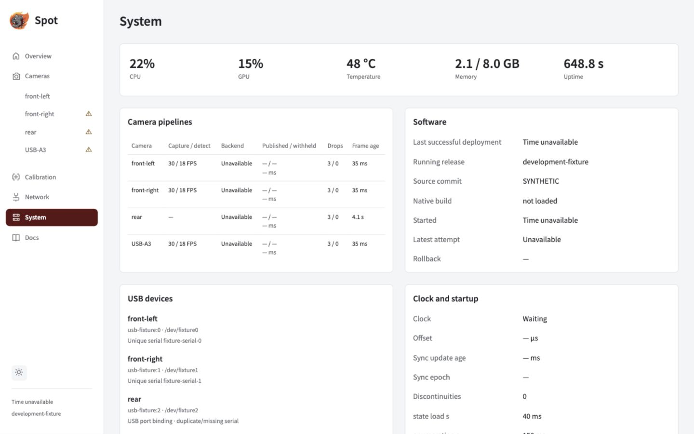

Build an immutable release, activate its ID, then verify the software actually running.

## Install a release

On the Jetson, prepare the build prerequisites in the repository README, then run:

```sh
pnpm install --frozen-lockfile
pnpm --dir apps/docs build:jetson
sudo apps/vision/deploy/install.sh /home/team581/spot-2026
```

The documentation build needs Node and pnpm. Alternatively, copy the prebuilt
`dist/jetson-docs/` directory with the checkout; installed releases need neither tool.

The installer builds and verifies the CUDA wheel and prints a **release ID**. It does not switch the running service.

## Activate and verify

For a qualified, disabled robot, replace `RELEASE_ID` with the printed ID:

```sh
sudo /opt/spot-vision/activate.py RELEASE_ID
```

For initial offline GUI setup while hardware qualification is pending:

```sh
sudo /opt/spot-vision/activate.py RELEASE_ID --setup-only
```

Activation restarts the service and waits up to 120 seconds for HTTP/native identity and the required readiness checks. Open **System** to verify the result.



_Use the Software panel to check the running identity and latest attempt. This demonstration has no installed native build._

| System field               | Check                                                                         |
| -------------------------- | ----------------------------------------------------------------------------- |
| Running release            | The intended release ID and actually loaded module                            |
| Last successful deployment | The latest verified activation                                                |
| Last attempt / rollback    | Whether the latest switch failed or restored a previous release               |
| Started                    | Process start time; calendar time may be unavailable until clock verification |

## Roll back

Activate an existing compatible beta release ID using the same command. Failed verification automatically restores the previous release link and restarts it. Saved assignments, calibrations and installation settings stay outside release directories.

## Get diagnostic evidence

```sh
systemctl status spot-vision
journalctl -u spot-vision
```

From System, export a support bundle/configuration or record 10–30 seconds of bounded diagnostics. Recording does not take camera ownership.

<details>
<summary>Release layout and migration details</summary>

Application files live read-only under `/opt/spot-vision/releases/RELEASE_ID`; activation atomically switches `current`. Writable state lives under `/var/lib/spot-vision`, and `/etc/spot-vision` is read-only to the service. Installation records dependency versions and verifies native/application assets.

Preserve the historical alpha installation before a first migration. An alpha wheel is not a beta rollback target. Configuration imports check the current profile, identity, policy, mode and calibration before atomic disabled-only acknowledgement. Without verified wall time, System shows **Time unavailable** while release identity and monotonic uptime remain available.

</details>

## Ethernet controls and discovery

The normal installer includes the network helper and local-name discovery. On an existing installation, run `sudo apps/vision/deploy/install-network.sh /absolute/spot/source` from the source checkout, then deploy the updated Spot application. NetworkManager and Avahi must be installed. This does not change Ethernet addresses; choose Automatic or Static on **Network → Jetson address**.

Local-name discovery advertises the Jetson's physical Ethernet ports; it does not advertise its separate Wi-Fi connection. The helper is a separate system service with access limited to physical Ethernet ports. Spot's camera service stays unprivileged. NetworkManager protects each trial with a 90-second rollback; an unconfirmed connection is not selected automatically on boot. Wi-Fi profiles and default routes are preserved. The installer saves previous helper and Avahi files in the printed backup directory.
