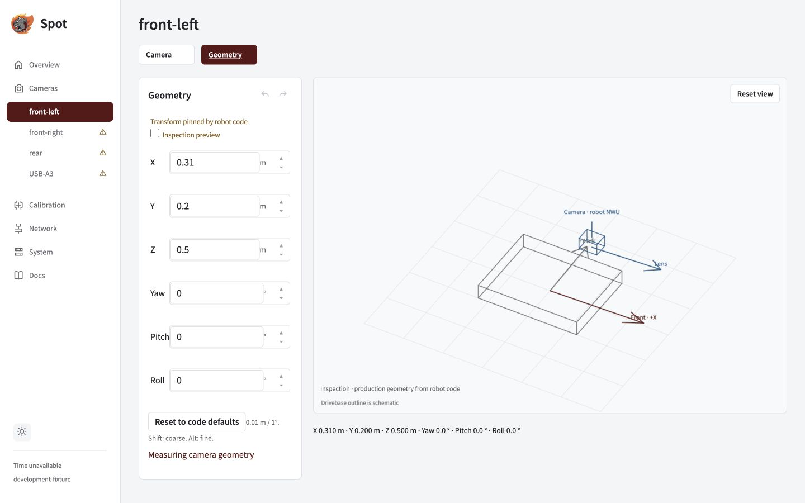

Compare the measured mount in robot code with the 3D view. Production geometry comes from the robot profile.

## Measure in the robot frame

| Value              | Convention                                                   |
| ------------------ | ------------------------------------------------------------ |
| X / Y / Z          | Metres from the robot origin to the camera optical origin    |
| Positive axes      | X forward · Y left · Z up (WPILib NWU)                       |
| Roll / pitch / yaw | Right-handed rotation; Java `Rotation3d` takes radians       |
| Pitch              | Positive points the forward lens down; negative points it up |

> **Keep the pitch sign.** Java and the Jetson use the same WPILib sign. A Java pitch of −20° also displays as −20° on the Jetson and points the lens up.

## Inspect the mount

1. Open the named camera's **Geometry** tab.
2. Compare X/Y/Z and Yaw/Pitch/Roll with the measured code values. Use the **Front** and **Lens** arrows to check direction.
3. Drag to orbit and scroll to zoom. **Reset view** restores the starting view.
4. To try an adjustment, enable **Inspection preview**. To change the production mount, edit robot code and deploy the new profile.

_The camera transform follows the profile. The drivebase outline is schematic; these example coordinates are not production measurements._

## Inspect before deploying

Use the [VS Code camera preview](../vscode-camera-preview) to view saved Java camera definitions beside the code, without a Jetson connection.

Viewer shortcuts and number editing

| Action             | Shortcut                                   |
| ------------------ | ------------------------------------------ |
| Orbit / zoom       | Arrow keys / + and −                       |
| Step a value       | Up/Down or steppers: 0.01 m or 1°          |
| Coarse / fine step | Shift: 0.1 m or 10° · Alt: 0.001 m or 0.1° |
| Commit / cancel    | Enter or blur / Escape                     |

Partial text stays editable. Finite values update the inspection preview; invalid text does not become zero. A conflict keeps the edit buffer. Scrolling does not change numbers, and native text undo remains available. Production history buttons stay disabled for code-pinned geometry.

Moving cameras

Fixed cameras use measured constant mounts. A moving camera requires capture-time joint history and full moving-mount qualification. Never substitute the current joint angle for the transform at capture time.

Next: [calibrate the lens](../calibrate).
