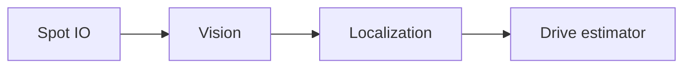

import { Code } from '@astrojs/starlight/components';
import javaExample from '../../../assets/java-example.java?raw';

Use this reference for subsystem ownership, transport and HTTP contracts. For day-to-day configuration, start with [Cameras in Java](../camera-configuration/).

## Robot data flow

| Owner          | Responsibility                                                                                                                             |
| -------------- | ------------------------------------------------------------------------------------------------------------------------------------------ |
| `Vision`       | Sole scheduled owner of transport, capture history, ordering, selection state and cached camera status                                     |
| `Localization` | Drain immutable `VisionMeasurement` values once, check age/history, convert FPGA to CTRE time once, insert pose, acknowledge actual fusion |
| `TrustFactor`  | Update from fused evidence; simulation follows the same health/trust rules                                                                 |

The offseason implementation lives in `offseason-bot/src/main/java/frc/robot/vision/`. Construction order is drivetrain → IMU → Vision → HealthManager → Swerve → Localization; helpers do not schedule themselves. Localization returns fusion acknowledgements to Vision and updates local trust only after fusion.

> **Commissioning gate:** measured `left`, `right`, `front`, `back` mounts, modes and controls are required. The production profile starts empty. `VisionConfig.FUSION_ENABLED` defaults false; heading stays suppressed. DS `UseVision` and pit mode can suppress fusion while retaining shadow diagnostics.

Compiled construction example

This seam provides one NT instance/session, capture source, clock and explicit capabilities. `poseAt` returns empty outside available FPGA-time history.

<Code code={javaExample} lang="java" />

## Tag selection

| Request                              | Behavior                                                                                     |
| ------------------------------------ | -------------------------------------------------------------------------------------------- |
| `tagsRequest()`                      | All configured field IDs                                                                     |
| `hubTagsRequest()`                   | Acquire broadly, then use own-alliance hub IDs after fresh accepted evidence from any camera |
| Red hub                              | 2, 3, 4, 5, 8, 9, 10, 11                                                                     |
| Blue hub                             | 18, 19, 20, 21, 24, 25, 26, 27                                                               |
| Unknown alliance / incomplete layout | Keep broad acquisition                                                                       |
| Hub evidence lost for 0.5 s          | Return to broad acquisition                                                                  |

Requires Spot **0.2.1+** with `tag_selection_supported=true` and matching offseason integration (`frc.robot.vision.generated`, schema v2). Older services report unsupported. Repeated requests do not reset timers. Selection changes invalidate queued old-policy output; filtering happens before solving and the robot checks applied generations.

Scheduling, health and simulation

Inputs run IMU 10 → Vision 11 → Localization 12 → Health 28 → managers 29 using the sorted-list scheduler. Priority-queue iteration does not enforce this order. State actions descend in priority so Vision publishes after Localization acknowledges.

Camera health and pose evidence are separate. Fresh zero-tag frames can maintain camera health while trust ages. Other cameras can continue when a required camera faults. An empty profile has no localization camera capability. Spot has no fuel-detection capability.

Qualify USB/compute throughput, visibility, correlation, partial outages, FPGA timestamps and provisional trust coefficients before enabling production fusion. A future headless runner can use scripted `VisionIO`, a manual clock and capture history; no scenario runner or registry reset API is supplied. Full scoring simulation must account for TestManager idling normal managers.

## Observation contract

| Field / limit      | Contract                                                                        |
| ------------------ | ------------------------------------------------------------------------------- |
| Topics / type      | `/Spot/v2` · `proto:spot.vision.v2.*` raw packets                               |
| Schema             | `proto/vision_v2.proto`, installed under `spot_vision/schemas`                  |
| Frame identity     | Session, generation, binding, calibration, mode, sequence and capture epoch     |
| Robot timestamp    | NT sample time translated to FPGA time; local Jetson NT time is diagnostic only |
| Bounds             | 64 KiB per observation · 32 cameras · 64 tags · 2 candidates                    |
| Initial time gates | 250 ms max age · 5 ms future tolerance · 20 ms reorder watermark                |

Reject stale, future, conflicting-domain, pre-reset, duplicate, old-epoch and mismatched packets. Do not clamp timestamps. Sentinels 0/1 require a verified NT server; actual roboRIO timing needs hardware qualification.

## HTTP operations

1. GET `/api/session` for the HttpOnly SameSite cookie and CSRF token.
2. POST JSON to `/api/operations` with matching Origin, `X-Spot-CSRF`, `operation`, `payload` and a unique bounded `request_id`.
3. Poll `/api/jobs/ID` for applied/rejected acknowledgement.

Handlers enqueue work; they never open cameras, solve calibration or write state. Revisions prevent concurrent overwrite. Theme stays in browser storage.

HTTP limits and measured timing records

| Limit                   | Value                 |
| ----------------------- | --------------------- |
| Ordinary body / import  | 64 KiB / 2 MiB        |
| Sessions / HTTP workers | 8 / 16                |
| Live mutations          | 5 per second; burst 2 |

A `qualify-timing` payload carries revision and a record with physical identity, System timing signature, `timestamp_source` = `read-completion-local-nt`, nonpositive `correction_us`, positive `uncertainty_s` ≤ 0.02, `measured_cycles` ≥ 100, and explicit evidence/conditions. Submit while disabled. Synthetic test records are not qualification evidence.

