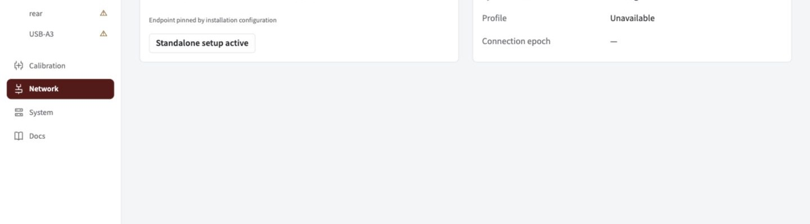

Find the interrupted component, restore it, then check fresh status before returning to robot use.

## Find the interruption

| Symptom             | First action                                             | Expected recovery                                                  |
| ------------------- | -------------------------------------------------------- | ------------------------------------------------------------------ |
| Robot link down     | Check Ethernet and roboRIO; open Network.                | A new handshake and time sync before observations resume           |
| One feed missing    | Check that camera's cable and labelled hub port.         | Rediscovery verifies its mode and controls; other cameras continue |
| All feeds missing   | Check powered hub and upstream USB.                      | Cameras rediscover using persistent identities                     |
| Jetson restarted    | Open the dashboard, then Network and System.             | UI starts before USB/robot dependencies are ready                  |
| Degraded processing | Open System for backend, temperature and target cadence. | The reported reason identifies reduced capacity                    |

_Check the live link and clock after reconnecting. This example shows a disconnected bench setup._

## Confirm recovery

1. Check Network for the current robot profile and synchronized clock.
2. Check live camera images, applied controls and frame age.
3. Check robot feedback for fresh accepted observations.
4. If a fault persists, [look up the rejection](../faults) or export a support bundle from System.

> **A disconnect does not authorize edits.** Unknown robot state stays locked. Standalone setup requires an explicit action while the link is known disconnected.

What happens to observations and saved state?

Robot interruptions leave local processing, previews and saved settings available. Spot withholds observations and discards unsent backlog. Reconnection creates fresh connection/time-sync epochs and a profile handshake; only post-sync, post-acknowledgement frames can resume. A new robot program has a new session/FPGA epoch. Cached profile equality is insufficient. Recovery does not silently reseed the estimator or clear trust degradation.

Camera rediscovery verifies persistent identity, mode and controls and starts a new capture epoch. A missing required camera faults; optional cameras degrade independently.

State uses checksummed immutable generations and atomic pointers. An interrupted staged write cannot activate a partial group. Corrupt active state falls back to the previous complete generation with a fault. Corrupt identity inventory disables production identity confidence instead of guessing.

Clock and processing recovery defaults

| Mechanism            | Engineering default                                                                                    |
| -------------------- | ------------------------------------------------------------------------------------------------------ |
| NT clock exchange    | Reconnect at 30 s expiry to request a fresh built-in exchange; unchanged offsets do not renew validity |
| CPU fallback         | Off by default; explicit fallback limits affected cameras to 5 FPS                                     |
| GPU recovery         | Up to 3 probes, 30 s apart; recurring failure shares the same budget until reconfiguration/restart     |
| Thermal reduction    | Enter at 80 °C, exit at 75 °C; processing capped at 10 FPS                                             |
| Shared worker budget | Scale camera targets proportionally above 80% measured demand                                          |

Capture and optical settings stay unchanged. Native crashes remain supervised service failures. System reports backend generations and degradation reasons. These defaults need hardware qualification; do not relax robot age gates to mask reduced throughput. NTCore 2026.2.2 processes only the initial offset exchange, which motivates the engineering expiry.

Power-loss trials

Qualify physical boot reliability and filesystem health with 1 s, 30 s and 5 min outages, repeated flapping, each startup order, hub/USB power loss and write interruptions. Software recovery behavior alone does not establish hardware reliability.

