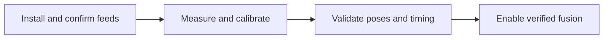
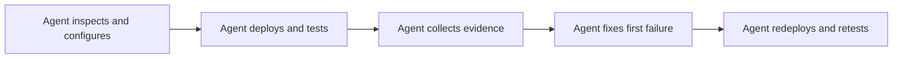
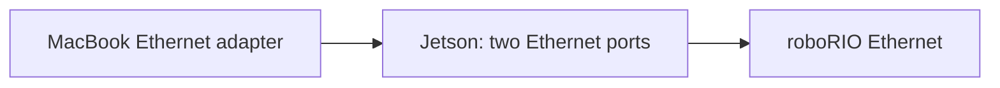

## Session closeout — 18–19 October 2026

**Ready for on-robot camera setup and tag detection. Pose fusion is not commissioned.** The software, camera assignments, network controls and automatic robot-profile updates were tested on the Jetson and roboRIO. All three cameras currently need valid camera intrinsics; the existing camera mounts are examples, not measurements. Keep `FUSION_ENABLED = false` until the remaining checks below pass.

### Installed configuration

| Item                         | Verified setting                                                                                                     |
| ---------------------------- | -------------------------------------------------------------------------------------------------------------------- |
| Dashboard                    | [spot.local:5800](http://spot.local:5800/) or maintenance address [192.168.69.170:5800](http://192.168.69.170:5800/) |
| Jetson robot Ethernet        | `enP7p1s0`, `10.5.81.11/24`                                                                                          |
| Jetson maintenance Ethernet  | `enP8p1s0`, `192.168.69.170/24`; development Mac `192.168.69.171/24`                                                 |
| roboRIO NT4 server           | `10.5.81.2`                                                                                                          |
| Camera bindings              | `front = USB-01`, `back = USB-02`, `side = USB-04`                                                                   |
| Capture / processing         | All three: 640 × 480 MJPEG at 120 capture FPS; 30 FPS processing cap                                                 |
| Exposure / gain / brightness | Front: 5,000 µs / 64 / 0; back: 5,000 µs / 64 / 0; side: 6,000 µs / 61 / −21                                         |
| Java configuration           | `apps/robot-tester/src/main/java/frc/robot/vision/VisionConfig.java`; robot ID `apps/robot-tester`                   |
| Profile hash                 | `53bd2c866f8ebce83e3cf90038570da7b254d284a1dc50fb84f4b07e45688e97`                                                   |
| Saved installation settings  | `/etc/spot-vision/installation.json`; assignments and calibration live outside immutable application releases        |

Interface names and USB identities describe this Jetson. Preserve the camera sockets; after moving a camera to a different socket, verify the preview and assignment again. The basic tester is a vision-only harness, not the robot's drivetrain program. Use [Java integration](../java) when moving the integration into the actual robot project.

### What passed

- All three SWYFT cameras captured concurrently. The initial overall workflow failed at networking/preview status, then passed repaired retests; those failures remain in the evidence.
- Unattended startup was checked in both device startup orders. Physical Jetson and roboRIO power cycles, a robot Ethernet interruption, and separate unplug/replug tests for each USB camera recovered. The later persistence test used a software Jetson reboot and is recorded separately.
- Ten real roboRIO deployments automatically delivered the complete Java profile to Spot. Each profile was compared field-for-field, including changed values and unchanged profiles with new robot sessions. Robot deployments needed no Spot Apply action or Spot restart.
- Role names appeared in the dashboard and all three physical feeds were paired through their previews. All bindings retained generation 1 through deployments and the Jetson reboot.
- Code changes to capture size, image rotation, required/optional status and control policies propagated. Pinned controls remained locked; tunable defaults allowed saved GUI overrides.
- **Omitted controls retain GUI settings.** Side exposure was omitted from Java, set to 7,000 µs in the GUI, redeployed, and retained through a Jetson reboot. Driver readback agreed at each stage. It was restored to 6,000 µs afterward. Resetting code defaults leaves omitted controls unchanged.
- GUI Static address save, immediate Revert, unconfirmed 90-second rollback and DHCP failure recovery passed. Successful DHCP acquisition was not tested because the direct roboRIO cable has no DHCP server. Discovery now advertises the Jetson Ethernet ports, preventing an unrelated Jetson Wi-Fi path from diverting `spot.local` lookup; three final hostname HTTP probes passed.
- Validation passed: 63 configuration/network/runtime/web/docs tests plus 14 subtests; 13 UI/viewer tests; the full Java suite; 44 Jetson native alpha pose/image tests; and all five CUDA image-to-pose regression cases, with five repetitions each.

### Latency result and limits

The 20/30/45 FPS processing-cap comparison delivered about 19/28/36 detections per second per camera. Robot decision-age p95 stayed around 41–44 ms. The 45 FPS cap repeatedly triggered load reduction, so the final choice is **120 capture FPS with a 30 FPS processing cap**. Higher capture and processing rates are separate settings.

With all three previews active, 3,145 preview requests succeeded, detection throughput stayed about 27 FPS per camera, read-completion-to-detection p95 was 20–21 ms, and read-completion-to-robot-decision p95 was 44–46 ms (p99 below 54 ms). The maximum in that load window was 91 ms. A separate quiet retest contained an isolated 200 ms age.

**Timing is not fully qualified.** Clock renewal still causes periodic delivery gaps of about 0.5–0.7 seconds. Repeating the fresh robot profile every 100 ms reduced the earlier 1.1–1.3 second gaps, while preserving synchronization and freshness checks. A good p95 does not remove these outages. Measurements start at camera read completion, exclude sensor exposure/driver delay, and currently omit live calibrated pose-solving work. Do not treat them as a hard latency bound or competition readiness.

### Why tags appear without poses

All three live feeds detected tag 4 and returned `NO_CALIBRATION` with no pose candidates. The GUI correctly leaves range and pose empty and now explains that calibration is required. The alpha and CUDA regressions validate the solver against saved images and synthetic geometry; they do not establish accuracy for the present mounts or room. Historical alpha calibration files were not promoted without a valid association to the current physical camera.

### Before using pose fusion on the robot

1. Mount the cameras securely and keep or deliberately rebind their USB assignments. Connect the Jetson robot port to the robot network; confirm `10.5.81.11` is unused by another device. Use **Network → Jetson address** if the installation needs a different address.
2. Replace every example mount in `VisionConfig.java` with measured x/y/z and roll/pitch/yaw. Verify the actual field layout and tag size, then deploy the actual robot project and confirm the current profile in Spot.
3. Complete [intrinsic calibration](../calibrate) for each physical camera and the final capture mode. Qualify exposure timestamps and validate poses against independently measured positions and orientations.
4. Resolve or explicitly qualify renewal outages, repeat latency checks with calibrated pose solving and the real robot workload, then verify estimator consumption before enabling fusion.



Raw evidence is local under `bench-runs/`: the original startup/recovery attempts, `2026-10-18-13-role-latency`, `2026-10-19-14-network-settings`, and `2026-10-19-15-persistence-latency-poses`. The last folder contains `results.md`, `code-settings-audit.md`, exact profile comparisons, persistence assertions, raw WPILOGs, exported frame records, status/thermal windows, native/CUDA test results and GUI screenshots. These large recordings are intentionally Git-ignored; this repository closeout preserves the conclusions. Scoped application backups are under `/home/team581/buddy-2026/.deployment-backups/`; network-helper/Avahi backups are under `/opt/spot-vision/network-backup.*`.

## Execution plan

This is an execution plan for the coding agent. When instructed to run it, own the entire session: inspect the checkout and hardware, configure the bench, build and deploy, use the Spot UI, collect evidence, diagnose failures, implement fixes, redeploy, and repeat the failed steps. Do not hand the user a command list or ask them to gather logs that you can retrieve yourself.

The goal is a bare roboRIO and Jetson that students can bring up easily. Finish with repeatable setup, useful error messages, persistent configuration, automatic Spot startup/configuration on Jetson boot, and recovery after ordinary interruptions. Camera speed tuning comes later. Writing this plan does not itself start deployment or hardware tests.

Start with **three SWYFT USB cameras connected to the Jetson simultaneously**, the basic robot tester, and fusion disabled. The first camera milestone is plug-and-play discovery and fresh frames from all three; it does not require tags in view. After that passes, use a fixed AprilTag for robot integration checks. No drivetrain, robot radio, or Ethernet switch is needed. Use the first 45–60 minutes as an initial bring-up timebox, then assess progress from recorded evidence. Work on the first concrete blocker rather than expanding the test matrix.



## Agent ownership and durable progress

Read repository instructions and inspect the current diff before editing. Preserve unrelated changes and measured camera settings. Discover the actual installed service, release, configuration paths, network interfaces, HTTP port, robot program and available management paths; do not treat example addresses or repository defaults as live facts. Use the deployment workflow/skill required by this repository when deploying Spot, including backup and verification of the code actually loaded by the service.

Maintain `bench-runs/<attempt>/operator-notes.md` yourself; the historical filename does not assign work to a human. Record completed steps, commands/results, applied hashes, timings, setup friction, the first failure, one hypothesis, each change, and the exact next action. Keep a short session checkpoint with the active run, phase, remote collector PID/output path, last confirmed hardware state, and next action. Resume from that checkpoint after interruption instead of repeating discovery or rereading large logs.

Continue through routine reversible setup, build, deployment, GUI interactions, collection and retests within the authorized session. Do not ask the user to approve each already authorized step. Resolve tool-required approval at the actual action if it arises. Pause dependent work only for missing access, a necessary unanswered physical fact, or a physical action you cannot perform. Continue independent diagnosis and fixes while waiting.

Human assistance is limited to unavailable physical capabilities: connect a specified cable, position/measure the rig or tag, move a calibration target, remove/reinsert a USB camera, or power-cycle hardware. Request one precise action with an observable completion condition. The agent then verifies the resulting state and performs the test and collection. Use software restarts remotely yourself; record that they do not establish recovery from a physical power loss. Never claim to have measured geometry or performed a cable/power test without evidence.

## Phase 1: discover and establish connectivity

Use the Jetson's two Ethernet ports as two separate links. Either physical port may connect to either device. **Port A and port B below are logical roles assigned after discovery, not jack positions or interface numbers. Do not swap cables merely to match these labels.** The agreed topology is:



| Connection                               | Purpose                                                                     |
| ---------------------------------------- | --------------------------------------------------------------------------- |
| MacBook Ethernet adapter ↔ Jetson port A | Agent management: SSH, deployment to Jetson, Spot browser and log retrieval |
| Jetson port B ↔ roboRIO Ethernet         | Robot NT4 transport and access to roboRIO through the Jetson                |
| Three SWYFT cameras → Jetson USB         | Three simultaneous, independently identified camera streams                 |

Use normal Ethernet cables and each device's own power supply. No Ethernet switch, radio, USB-B cable or Wi-Fi is required. Keep both Ethernet cables connected during normal testing. Request a physical change only if the observed cabling differs from this setup. Keep the roboRIO disabled throughout the session.

### Identify and configure both links

Inspect the Mac's Ethernet adapter and both Jetson interfaces. Map each interface name/MAC address to its actual cable using link/address evidence; do not assume names such as `eth0`/`eth1`, left/right or top/bottom ordering, or that both ports form a switch. Assign the Mac-facing interface the management role (A) and the roboRIO-facing interface the robot role (B), even when the physical order is reversed. If existing evidence is insufficient, request one controlled cable identification action, then record the verified mapping before applying addresses/routes. The Jetson must have a distinct, non-overlapping subnet on each link. A direct cable supplies no DHCP server.

Example addresses for team 581, preserving the documented Jetson maintenance address:

| Device/interface              | Address             | Purpose                               |
| ----------------------------- | ------------------- | ------------------------------------- |
| MacBook Ethernet adapter      | `192.168.69.171/24` | Agent computer on the management link |
| Jetson port A, facing MacBook | `192.168.69.170/24` | SSH/Spot management endpoint          |
| Jetson port B, facing roboRIO | `10.5.81.10/24`     | Spot on the robot link                |
| roboRIO Ethernet              | `10.5.81.2/24`      | NT4 server                            |

Inspect existing addresses/routes first and adapt the example if it conflicts with the actual team or another connected network. Preserve working maintenance access and record the original settings plus rollback commands before making changes. Do not put both Jetson ports on the same subnet. Neither direct link needs to replace the Mac's normal internet default route.

Reach the Jetson from the Mac at `team581@192.168.69.170` using `~/.ssh/spot_jetson_ed25519`, as specified by the repository instructions. Establish this management connection first, then configure the robot-facing interface over that connection. If the Jetson's management interface needs initial setup and cannot be reached at its existing address, resolve that bootstrap access explicitly rather than assuming SSH already works.

Set the **installed** Spot installation config's `nt.mode` to `client`, `nt.server` to the roboRIO's robot-link address (`10.5.81.2` in this example), and remove `nt.team` when selecting explicit-server configuration. The roboRIO program runs the NT4 server. Robot camera settings still come from Java. Check the actual installed `http.port`; the repository example uses `5800`. Open Spot from the Mac using the Jetson management address and that port, for example `http://192.168.69.170:5800/`.

### Establish agent access to the roboRIO through the Jetson

The two Ethernet ports do not automatically relay traffic. Configure and verify a concrete path before attempting robot deployment or log collection. Prefer a routed path so normal WPILib deployment can run on the Mac:

1. Verify that the Jetson can reach the roboRIO directly on the robot link.
2. Add a specific Mac route for the robot subnet (`10.5.81.0/24`) through the Jetson's management address (`192.168.69.170`).
3. Configure Jetson IPv4 forwarding and scoped firewall rules for traffic between these two links; preserve other interface/firewall behavior.
4. Configure/verify the return path from the roboRIO to the Mac management subnet via the Jetson robot-link address (`10.5.81.10`). A Mac route alone is insufficient. Prefer a specific return route that preserves the roboRIO's existing gateway; record any required alternative.
5. From the Mac, verify actual roboRIO SSH/deployment connectivity using its explicit Ethernet address, then perform the tester deployment. Do not rely on mDNS/broadcast discovery crossing a routed link. Verify the deployed robot program and NT4 listener afterward.

Inspect the host networking tools and installed WPILib deployment configuration before selecting exact commands. Record each applied route/forwarding/firewall change and its rollback. Make the intended bench setup survive the planned restarts, or explicitly automate its reapplication and record that setup friction. Do not claim restart recovery if access only worked because of an undocumented temporary route.

If routing/return-path configuration is unavailable, use an SSH relay through the Jetson instead. The agent must inspect which deployment connections are required and verify the actual deployment path; one forwarded SSH port does not establish that every WPILib tool works. For log retrieval, the agent can copy the roboRIO log into a staging directory on the Jetson and then fetch it over the management link. Keep credentials on their intended hosts; do not copy the Mac's private key to the Jetson. Prefer fixing the network path over asking the user to move cables or run deployment commands.

Follow [WPILib IP configuration](https://docs.wpilib.org/en/stable/docs/networking/networking-introduction/ip-configurations.html) and [roboRIO setup](https://docs.wpilib.org/en/stable/docs/software/roborio-info/roborio-web-dashboard.html) if the controller is not imaged/configured for 2026. Request a physical/bootstrap action only when the agent cannot establish the prerequisite with its available tools.

Checkpoint: record the two physical interface mappings, verified addresses, Mac route, roboRIO return path, forwarding/firewall state, SSH/HTTP/deployment reachability, actual service/config paths and rollback commands. Keep the Mac–Jetson management link up while testing interruptions of the Jetson–roboRIO link.

## Phase 2: execute the integration checks

### First establish the three-camera plug-and-play baseline

Before changing camera bindings, capture requests, controls, calibration or service state, inspect the existing running system with all three SWYFT cameras attached. Determine whether they are **already receiving frames**. Save the initial status snapshots and GUI evidence before attempting any repair. If a prerequisite prevents inspection, record that blocker and the actions needed to inspect; do not label the eventual repaired state as an initial plug-and-play pass.

Enumerate three distinct physical cameras using USB identity/topology and capture-capable device information. Multiple `/dev/video*` nodes for one camera do not count as multiple cameras. Identical model names, missing/duplicate serials, or three UI tiles are insufficient proof by themselves. Map each physical device to its Spot feed and any existing Java logical role, and record how that mapping was established.

Use the existing service and its GUI/status to verify all three streams concurrently. Do not launch competing capture owners or stop two cameras to get the third to work. For a bounded 60-second window, record each camera's identity, frame-count delta (`metrics.captured` where exposed), capture FPS (`metrics.fps_capture`), last-capture freshness, negotiated settings, faults and service restarts. Read the actual installed status schema if fields differ. Check the GUI previews show fresh decoded images for all three; counters or a cached thumbnail alone do not prove a live preview. Request a single physical view change only if needed to establish freshness or identity.

The initial plug-and-play check passes only when all three distinct cameras are discovered and receive advancing frames simultaneously without camera-specific manual edits, binding changes, service restarts or reconnect workarounds during this check. Record discovery-to-first-frame time when observable, or mark it unmeasured if the cameras were connected before recording. Calibration, timing qualification and tag acceptance are separate results; their absence must not be confused with a USB capture failure.

If any stream is absent, frozen, duplicated or faulted, save its evidence, diagnose the first cause, fix it, and repeat the same three-camera check. Keep separate results for **initial behavior**, **behavior after the fix**, and **reconnect/restart recovery**. Record any required one-time role binding honestly as setup friction; do not count a manually repaired first launch as zero-configuration success. Verify a three-camera return to fresh frames after the recovery steps below.

### Then verify the robot integration

Execute the following checks in order, collecting evidence automatically. Record expected/actual behavior, elapsed time, confusing wording, commands, edits and restart counts in the run notes. These are the primary integration results; a latency screen does not replace them. At the first failure, enter the repair loop below and return to that same step after the fix.

| Step                      | Agent action                                                                                                                                                                     | Evidence of success                                                                                                                                                                            |
| ------------------------- | -------------------------------------------------------------------------------------------------------------------------------------------------------------------------------- | ---------------------------------------------------------------------------------------------------------------------------------------------------------------------------------------------- |
| 1. Deploy                 | Build/deploy `apps/robot-tester`; leave disabled                                                                                                                                 | Starts with no drivetrain/CAN devices; configuration loaded; unique bench log exists                                                                                                           |
| 2. Connect                | Start/verify Spot and the Jetson–roboRIO Ethernet link                                                                                                                           | Robot ID/profile appears; config generation acknowledged; clock synchronizes; no manual transport-topic setup                                                                                  |
| 3. Bind all three         | Preserve/verify existing physical-to-role bindings; use the UI only where a binding is missing                                                                                   | Three distinct SWYFT feeds map to three intended roles; record every manual step; capture settings/controls read back correctly                                                                |
| 4. Configure geometry     | Obtain actual mount/tag measurements; define the home layout in Java                                                                                                             | Profile shows the intended mount, tag ID/size/pose; changes survive rebuild/redeploy                                                                                                           |
| 5. Complete prerequisites | Run the normal intrinsic calibration/timing workflow; request only necessary target motions                                                                                      | GUI says what is missing and how to resolve it; valid evidence is associated with the actual capture/control settings                                                                          |
| 6. Observe all three      | Record all three capture streams concurrently and verify per-camera robot delivery/diagnostics for 60 seconds                                                                    | Three live streams remain fresh; each role has delivered decisions or an explicit upstream prerequisite/fault explaining withholding; no unexplained silence                                   |
| 7. Persist                | Restart Spot and then the roboRIO separately; verify saved settings are reapplied                                                                                                | All three bindings/capture settings and applicable calibration persist; the current robot profile is automatically received/applied; no manual configuration or topic edits                    |
| 8. Interrupt              | Start recording, request a 5-second interruption/reconnection of only the Jetson–roboRIO Ethernet cable, verify recovery; repeat USB unplug/replug for each SWYFT camera in turn | Other camera streams continue during each USB interruption; all three recover fresh frames with stable bindings; robot link/observations recover without stale backlog                         |
| 9. Automatic boot         | Reboot the Jetson remotely, then request a physical power cycle for a separate cold-boot check; observe without manually starting/configuring Spot                               | Boot service starts unattended; persistent networking and camera state load automatically; three streams recover and the robot profile is applied without login, GUI clicks or repair commands |

### Verify unattended boot and automatic configuration

Treat **automatic start** and **automatic configuration** as two explicit acceptance checks. First inspect the installed boot mechanism before changing it. For a systemd installation, identify the actual unit and inspect its definition/drop-ins, enabled state, execution user, executable/release target, configuration/state paths, restart policy and current-boot journal. An already running process or `active` state alone does not prove boot startup. Record whether it was enabled/configured correctly before any repair. If missing or incorrect, fix persistent service installation/configuration using the repository deployment workflow, then retest a real Jetson boot.

Automatic configuration means the Jetson restores its saved installation settings, two Ethernet interface roles/addresses and required forwarding/firewall rules, selected Spot release, USB-to-role bindings, capture requests/controls, and still-valid calibration/timing records. When the roboRIO is available, Spot automatically connects to its configured NT4 server and receives/applies the current Java profile. Verify actual applied profile/generation and camera readback, not just files on disk. Initial physical measurements, first-time binding or calibration are not automatically generated: once legitimately configured, they must survive boot and be reused where applicable. Invalidated evidence must produce an actionable prerequisite rather than a fabricated qualification.

Execute these two startup orders with all three SWYFT cameras connected:

1. **roboRIO first:** leave the disabled roboRIO running, save the Jetson boot ID and baseline evidence, and reboot the Jetson. Use a bounded scripted wait for management reachability, then observe service health and all three streams. Collect the new boot ID, current-boot service journal, process/start identity, loaded release/configuration, applied robot profile and fresh-frame evidence. Do not issue a service start/restart, launch Spot from SSH, log into a Jetson desktop, click Apply, rebind a camera, or reapply Jetson network configuration to make this boot pass. Read-only SSH/browser observation by the agent is allowed.
2. **Jetson first:** boot the Jetson while the roboRIO is unavailable, verify the service starts and reports its waiting/offline state clearly, then make the roboRIO available. Verify automatic connection, synchronization and current-profile application, followed by fresh frames from all three and robot-delivery diagnostics. No Spot restart, settings reapplication, camera reconnect or agent repair command may be required. Cached state must not impersonate a fresh robot session or bypass output guards.

Use a fixed observation timeout (initially 180 seconds after boot/reachability and after the roboRIO becomes available); record actual timing and the reference point. A timeout is a failing startup artifact to diagnose, not permission to poll indefinitely. Verify three-camera freshness for the same bounded 60-second window used in the plug-and-play check. If restoring Mac-side routes is necessary after a reboot, perform that access action yourself and record it separately; it must not mask manual reconfiguration of the Jetson or its Spot service.

After reboot behavior passes, request one physical Jetson power cycle to verify cold startup. Preserve the known-good storage/configuration and collect independent boot evidence again. Mark cold boot unverified if the physical action has not occurred. Keep **initial boot behavior**, **boot behavior after a fix**, **warm reboot**, **cold boot**, and the two startup orders distinct in the results. Any manual service/configuration action converts that attempt into a diagnosed failure plus a repair; it cannot count as an unattended boot pass.

Do not wait for every pose gate before diagnosing setup: profile exchange, USB binding, controls, health, and fault messages are useful milestones on their own. Spot can withhold observations when calibration/timing prerequisites fail. Correlate Jetson status with roboRIO decisions; an empty roboRIO frame log alone cannot identify the cause. Fix the missing prerequisite or the diagnostic message, keeping the production guards intact.

The current tester configuration contains `front` and `back`, pointing in opposite directions. Inspect the actual configuration at execution time. Three-camera capture discovery must be tested before editing that profile. For subsequent robot integration, reconcile three physical feeds with three Java roles: retain valid existing roles/mounts and add the missing bench role using actual measurements. Record the profile change; do not invent a third mount or overwrite measured settings. Keep all three cameras capturing during the integration trial. Provide targets in each view if testing tag acceptance from every role; a healthy no-tag view is not a link failure. If geometry is unavailable, complete the raw capture check and explicitly mark pose/robot-delivery prerequisites as pending.

For a printed tag at home, define a surveyed `AprilTagFieldLayout`; an official tag ID on a wall does not have its official field position. Obtain measurements of the black tag square, mount, and target pose; request missing physical measurements once and record their source. See [camera settings](../camera-configuration). Single-tag pose ambiguity may correctly cause rejection; a second visible tag can help.

Leave `FUSION_ENABLED` false for initial integration. To test actual estimator ingestion afterward, keep the whole rig and tag fixed, set the measured `BenchConfig.STATIONARY_POSE`, and enable fusion only in the tester. Confirm `BENCH_FUSED` and increasing consumption counts. This estimator has zero wheel movement and zero gyro rotation. Rotating a camera/rig/tag is an optional detection and recovery exercise with fusion disabled; it cannot validate moving-robot localization or heading accuracy.

Use the GUI and intended student workflow for binding/configuration checks. Use supported APIs/CLIs for automation and diagnostics where appropriate, but do not silently bypass a broken setup screen and declare its workflow successful. Fix the UI failure or record that check as unresolved.

## Phase 3: collect and summarize evidence yourself

The following commands are for the agent to execute and adapt to discovered paths and addresses. The tools use Python 3.10+ and the standard library. Run local commands from the Spot repository root. Use a new directory for each attempt; retain the failing run as the baseline.

```sh
python3 apps/vision/tools/bench_session.py new-run bench-runs/01-connect \
  --cameras swyft-1 swyft-2 swyft-3 \
  --hypothesis "Three connected SWYFT cameras are discovered and already receiving fresh frames concurrently"
```

The names `swyft-1`, `swyft-2`, `swyft-3` are example evidence labels, not preconfigured Java roles. Substitute the actual three logical names when known; record the physical identity mapping in the manifest/notes. For the initial capture-only run, use physical evidence labels without inventing bindings. Create a separate run with the actual profile role names for roboRIO frame analysis.

This creates an operator-notes template and snapshots the local Java configuration and example installation JSON with hashes. Add the actual installed release/config hash, applied profile hash, selected capture settings/readback, topology, tag geometry, and checklist observations to the notes. The copied repository installation JSON is not proof of the Jetson's live config. Keep private credentials out of collected artifacts.

Copy/update the collector through the applicable deployment workflow, then execute it **on the Jetson** alongside the existing service:

```sh
python3 apps/vision/tools/bench_capture.py --output /home/team581/bench-runs/01-connect \
  --duration-s 90 --port 5800
```

It samples local `/api/status` once per second, flushes each record, and exits. Optional `--tegrastats` adds local thermal/load evidence. It does not open another camera owner, change settings, or restart the service. Launch it as a detached bounded process, redirect stdout/stderr to the run folder, and save its PID in the checkpoint. Verify process startup before requesting a robot-link interruption. Keep the separate Mac–Jetson management link connected, so status collection and agent access continue while the robot link is unplugged. Use a bounded wait for completion; `capture.json` marks normal completion. Request errors are recorded too.

The tester writes `bench-<robot-session>.wpilog` independently of Driver Station traffic, with raw delivered observations, decisions and typed bench telemetry. `Bench/LogDirectory` reports the selected directory: usually `/home/lvuser/logs`, or roboRIO USB storage when available. Standard DataLogManager files are additional evidence; use the `bench-` file for this workflow. Confirm the log continues beyond 15 seconds with Driver Station disconnected, then confirm the previous log remains after a restart. Allow writes to flush before retrieval; a copy of an actively written file may have an incomplete tail. Watch disk capacity during long sessions.

Retrieve Jetson status over the management link and the matching roboRIO log over the verified routed/relay path. Both cables stay in place. The helper uses existing SSH credentials, copies only the explicit remote path, and changes no service state:

```sh
python3 apps/vision/tools/bench_session.py collect bench-runs/01-connect \
  --host 192.168.69.170 --user team581 \
  --identity ~/.ssh/spot_jetson_ed25519 \
  --remote /home/team581/bench-runs/01-connect
```

With routed Mac access verified, retrieve the roboRIO log using the WPILib log retrieval tool or the same helper with `--host 10.5.81.2 --user lvuser --remote /home/lvuser/logs/bench-EXACT-SESSION.wpilog` if SSH is already configured. Replace that filename with the actual recorded session. The helper is deliberately noninteractive and will fail promptly if SSH authentication is unavailable; establish it normally first. Files land under `raw/<host>/`. If using the relay fallback, perform the two-stage Jetson staging/fetch described above yourself and record both source and destination paths.

Summarize Jetson setup diagnostics before opening a large recording:

```sh
python3 apps/vision/tools/bench_session.py doctor \
  bench-runs/01-connect/raw/192.168.69.170/01-connect/status.jsonl \
  > bench-runs/01-connect/doctor.json
```

Export the roboRIO WPILOG using the supplied WPILib reader, then create a small agent brief. Replace the sample filename with the file retrieved above. Use absolute paths for Gradle properties because Gradle runs in the tester directory.

```sh
cd apps/robot-tester
./gradlew exportBenchLog \
  -PbenchLog=/absolute/path/to/bench-SESSION.wpilog \
  -PbenchOutput=/absolute/path/to/bench-runs/01-connect/frames.jsonl
cd ..
python3 apps/vision/tools/bench_session.py report bench-runs/01-connect \
  --frames bench-runs/01-connect/frames.jsonl --warmup-s 15 --duration-s 60
```

Evaluate initial three-camera capture from the recorded Jetson status sequence and live-preview evidence, not the roboRIO frame report. Compute per-device counter deltas/freshness across the full window with a small deterministic script using the discovered schema, and save a compact three-row result table to the run notes: physical identity/role, initial frames already advancing, concurrent capture delta/FPS, preview freshness, faults, manual interventions and pass/fail. A latest-only `doctor` snapshot does not establish a sustained concurrent pass. Use the WPILOG report for the subsequent robot-delivery test; withheld unqualified observations can make that report fail even when all USB streams are healthy.

The report writes `summary.json` and `agent-brief.txt`. Use `--scenario recovery` on `new-run` for interruption tests and annotate interruption times in operator notes. Recovery intervals deliberately include missing data; judge reconnection behavior against those notes. Do not compare them to a steady static run as if they measured the same condition.

A no-frame report is a useful failing integration artifact. `screening_passed` only checks basic delivered-rate/age/gap/counter sanity; it does not mean tag acceptance, successful setup, or recovery. Add `--require-acceptance` when creating a run to require accepted poses, or `--require-consumption` for the stationary fusion step. The default 1 decision/s floor detects gross silence; it is not the target camera FPS. Successful camera bring-up also requires checking the advertised/readback cadence and upstream processing counters.

## Phase 4: diagnose, repair, redeploy and retest

Read your run notes, manifest, `doctor.json` and `agent-brief.txt` first. Identify the first blocked checklist step and one falsifiable cause. Inspect only the relevant status/log excerpt and source files. Preserve the failing evidence; make one coherent fix, add a focused regression check when useful, and run the relevant local checks. Update the actual deployed code/configuration using the required workflow and verify the running release/profile identity.

Create a new attempt folder, execute the same failed step yourself, and collect its evidence. If it succeeds, resume the remaining checklist and repeat from a fresh session. If it fails, record whether the hypothesis was disproved and choose the next cause from the evidence. Keep the user out of routine command execution, deployments, GUI navigation, log collection and analysis.

For a setup problem that repeatedly needs a manual edit, fix the default, UI or help path and retest it. A new workaround in the notes alone does not establish low-friction setup. Keep a change only when it fixes the original failure, survives restart and introduces no unexplained regression. Preserve all production validation gates; never fabricate calibration or timing qualification to make a test pass.

For code changes affecting rate/age, execute `python3 apps/vision/tools/bench_session.py compare BASELINE/summary.json CANDIDATE/summary.json` using matching static runs. Investigate flagged regressions and repeat ambiguous results. Do not turn this session into a camera performance search.

Use scripts for recording, parsing and bounded waiting. Do not spend agent turns polling unchanged state or rereading full recordings. If three repair attempts fail on the same cause, stop that repair loop, save the diagnosis and propose one concrete next experiment. If a physical action or access is required, checkpoint once and request it; resume execution when it is available.

## Phase 5: finish with verified results

Finish when the checklist succeeds, or report the exact remaining blocker with evidence and the one required next action. Deliver a concise account of the initial plug-and-play result for each of the three SWYFT cameras, simultaneous frame reception, manual interventions, unattended Spot startup and automatic-configuration results for each boot/startup order, recovery/retest results, robot integration checks actually completed, issues fixed, deployed identities, artifact locations, remaining gaps and corrected student setup instructions. Mark skipped physical interruption/power tests and unverified geometry explicitly. Software restarts and synthetic tests do not replace those results. Do not ask the user to analyze the run or decide which failure you should investigate next when the evidence supports a next step.

## Latency check and paper context

[FALCON](https://arxiv.org/abs/2610.22143) motivates recording tail latency and load alongside throughput. Its 100 ms experiments use a fixed-work proxy; the full perception example takes roughly 1.3 seconds. Those results do not transfer to this AprilTag pipeline or establish a hard bound here. Borrow the measurement discipline, then prioritize setup and recovery defects.

Keep the initial verified capture request rather than maximizing FPS immediately. Acquisition FPS and Spot's processing cap differ; the repository installation example caps normal processing at 30 FPS. More captured frames can increase USB/decode load without improving delivered results. After integration works, change one supported capture setting at a time, recheck matching calibration/timing prerequisites, and compare freshness and tag quality.

Reports separate delivered decisions (including rejections) from actual estimator consumptions. They include observed age percentiles/maxima and gaps, and flag apparent-future ages. Current read-completion timestamps follow capture/decode and need measured bias/jitter evidence before being called exposure-to-consumption latency. Upstream withheld frames need Jetson counters. Short bench runs establish integration evidence, not competition-network behavior or moving-robot performance.
