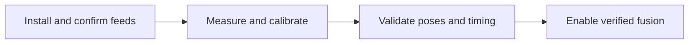
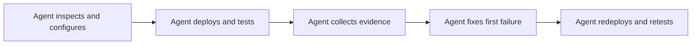
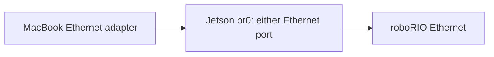

## Historical session closeout — 18–19 October 2026

These results describe the retired standalone tester and the configuration installed during that session. They do not establish the current offseason robot configuration or qualify its drivetrain integration.

**Ready for on-robot camera setup and tag detection. Pose fusion is not commissioned.** The software, camera assignments, network controls and automatic robot-profile updates were tested on the Jetson and roboRIO. All three cameras currently need valid camera intrinsics; the existing camera mounts are examples, not measurements. Keep `FUSION_ENABLED = false` until the remaining checks below pass.

### Installed configuration

| Item                         | Verified setting                                                                                                     |
| ---------------------------- | -------------------------------------------------------------------------------------------------------------------- |
| Dashboard                    | [spot.local:5800](http://spot.local:5800/) or maintenance address [192.168.69.170:5800](http://192.168.69.170:5800/) |
| Jetson robot Ethernet        | `enP7p1s0`, `10.5.81.11/24`                                                                                          |
| Jetson maintenance Ethernet  | `enP8p1s0`, `192.168.69.170/24`; development Mac `192.168.69.171/24`                                                 |
| roboRIO NT4 server           | `10.5.81.2`                                                                                                          |
| Camera bindings              | `front = USB-01`, `back = USB-02`, `side = USB-04`                                                                   |
| Capture / processing         | All three: 640 × 480 MJPEG at 120 capture FPS; 30 FPS processing cap                                                 |
| Exposure / gain / brightness | Front: 5,000 µs / 64 / 0; back: 5,000 µs / 64 / 0; side: 6,000 µs / 61 / −21                                         |
| Java configuration           | Retired standalone tester; historical robot ID `apps/robot-tester`                                                   |
| Profile hash                 | `53bd2c866f8ebce83e3cf90038570da7b254d284a1dc50fb84f4b07e45688e97`                                                   |
| Saved installation settings  | `/etc/spot-vision/installation.json`; assignments and calibration live outside immutable application releases        |

Interface names and USB identities describe this Jetson. Preserve the camera sockets; after moving a camera to a different socket, verify the preview and assignment again. The session used a vision-only harness. Current integration uses the existing offseason robot; see [Java integration](../java).

### What passed

- All three SWYFT cameras captured concurrently. The initial overall workflow failed at networking/preview status, then passed repaired retests; those failures remain in the evidence.
- Unattended startup was checked in both device startup orders. Physical Jetson and roboRIO power cycles, a robot Ethernet interruption, and separate unplug/replug tests for each USB camera recovered. The later persistence test used a software Jetson reboot and is recorded separately.
- Ten real roboRIO deployments automatically delivered the complete Java profile to Spot. Each profile was compared field-for-field, including changed values and unchanged profiles with new robot sessions. Robot deployments needed no Spot Apply action or Spot restart.
- Role names appeared in the dashboard and all three physical feeds were paired through their previews. All bindings retained generation 1 through deployments and the Jetson reboot.
- Code changes to capture size, image rotation, required/optional status and control policies propagated. Pinned controls remained locked; tunable defaults allowed saved GUI overrides.
- **Omitted controls retain GUI settings.** Side exposure was omitted from Java, set to 7,000 µs in the GUI, redeployed, and retained through a Jetson reboot. Driver readback agreed at each stage. It was restored to 6,000 µs afterward. Resetting code defaults leaves omitted controls unchanged.
- GUI Static address save, immediate Revert, unconfirmed 90-second rollback and DHCP failure recovery passed. Successful DHCP acquisition was not tested because the direct roboRIO cable has no DHCP server. Discovery now advertises the Jetson Ethernet ports, preventing an unrelated Jetson Wi-Fi path from diverting `spot.local` lookup; three final hostname HTTP probes passed.
- Validation passed: 63 configuration/network/runtime/web/docs tests plus 14 subtests; 13 UI/viewer tests; the full Java suite; 44 Jetson native alpha pose/image tests; and all five CUDA image-to-pose regression cases, with five repetitions each.

### Latency result and limits

The 20/30/45 FPS processing-cap comparison delivered about 19/28/36 detections per second per camera. Robot decision-age p95 stayed around 41–44 ms. The 45 FPS cap repeatedly triggered load reduction, so the final choice is **120 capture FPS with a 30 FPS processing cap**. Higher capture and processing rates are separate settings.

With all three previews active, 3,145 preview requests succeeded, detection throughput stayed about 27 FPS per camera, read-completion-to-detection p95 was 20–21 ms, and read-completion-to-robot-decision p95 was 44–46 ms (p99 below 54 ms). The maximum in that load window was 91 ms. A separate quiet retest contained an isolated 200 ms age.

**Timing is not fully qualified.** Clock renewal still causes periodic delivery gaps of about 0.5–0.7 seconds. Repeating the fresh robot profile every 100 ms reduced the earlier 1.1–1.3 second gaps, while preserving synchronization and freshness checks. A good p95 does not remove these outages. Measurements start at camera read completion, exclude sensor exposure/driver delay, and currently omit live calibrated pose-solving work. Do not treat them as a hard latency bound or competition readiness.

### Why tags appear without poses

All three live feeds detected tag 4 and returned `NO_CALIBRATION` with no pose candidates. The GUI correctly leaves range and pose empty and now explains that calibration is required. The alpha and CUDA regressions validate the solver against saved images and synthetic geometry; they do not establish accuracy for the present mounts or room. Historical alpha calibration files were not promoted without a valid association to the current physical camera.

### Before using pose fusion on the robot

1. Mount the cameras securely and keep or deliberately rebind their USB assignments. Connect the Jetson robot port to the robot network; confirm `10.5.81.11` is unused by another device. Use **Network → Jetson address** if the installation needs a different address.
2. Replace every example mount in `VisionConfig.java` with measured x/y/z and roll/pitch/yaw. Verify the actual field layout and tag size, then deploy the actual robot project and confirm the current profile in Spot.
3. Complete [intrinsic calibration](../calibrate) for each physical camera and the final capture mode. Qualify exposure timestamps and validate poses against independently measured positions and orientations.
4. Resolve or explicitly qualify renewal outages, repeat latency checks with calibrated pose solving and the real robot workload, then verify estimator consumption before enabling fusion.



Raw evidence is local under `bench-runs/`: the original startup/recovery attempts, `2026-10-18-13-role-latency`, `2026-10-19-14-network-settings`, and `2026-10-19-15-persistence-latency-poses`. The last folder contains `results.md`, `code-settings-audit.md`, exact profile comparisons, persistence assertions, raw WPILOGs, exported frame records, status/thermal windows, native/CUDA test results and GUI screenshots. These large recordings are intentionally Git-ignored; this repository closeout preserves the conclusions. Scoped application backups are under `/home/team581/buddy-2026/.deployment-backups/`; network-helper/Avahi backups are under `/opt/spot-vision/network-backup.*`.

## Current robot integration workflow

Use the existing `offseason-2026/offseason-bot` application. The standalone tester and its custom bench-log exporter/reporting tools have been removed. Bare-roboRIO testing without the robot hardware is no longer a supported deployment workflow.

1. In `offseason-2026`, configure measured mounts, capture settings, controls and field geometry in `offseason-bot/src/main/java/frc/robot/vision/VisionConfig.java`. Follow [Cameras in Java](../camera-configuration/) and keep fusion disabled until commissioning is complete.
2. Run the existing Java tests and build the robot:

   ```sh
   ./gradlew :shared:test :offseason-bot:test
   ./gradlew :offseason-bot:build
   ```

3. Connect the Jetson to the robot network and verify the configured NT4 server. Deploy the existing robot application with `./gradlew :offseason-bot:deploy` when the robot is ready for deployment. This replaces the installed robot program and initializes its normal hardware.
4. Confirm the deployed profile, camera bindings, capture readback and health in Spot. Complete calibration and timing qualification before enabling fusion. Check actual estimator ingestion through the robot's existing vision/localization telemetry and logs; an accepted detection alone does not establish fusion.
5. Use the existing tests and headless testing workflow documented in `offseason-2026/docs/integration-testing.md` for robot testing. Repeat startup, interruption and recovery checks on the actual robot, recording deployed revisions, profile identity and remaining physical checks.



The current NixOS configuration bridges both Ethernet sockets into one network.
Either socket can connect to the robot radio/router or a laptop. This supersedes
the separate routed links used for the historical session above; those results
do not qualify the bridge. Confirm the running generation has `br0` with both
Ethernet adapters attached before using this topology:



The Nix default supplies maintenance access at `192.168.69.170/24` through either
socket. Initially give the Mac's Ethernet adapter `192.168.69.171/24`, then use
**Network → Jetson address** to choose the robot static address or DHCP. Every
trial retains the maintenance address and rolls back after 90 seconds unless
confirmed. A direct roboRIO cable needs a static address because neither end
supplies DHCP. See [Connect to Spot](../connect/) for the address-change workflow.

The bridge acts as a switch. To reach the roboRIO directly from the Mac, also give
the Mac adapter an unused address on the robot subnet. Preserve its normal
internet default route; Jetson IP forwarding, NAT and custom return routes are
unnecessary. Qualify each socket individually and swap the cables before
declaring port interchangeability verified.

Discover the running generation, bridge membership, addresses and routes before changing networking. Collect service status with `apps/vision/tools/bench_capture.py`; retain robot logs from the existing robot logging workflow. Record measurement windows, delivered/rejected observations, actual estimator consumption and recovery gaps. Keep recordings under the Git-ignored `bench-runs/` directory. The historical latency results above are context, not acceptance results for the current robot.
