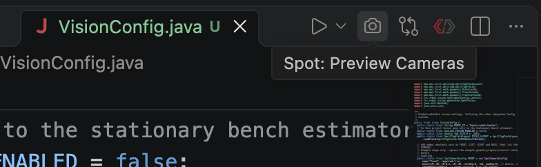
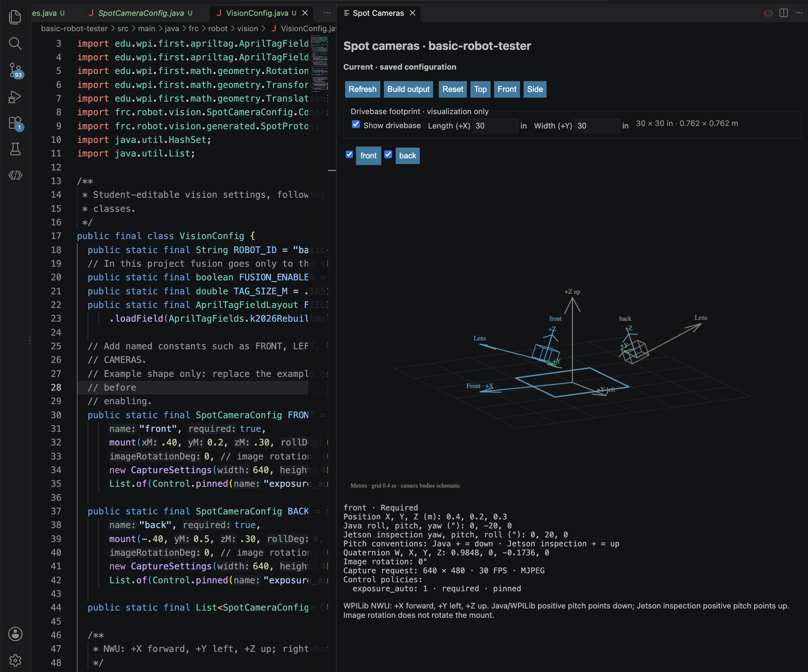

Inspect saved Java camera mounts beside `VisionConfig.java`. The preview runs offline and reads the compiled configuration.

## Install or update the extension

1. In the VS Code installation you use for the robot project, open **Extensions** and search for `team581.spot-camera-preview` (**Spot Camera Preview**).
2. Click **Install**, then reload VS Code if prompted. Install into the profile you use for the robot project.
3. Leave **Auto Update** enabled for the extension so VS Code installs future releases. If you previously installed a `.vsix`, enable **Auto Update** explicitly in the extension's menu.

The extension is distributed through the [VS Code Marketplace](https://marketplace.visualstudio.com/items?itemName=team581.spot-camera-preview); installation does not require GitHub access.

The preview runs offline after installation. Its first geometry export may need connectivity while Gradle resolves the robot project's dependencies.

## Open the preview

1. Open `offseason-2026` in VS Code, then open `offseason-bot/src/main/java/frc/robot/vision/VisionConfig.java`.
2. Click the camera icon in the editor title bar, or run **Spot: Preview Cameras** from the Command Palette.

_Open the preview from the camera icon. It normally opens automatically beside the configuration file._

## Verify a mount

_Keep definitions on the left and mounts on the right. This older screenshot uses illustrative mounts and earlier pitch labels; current versions use WPILib pitch on both sides._

1. Register the measured definitions in **CAMERAS**. A named constant alone does not appear in the scene.
2. Save a position or rotation change. The preview builds and refreshes automatically.
3. Select a camera and compare its position, lens direction and local axes with the physical mount. Hide other cameras to isolate it.
4. Drag to orbit, scroll to zoom, or use **Top**, **Front**, **Side** and **Reset**. Inspect the capture request and control policies below the scene.

> **Pitch:** positive points the lens down; negative points it up. Java −20° and Jetson inspection −20° both point up. Image rotation is separate from mount rotation.

## Check preview status

| Status          | Meaning / action                                                                                       |
| --------------- | ------------------------------------------------------------------------------------------------------ |
| Current         | Saved configuration exported successfully                                                              |
| Unsaved changes | Scene still reflects an earlier saved version                                                          |
| Building        | A new export is running                                                                                |
| Stale preview   | Last successful scene retained after an error; open **Build output**, fix the code and save or refresh |

## Troubleshooting

| Problem     | Try this                                                                                                                                              |
| ----------- | ----------------------------------------------------------------------------------------------------------------------------------------------------- |
| No panel    | Run **Spot: Preview Cameras**; check workspace trust and **Spot Camera Preview: Auto Open**. Closing the panel suppresses auto-open for that session. |
| Empty scene | Add measured definitions to `CAMERAS`.                                                                                                                |
| Build fails | Open **Build output** and fix Java/project errors. Invalid names, dimensions or image rotation can block export.                                      |

Scene conventions and shortcuts

Positions use metres and WPILib NWU axes. Arrow keys orbit; +/− zoom. Grid spacing is 0.4 m. The optional **Show drivebase** footprint defaults to 30 × 30 in (0.762 × 0.762 m), centered at the origin at Z=0. **Length (+X)** and **Width (+Y)** are in inches and persist across refreshes. These inspection settings do not change robot configuration.

Camera bodies and the drivebase are schematic; no calibrated field of view is inferred. Readouts show translation, quaternion, native roll/pitch/yaw, capture request, image rotation, required status and control policies.

Before commissioning, verify physical identity, calibration, delivered FPS, USB capacity and applied controls on the Jetson. See [Cameras in Java](../camera-configuration).
