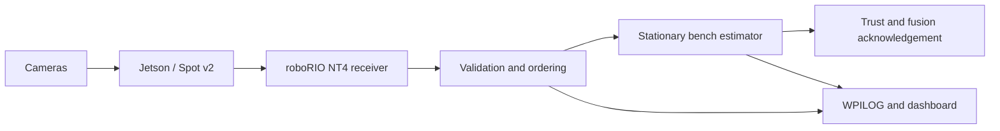

# Basic robot tester — WPILib 2026

A standalone Java robot project for testing Spot with a bare roboRIO and a Jetson.
Team number defaults to **581**. No drivetrain, motor controllers, gyro, CAN bus,
CTRE libraries, team scheduler, or sibling checkout is required. The normal
`TimedRobot` lifecycle and a 20 ms loop run the pipeline in disabled, autonomous,
teleop, and test modes. Keeping the roboRIO disabled is sufficient for bench work.



## Build and deploy

Open **this folder** in WPILib 2026 VS Code. The project uses GradleRIO/WPILib
**2026.2.1**, Java **17**, and Gradle **8.11**. It intentionally stays on 2026 APIs.
The wrapper and generated protobuf bindings are included. An initial online
build downloads dependencies unless they are already in the WPILib/Gradle cache.

```sh
cd basic-robot-tester
./gradlew build
./gradlew deploy
```

Use the WPILib VS Code commands for equivalent build/deploy/simulation actions.
On macOS, a terminal without Java configured can use:

```sh
export JAVA_HOME="$HOME/wpilib/2026/jdk"
./gradlew build
```

Change `.wpilib/wpilib_preferences.json` if your home roboRIO has a different
team number. Deploying installs this test program in place of the roboRIO's
existing robot program. No deployment is performed by generating this project.

`./gradlew simulateJava` runs the same receiver/pipeline on a desktop NT server;
desktop tests cannot qualify actual roboRIO FPGA timing or Jetson performance.

## Configure the bench

See the [camera configuration reference](../docs/operator/12-camera-configuration.md)
for the hardware quick reference, every Java option, and control values/units.

Students edit **`src/main/java/frc/robot/vision/VisionConfig.java`**, following the
same named-constant pattern as the other subsystem configuration classes. Camera
settings are compiled into the robot program and sent to Spot automatically.
Rebuild/redeploy after changes. There is no camera-settings JSON to maintain.

Define camera constants and put them in `CAMERAS`. The example is also included
as a comment in `VisionConfig.java`. **Replace the illustrative values with
measured mounts and verified capture settings/controls before enabling it.**

```java
public static final SpotCameraConfig FRONT = new SpotCameraConfig(
    "front",
    true, // required
    mount(.10, 0, .30, 0, 0, 0), // x/y/z metres, roll/pitch/yaw degrees
    0, // image rotation: 0 or 180 degrees
    new CaptureSettings(640, 480, 30, PixelFormat.MJPEG),
    List.of(Control.pinned("exposure_auto", 1)));

public static final List<SpotCameraConfig> CAMERAS = List.of(FRONT);
```

- `mount(...)` uses NWU: +X forward, +Y left, +Z up. Choose and measure a bench
  reference even without a robot chassis. Rotations are right-handed degrees.
- `CaptureSettings(width, height, fps, PixelFormat.MJPEG)` specifies the actual USB
  capture request. Choose a resolution/rate advertised by the device and tested
  with all cameras connected. MJPEG compresses frames over USB; `PixelFormat.YUYV`
  is available for verified uncompressed setups. Internal conversion to YUYV on
  the Jetson does not mean YUYV is being sent over USB.
- Each camera has one capture configuration. The protocol's mode ID and signature
  are generated deterministically from it. Students do not name modes or provide
  signature strings. Capture-setting changes produce new identities and require
  matching calibration/timing evidence. Changing from the previous hand-named mode
  API can require rebinding saved mode selections and recalibration/requalification
  in Spot. Physical lens/focus changes still require recalibration even when these
  capture values remain unchanged.
- `Control.pinned(name, value)` requires the robot's value and disallows a GUI
  override. `Control.tunable(name, value)` supplies a required default with a
  permitted saved GUI override. The full `Control` constructor also accepts
  `required` and `allowOverride` explicitly. Use names/ranges supported by the
  actual camera. `List.of()` is allowed when declaring no control policies.
- `ROBOT_ID`, `FIELD_LAYOUT`, `TAG_SIZE_M`, and `FUSION_ENABLED` are in the same
  file. `FUSION_ENABLED` defaults false for shadow validation/logging. True
  releases accepted measurements to this project's stationary bench estimator.
  Heading fusion remains disabled.
- `BenchConfig.STATIONARY_POSE` holds the bench-only initial pose. Set it near
  the actual declared pose to pass the innovation gate. There is no automatic
  first-frame seeding. This constant stays out of the actual robot's vision
  configuration; its drivetrain supplies pose history instead.

Defaults deliberately contain **no cameras**. Expect `No measured camera
configuration` until real definitions are added. Invalid camera settings are
rejected before publication. Startup failures appear in
`SmartDashboard/Bench/ConfigError`.

For printed tags at home, replace `FIELD_LAYOUT` with a surveyed
`AprilTagFieldLayout` constructed in Java, or load a WPILib field-layout asset
from the deploy directory. That optional asset describes field geometry, not
camera configuration. Use the blue-wall-right origin and positive field
sizes. Printing an official tag ID does not put it at its official field
position; set `TAG_SIZE_M` to your measured print size.

The same `VisionConfig`/`SpotCameraConfig` pattern can be used in the actual
robot project. USB device-to-name binding, intrinsic calibration, and timing
qualification remain on the Jetson. Students do not need to construct protobufs
or configure transport to add cameras.

Connect Jetson and roboRIO Ethernet, directly or through a switch, on a common
subnet. The roboRIO program is the NT4 **server**. Configure the Jetson's installed
beta service to connect to it; use an explicit `nt.server` address if team
discovery is inappropriate for the home network. A roboRIO USB connection to a
laptop alone does not establish a Jetson-to-roboRIO Ethernet path.

Use a matching Spot v2 service (0.2.1 or later with `tag_selection_supported`).
Use Spot's naming/binding, calibration, and timing qualification workflows before
expecting accepted poses. Do not invent a timing qualification record to unlock
the receiver. Transport/health/configuration diagnostics are useful before those
gates pass. The local bench profile remains separate from production settings.

## Dashboard and evidence

Use Elastic, Glass, or another NT dashboard. Values are under `/SmartDashboard`:

| Entry | Meaning |
| --- | --- |
| `Bench/ConfigLoaded`, `ConfigError`, `ProfileHash` | Startup and manifest identity |
| `Bench/TransportAvailable`, `TransportReason`, `SyncState` | Handshake and service health |
| `Vision/Spot/Reason`, `Available`, `UsableCameras` | Production validation state |
| `Vision/Spot/<camera>/Accepted`, `Rejected` | Lifetime per-camera decision counts |
| `Bench/<camera>/DecisionAge/*` | Capture-to-receiver-decision age of delivered samples |
| `Bench/<camera>/ConsumptionAge/*` | Capture-to-estimator-consumption age, including ordering wait |
| `Bench/FramesDelivered`, `MeasurementsConsumed`, `IngestionRejected` | Delivered/consumed/history-or-age-rejected totals |
| `Vision/Spot/QueueDrops`, `Bench/MalformedPackets` | Queue and malformed-packet diagnostics |
| `Bench/LoopIntervalMs`, `LoopWorkMs` | Loop cadence and measured harness work |
| `Bench/Field`, `TrustM`, `EvidenceAgeS` | Bench pose and evidence/trust heuristic |
| `Bench/UseVision` | Runtime bench estimator suppression; validation still runs |
| `Bench/HubTags` | Exercise offseason alliance-hub selection; unknown alliance stays broad |
| `Bench/ResetPose` | One-shot reset to configured pose while disabled; clears queued/history evidence |

Percentiles cover the latest **4096 nonnegative finite samples per camera**;
`Count` and `LifetimeMaxMs` are lifetime values. Negative/future ages increment
`Invalid` and remain visible in raw decision records. Decision-age statistics
include rejected delivered samples; consumption statistics include only actual
bench estimator submissions. The transport filters unhealthy/malformed/session
mismatched packets before delivery, so delivered counts are not network packet
counts or a complete packet-loss measurement.

DataLogManager records NT state plus per-frame records under `/Bench/Frames`
(JSON) and original delivered protobufs under `/Bench/Raw/<camera>`. Frame records
include identity, sequence, epochs, capture/decision/consumption times, rejection
reason, and reported timing uncertainty. `BENCH_FUSED` means insertion into this
bench estimator. Normal logging goes to roboRIO USB storage when present, or
`/home/lvuser/logs`; retrieve WPILOGs with the WPILib log tool.

Capture-to-consumption is based on Spot's declared capture timestamp. Current
read-completion timestamps require measured bias/jitter characterization before
calling the number exposure-to-consumption latency. An NT sync offset is useful
diagnostic information, not independent proof of clock accuracy.

Suggested run: one camera for 2–5 minutes, then all cameras; compare headless and
preview-on runs. Save logs across Ethernet disconnect/reconnect, Spot restarts,
roboRIO restarts, and both startup orders. Confirm old observations do not resume
as a backlog. The project's existing qualification targets start at consumption
p95 ≤100 ms, age rejection >250 ms, and future rejection >5 ms. Bench runs do not
qualify moving-robot accuracy, drivetrain load, or competition radio behavior.

## Source and adaptation

The copied Spot pipeline is from `offseason-2026` ref
`origin/spot-beta-integration`, commit
`b571f80b5b58fd7ea8db35033e64b06e9028e6ca`. It includes the real `SpotVisionIO`,
`VisionProcessor`, `CaptureHistory`, `MeasurementQueue`, `TrustFactor`, generated
protobuf classes, immutable measurements, and golden contract fixtures.

`Vision` uses explicit calls instead of the team's subsystem registry, and native
WPILib dashboard/logging instead of DogLog. Camera status snapshots are copied
immutably. Camera settings come from the Java `VisionConfig` constants. `Localization` retains
the offseason batch eligibility/history recheck, chronological ingestion,
actual-fusion acknowledgement, and trust update rules. Its hardware boundary is
a WPILib differential-drive pose estimator receiving **zero wheel movement and
zero gyro rotation**. This is a stationary test sink; do not move the rig and
interpret it as drivetrain odometry. WPILib consumes FPGA seconds directly, so
there is no CTRE time conversion or validation of that boundary here.

There are no sibling-project source links or regeneration steps needed to build.
The checked-in generated binding matches the included `proto/vision_v2.proto`.
Contract, ordering, trust, selection, bench ingestion, configuration, and latency
tests run with `./gradlew test`. Hardware qualification remains outstanding.
