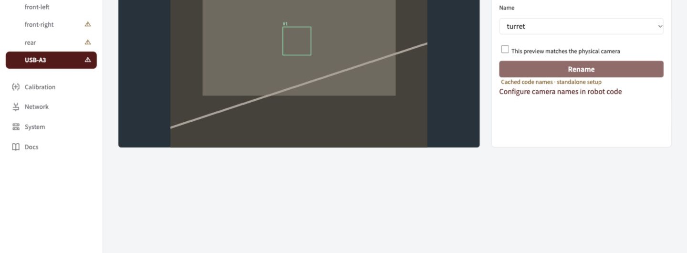

Bind each physical USB feed to its matching name in robot code. A rename keeps the camera's compatible calibration.

## Identify the feed

1. Connect one camera to the powered hub and open its USB entry in the sidebar.
2. Cover the lens briefly or point it at a distinct object. Confirm you are looking at the intended physical camera.
3. Under **Camera name**, choose its code-defined **Name** and check **This preview matches the physical camera**.
4. Click **Rename**. Wait for the sidebar name to change and confirm the same feed stays selected.

_Match the preview first, then choose the name. The names in this demonstration come from its example profile._

## If a name is missing

| Symptom                     | What to do                                                                               |
| --------------------------- | ---------------------------------------------------------------------------------------- |
| No names available          | Add measured camera definitions to robot code, deploy, and check the profile on Network. |
| Name already in use         | Use [Replace a camera](../replacement/) for a deliberate replacement.                    |
| Cached names shown          | Reconnect the robot to confirm the current profile.                                      |
| Calibration warning remains | Continue to [Calibrate](../calibrate/); naming does not calibrate a camera.              |

> **Use stable ports.** Keep the hub on the same Jetson port and each camera on its labelled hub port. Linux `/dev/videoN` order is not a camera identity.

How USB identity is saved

USB labels and slots follow the physical USB path across restarts and reboots. Moving to another port selects that port's slot; returning restores the original saved configuration.

Serial numbers distinguish devices within a slot so a replacement cannot silently inherit calibration. Confirm replacements explicitly when serials are missing or duplicated. An upgrade from the older serial registry pins each connected camera to its current port while retaining its saved identity and settings.

Robot code supplies names, modes, transforms, field layout and control policy. You cannot create arbitrary names in the GUI. The offseason profile intentionally starts empty until mounts are measured.

Next: [check camera geometry](../geometry/).
