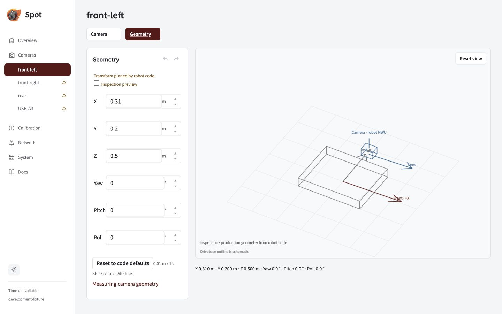

Rebind the existing logical name, then qualify the replacement's optics and timing.

## Replace the physical device

1. Disable the robot, or explicitly begin standalone setup with the link known disconnected.
2. Open the existing named camera and expand **Advanced**.
3. Select the connected device under **Replacement camera**. Verify its preview and labelled USB port.
4. Check **I confirmed the replacement feed**, then click **Replace camera**.
5. Verify capture mode and controls, [calibrate with new validation views](../calibrate/), then repeat measured timing and pose qualification.

> **Treat every replacement as a new physical camera.** Replacement invalidates calibration even if the device reports the same serial number.

## What carries over?

| Kept                       | Must be checked again                                            |
| -------------------------- | ---------------------------------------------------------------- |
| Logical camera name        | Physical feed and USB identity                                   |
| Robot-code mount transform | Actual replacement mounting and lens direction                   |
| Robot control policy       | Applied mode and control readback                                |
| Saved history              | New calibration, independent validation and timing/pose evidence |

_After rebinding, compare the physical mount with Geometry. The code-defined transform remains unchanged by replacement._

Identity and history checks

Replacement advances the binding generation. Choose the replacement's actual identity in the existing camera's Advanced picker, including when it differs from the old identity. Do not choose by Linux video-node order; missing or duplicated serials require explicit port/feed confirmation.

Discovery inventory and physical bindings survive service restart. Ordinary rename can retain a compatible calibration, but replacement requires fresh physical evidence. History restore verifies identity, optical mode, orientation and optical controls.

