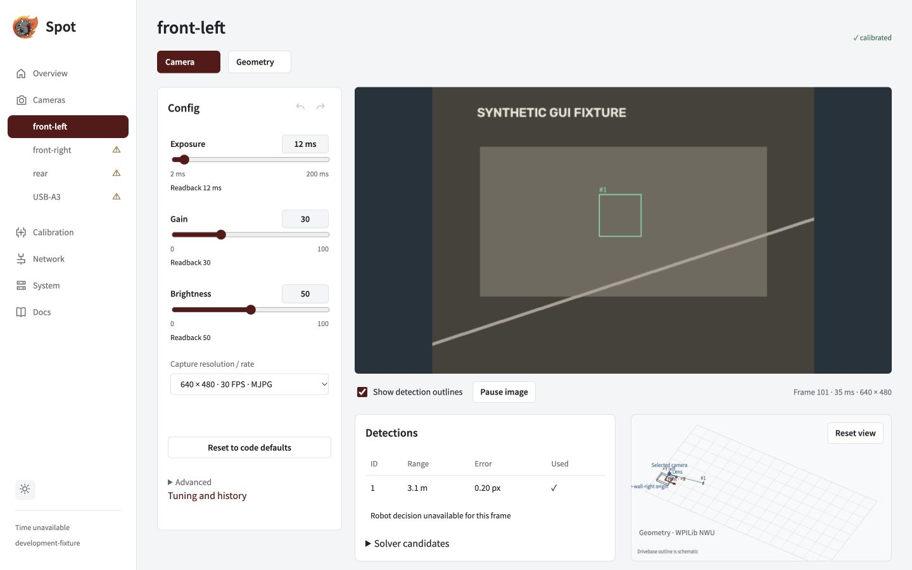

Check the camera image, then the robot's decision. Seeing a local pose is only the first check.

A visible tag does not guarantee a pose. **Calibration required** means Spot can detect tag IDs and corners but cannot compute a trustworthy distance or pose. Complete intrinsics for each actual camera and capture mode. Then verify the field layout, tag size and measured mounts; robot timing and acceptance checks still apply. The Detections panel explains whether a local pose is available.

## Check the image

1. Open **Overview** and check detection FPS and frame age.
2. Open a camera and enable **Show detection outlines**. Confirm tag boundaries and IDs align with the displayed image.
3. Inspect **Detections** and **Solver candidates** for that frame.
4. Use **Pause image** for a closer look; resume to request fresh frames. Processing and publication continue while the image is paused.

_Image, table and candidates describe the same displayed frame. The example feed is synthetic._

## Read the status correctly

| Indicator                 | Meaning                                                                       |
| ------------------------- | ----------------------------------------------------------------------------- |
| Detection FPS             | Usable detector/solver cadence; separate from capture and browser preview FPS |
| Zero tags                 | Normal for a fresh frame without visible tags                                 |
| —                         | Metric unavailable                                                            |
| Increasing frame age      | The last frame is getting older; stale images lose their outlines             |
| Blue / amber candidate    | Local lowest-image-error solution / alternative solutions                     |
| Robot validation / fusion | Separate robot decisions for the identified frame and capture epoch           |

## Confirm robot acceptance

Check **Robot validation** and **Fusion** on the camera page. If feedback is unavailable, local detections do not establish robot acceptance. For a rejection, use the [fault lookup](../faults/).

The robot checks capture-time pose and mount history, tag geometry, field bounds, timestamps and innovation. IPPE alternatives need a decisive capture-time heading advantage.

> **Before enabling fusion:** complete the real Jetson/roboRIO hardware trials and team review. Fusion and revised trust default off; heading fusion remains disabled. Fixture screenshots and CPU simulation do not qualify hardware.

Hardware qualification checklist

- Match measured capture timing to the physical identity, exact mode and control readback.
- Verify FPGA timestamp domains and sentinels, sensor-to-read delay and uncertainty.
- Measure four-camera throughput, frame age and image/pose accuracy.
- Test USB/Ethernet outages, independent boot orders, abrupt power loss, recovery and rollback.

Export the timing signature in the System support bundle. Submit measured timing evidence through the API while disabled. Mode/control changes invalidate that evidence. Never use zero uncertainty or adjust timestamps to hide clock errors. See [API and Java integration](../java/) for the timing-record contract.

