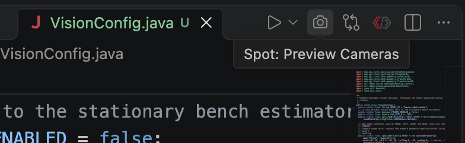
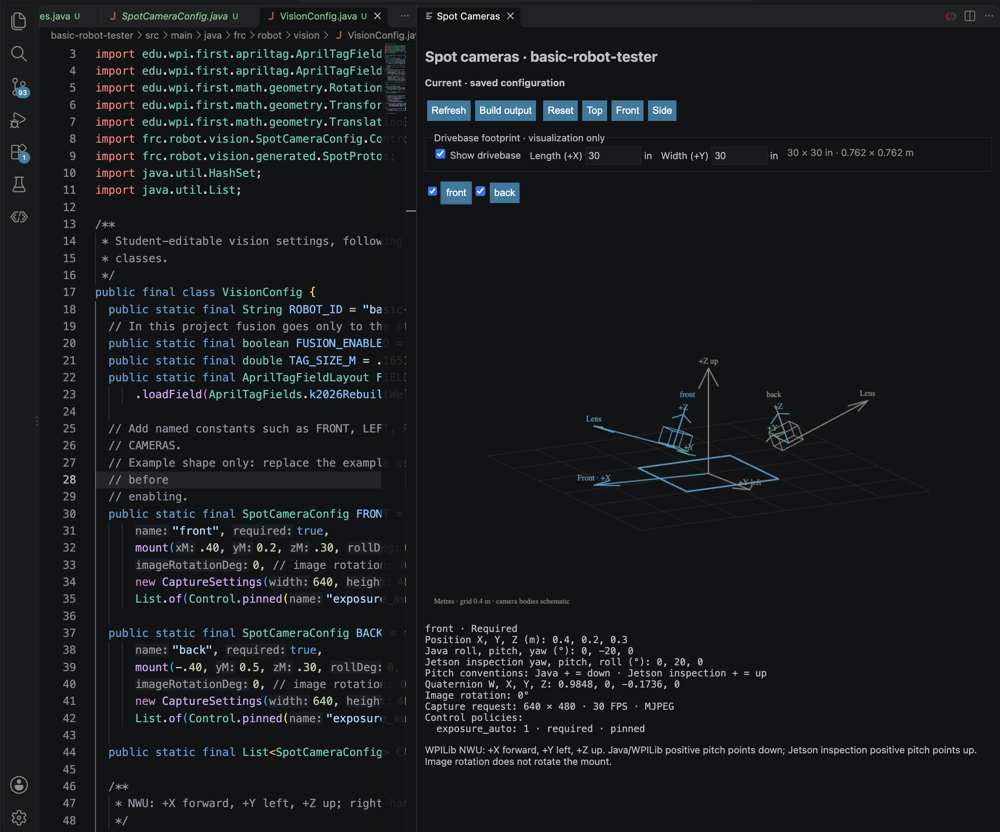

Inspect saved Java camera mounts beside `VisionConfig.java`. The preview runs offline and reads the compiled configuration.

## Open the preview

1. Run the robot project's normal build. It installs the approved Spot extension; reload VS Code if prompted.
2. Open `src/main/java/frc/robot/vision/VisionConfig.java` in the robot project.
3. Click the camera icon in the editor title bar, or run **Spot: Preview Cameras** from the Command Palette.



_Open the preview from the camera icon. It normally opens automatically beside the configuration file._

| Project            | Build                                     |
| ------------------ | ----------------------------------------- |
| offseason-2026     | `./gradlew :offseason-bot:build`          |
| basic-robot-tester | `./gradlew build`                         |
| Windows            | Use `gradlew.bat` in place of `./gradlew` |

The first preview can take longer while Gradle resolves dependencies. Automatic private extension downloads require an authenticated GitHub CLI (`gh`) with access to `team581/spot-2026`. The visualizer itself does not require `gh`; use the manual installation steps below if it is unavailable.

## Install manually without `gh`

1. Open the robot project's `camera-preview-release.json` and note its `tag`, `asset` and `version`. Use the version pinned by that project.
2. Sign into GitHub in your browser with an account that has access to `team581/spot-2026`, then open the [Spot releases](https://github.com/team581/spot-2026/releases). Find the release matching `tag` and download the `.vsix` file matching `asset` under **Assets**. The current pin is [camera-preview-v0.1.2](https://github.com/team581/spot-2026/releases/tag/camera-preview-v0.1.2), with asset `spot-camera-preview-0.1.2.vsix`.
3. In the VS Code installation you use for the robot project, open **Extensions**, click **…**, and choose **Install from VSIX…**. Select the downloaded file. If using an alternate VS Code profile, install into that profile.
4. Reload VS Code if prompted, then open `VisionConfig.java` and run **Spot: Preview Cameras** from the Command Palette, or click the camera icon in the editor title bar.

Once the pinned version or a newer version is installed, the build skips the extension download, so `gh` is unnecessary. Repeat these steps when the project pins a newer version. The preview runs offline after installation; the first robot build may still need connectivity to resolve Gradle dependencies.

## Verify a mount



_Keep definitions on the left and mounts on the right. This older screenshot uses illustrative mounts and earlier pitch labels; current versions use WPILib pitch on both sides._

1. Register the measured definitions in **CAMERAS**. A named constant alone does not appear in the scene.
2. Save a position or rotation change. The preview builds and refreshes automatically.
3. Select a camera and compare its position, lens direction and local axes with the physical mount. Hide other cameras to isolate it.
4. Drag to orbit, scroll to zoom, or use **Top**, **Front**, **Side** and **Reset**. Inspect the capture request and control policies below the scene.

> **Pitch:** positive points the lens down; negative points it up. Java −20° and Jetson inspection −20° both point up. Image rotation is separate from mount rotation.

## Check preview status

| Status          | Meaning / action                                                                                       |
| --------------- | ------------------------------------------------------------------------------------------------------ |
| Current         | Saved configuration exported successfully                                                              |
| Unsaved changes | Scene still reflects an earlier saved version                                                          |
| Building        | A new export is running                                                                                |
| Stale preview   | Last successful scene retained after an error; open **Build output**, fix the code and save or refresh |

## Troubleshooting

| Problem                           | Try this                                                                                                                                              |
| --------------------------------- | ----------------------------------------------------------------------------------------------------------------------------------------------------- |
| No panel                          | Run **Spot: Preview Cameras**; check workspace trust and **Spot Camera Preview: Auto Open**. Closing the panel suppresses auto-open for that session. |
| Empty scene                       | Add measured definitions to `CAMERAS`.                                                                                                                |
| Download fails or `gh` is missing | Follow **Install manually without `gh`** above, or run `gh auth status`, verify private repository access, then retry the install task below.         |
| Build fails                       | Open **Build output** and fix Java/project errors. Invalid names, dimensions or image rotation can block export.                                      |
| VS Code CLI missing               | Set `SPOT_CAMERA_PREVIEW_CODE` to the `code` executable, or use the Gradle override below.                                                            |

<details>
<summary>Extension updates and manual installation</summary>

Each robot project pins a private release version and checksum in `camera-preview-release.json`. Pull team changes, then build to install the approved version if missing or older. Newer installations are not downgraded. Cached, checksum-verified packages can install offline; the first download needs GitHub authentication and connectivity. The cache lives under Gradle user home in `spot-camera-preview`.

Saving Java refreshes geometry only. Preview exports, CI and SSH builds skip installation. An automatic install failure warns without failing the robot build.

To retry explicitly:

```sh
# basic-robot-tester
./gradlew installSpotCameraPreview
# offseason-2026
./gradlew :offseason-bot:installSpotCameraPreview
```

Use `-PskipSpotCameraPreviewInstall=true` to opt out, or `-PspotCameraPreviewCode=/path/to/code` to choose VS Code. For an alternate VS Code profile, install the VSIX into that profile manually: download the pinned private release asset and choose **Extensions → … → Install from VSIX**. Reload if prompted. If the release is missing, a maintainer must publish it and update the project manifests.

</details>

<details>
<summary>Scene conventions and shortcuts</summary>

Positions use metres and WPILib NWU axes. Arrow keys orbit; +/− zoom. Grid spacing is 0.4 m. The optional **Show drivebase** footprint defaults to 30 × 30 in (0.762 × 0.762 m), centered at the origin at Z=0. **Length (+X)** and **Width (+Y)** are in inches and persist across refreshes. These inspection settings do not change robot configuration.

Camera bodies and the drivebase are schematic; no calibrated field of view is inferred. Readouts show translation, quaternion, native roll/pitch/yaw, capture request, image rotation, required status and control policies.

</details>

Before commissioning, verify physical identity, calibration, delivered FPS, USB capacity and applied controls on the Jetson. See [Cameras in Java](../camera-configuration/).
