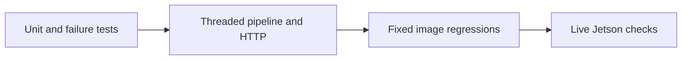

# Alpha verification

Historical October 4, 2026 evidence. The alpha/prototype GUI and its SSH launcher
have been retired; commands below reproduce the workflow at that checkpoint.
Use the [current operator guide](../apps/docs/src/content/docs/index.md) for setup
and the [documentation index](README.md) for later commissioning records.

## Repeatable checks

Install the host CPU native extension and testing extras using the setup in the
root README. NetworkTables integration tests also need the `nt` extra. Run:

```sh
PYTHONPATH=src .venv/bin/python -m pytest
node --test tools/tests/test_pose_viewer.cjs tools/tests/test_camera_tuning.cjs
PYTHONPATH=src .venv/bin/python -m pytest --cov=spot_vision --cov=tools \
  --cov-report=term-missing --cov-report=html:prototype-runs/coverage
```

Pytest now discovers both `tests/` and `tools/tests/` by default. The complete
suite requires localhost sockets for HTTP tests. Coverage includes branches and
excludes test code and generated protobuf code. Its percentages describe Python
code; they do not measure C++ or CUDA coverage.



The added tests cover queue capacity and shutdown, detector buffer validation
and ownership, concurrent independent detectors, tag/no-tag/reset transitions,
four-camera service output and lifecycle, degraded configuration, calibration
state races and save policy, independently projected ChArUco calibration and
outlier rejection, replay/probe/benchmark commands, rotation singularities,
capture fallback and retry, scheduler failures, optional telemetry dependencies,
and alpha daemon cleanup. Real camera fixtures in `tests/data/live-alpha/`
complement synthetic geometry fixtures in `tests/data/regression/`.

## Live verification without a deployment

Keep the existing alpha daemon running and point the cameras at tags. This
checker only issues GET requests against its shared frames and telemetry. It
does not open camera devices, change controls, save calibration, or restart a
process:

```sh
.venv/bin/python tools/verify_alpha_hardware.py --duration 120 \
  --camera 1 --camera 2 --camera 3 --camera 4 --expected-tag 4 \
  --output-dir prototype-runs/alpha-verification/live
```

Change `--expected-tag` to match the actual scene; omit it to accept any detected
tag. The default gates require at least 90% valid sampled outputs, progress of
capture/detection/publication, at least 1 detection FPS, finite normalized poses,
consistent selected-candidate error and tag relationships, decodable JPEGs, and
no new capture/decode failures, reconnects, or timestamp discontinuities. A
counter reset or sequence reversal fails the check; rerun after a deployment.
Dropped pending frames, result-queue drops, and driver sequence gaps are reported
as warnings. The 1 FPS gate checks liveness and **does not certify throughput
requirements**. Exit codes are 0 for pass, 1 for failed gates, and 2 for an
unavailable endpoint or invalid request.

For offline GPU accuracy on the Jetson, use the image-regression command from
the README. It disables CPU fallback and uses the GPU's required decimation 2;
each case records `detector_decimate`. NAPA CPU cases report 1 (full resolution)
and record their sampling and contrast thresholds as `detector_min_tag_px` and
`detector_min_contrast`.

## Results from 2026-10-04

- Added 184 Python cases: **349 passed**, with **8 JavaScript tests passed**.
  A fresh host C++ extension build also passed 38 focused native/image/service
  tests using the newly built module directly.
- Core Python line coverage: **71.84% → 92.23%**; branch coverage:
  **53.19% → 78.82%**. Core means `src/spot_vision`, excluding generated
  protobuf code. All application/tool Python combined: approximately **83%**
  when lines and branches are counted together.
- The real Jetson CPU and CUDA backends each passed all five synthetic scenes,
  repeated five times for timing: central/peripheral distortion, multi-tag,
  blank, and rotated capture. Strict CUDA used no fallback.
- Both native backends detected physical Tag 4 in captured images from all four
  cameras. Corresponding-corner differences were **0.006–0.010 px**. Checks also
  covered packed-buffer pointer identity, input immutability, blank-frame
  results, reset recovery, pose solving, and protobuf output.
- A 120-second live run collected **118 samples per camera**. Every sample had
  valid Tag 4 output and a pose; all four JPEGs decoded. There were **zero new
  capture/decode failures, reconnects, sequence gaps, or timestamp
  discontinuities**.

| Camera | Capture FPS | Detection FPS | Result queue drops during 120 s |
| ------ | ----------: | ------------: | ------------------------------: |
| 1      |       106.3 |          64.2 |                            1301 |
| 2      |        15.2 |          13.9 |                             284 |
| 3      |        15.3 |          13.7 |                             245 |
| 4      |        14.2 |          13.1 |                             199 |

These measurements used the current mixed-resolution live configuration and
active preview clients. Every camera progressed, but this does not establish
equal scheduling rates or requested 120 FPS capture. Earlier lifetime counters
showed reconnects on cameras 3 and 4; none occurred in the two measured windows
(30 seconds and 120 seconds).

The first isolated CUDA corpus run exposed an upstream fatal assertion for
decimation 1. `create_detector` now rejects unsupported CUDA decimation before
calling native code and follows the configured CPU-fallback policy. The native
binding also has an early validation guard. Safe rejection and fallback were
verified with staged Python on the real Jetson.

The fix was subsequently **rebuilt and deployed to the Jetson**, including the
installed Python modules and CUDA extension used by the alpha daemon. Direct
native calls with decimation 1, 1.5, 3, 4, and NaN now raise `ValueError` safely.
The installed factory rejects unsupported settings, and its CPU fallback still
detects the synthetic tags. Both installed backends passed all five regression
scenes, repeated five times. The running daemon's mapped native binary inode
matches the rebuilt installed extension.

After deployment, all four cameras passed a 30-second live check: **31 valid
Tag 4/pose samples per camera**, decodable previews, and zero new capture/decode
failures, reconnects, sequence gaps, or timestamp discontinuities. Detection
rates were approximately 56.8, 12.8, 12.1, and 13.3 FPS for cameras 1–4; pending
frame overwrites and result queue drops remain. An independent 10-second NT4
check received **860 protobuf and typed-pose updates**, all with matching
capture timestamps and valid Tag 4 candidates. The daemon stayed alive, served
the dashboard, and logged no errors or CPU fallback during verification.

The scoped deployment preserved configuration/calibration files and the
detached alpha service mode. New PID: `6116`. Rollback files and manifest:
`/home/team581/buddy-2026/.deployment-backups/decimation-fix-m8ngo8sk/`.
The first startup check ran before cameras initialized and triggered a verified
rollback; the corrected readiness check waited for all enabled cameras before
the successful deployment. Deployment scripts, build log, hashes, installed
regression results, live reports, and NT4 results are saved locally under
`prototype-runs/alpha-verification/deployment/`.

Local evidence is saved under `prototype-runs/alpha-verification/` (ignored by
Git): `pytest.xml`, `coverage.json`, the HTML coverage directory, `live/` reports,
and `native/` CPU/CUDA reports and the assertion-based live-native script. The
isolated Jetson check was staged under `/tmp/spot-alpha-verification.9B37R5/`.
It used current local Python source and the deployed Jetson native extension;
the live installation was left running.

## Remaining verification

Absolute physical pose accuracy needs measured rig/field ground truth. The
native corner agreement check establishes consistency, not physical accuracy.
The two-minute stationary check does not replace the documented 30-minute
thermal endurance run, USB unplug/replug test, physical no-tag transition, live
MJPEG/YUYV comparison, dynamic-scene accuracy, or roboRIO-side NT4 timestamp
verification. An independent Mac NT4 subscriber received progressing protobuf
and typed Pose3d updates for all four cameras with matching capture timestamps.
The first strict three-second stream check flagged cameras 1 and 2; a second
three-second check and a ten-second check passed all four. The ten-second run
received 860 protobuf and typed-pose updates with matching timestamps. Results were retained under
`prototype-runs/alpha-verification/nt4*.json`; this intermittent behavior needs
follow-up and does not disappear because a retry passed. The actual roboRIO
subscriber was not exercised. Upstream CUDA C++ GTest
executables were not available in the deployed checkout; native CUDA was
verified through the pybind extension instead. Investigate the observed
throughput and queue loss before claiming production performance.
