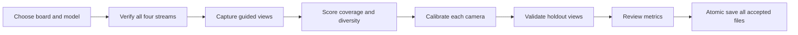

# Four-camera ChArUco calibration

Historical alpha calibration design and workflow. Its standalone wizard and
prototype server have been retired. Use the installed dashboard's
[calibration guide](../apps/docs/src/content/docs/operator/calibrate.md) for the
current capture, independent validation, and acknowledged group-apply workflow.
The measurements and alpha persistence behavior below are retained as design history.

## Team board and capture guide

The wizard defaults to the team's 15×15 board: 30 mm squares, 22 mm markers,
and `DICT_4X4_250`. Its marker IDs run from 0 to 111. The smaller
`DICT_4X4_50` dictionary only recognizes the first 50 markers; a dictionary
that cannot hold the board's marker IDs is rejected before capture starts.
The supplied board photo was verified to detect all 112 markers and 196
inner chessboard corners with the default configuration.

Start capture enables automatic capture on each camera. A detected view is
accepted when the RMS displacement of matching board corners since the last
accepted view reaches 2.5% of the image diagonal. This captures translation,
scale, tilt, and rotation while ignoring stationary frames and small jitter.
A view with fewer than four shared corners is treated as a new board region.
Capture stops adding views at 80 frames; Pause/Resume controls each camera,
and computing a result pauses that camera to preserve its reviewed samples.

The preview has a 4×4 coverage guide. Each cell counts accepted views with
at least three detected corners in that image region. Amber cells have fewer
than three views; green cells have at least three. These counts guide spatial
coverage, and do not guarantee calibration accuracy. Also vary board distance
and tilt, keep it sharp, and use the calibration report to judge the result.

## Math and quality policy

The board is a planar grid of `squares_x` by `squares_y` squares. Its 3-D
corner coordinates are `(col * square_length, row * square_length, 0)` in
metres. OpenCV's ChArUco detector interpolates chessboard corners from the
detected marker corners and returns stable board-corner IDs; only IDs with a
known 3-D coordinate are used.

For image `i`, with intrinsic matrix `K` and distortion vector `d`, the
reprojection objective is

`sum_i sum_j || p_ij - project(K, d, R_i, t_i, X_j) ||^2`.

`K = [[fx, 0, cx], [0, fy, cy], [0, 0, 1]]`; `R_i,t_i` are the board pose for
that capture. `calibrateCameraCharuco` minimizes this objective with
Levenberg-Marquardt. The selected distortion model is explicit: five-term
`plumb_bob` (`k1,k2,p1,p2,k3`) by default, or OpenCV rational (`k1..k6,p1,p2`)
when enabled. Fisheye is kept as a future model because its corner API and
optimization are separate and should not be silently mixed with the standard
model.

Each accepted frame must meet configurable minimum corner count and marker
count. The capture set is scored for image coverage (convex hull area divided
by image area), pose diversity (normalized board-center bins and tilt bins),
and sharpness (variance of the Laplacian). Frames are ranked by a weighted
quality score; automatic duplicate rejection uses matching corner movement.
After an initial solve, per-frame RMS reprojection error is computed and frames
outside `median + max(3 * MAD, 0.5 px)` are excluded, then the solve is repeated
once. A result is accepted only when frame count, coverage, diversity, and
RMS thresholds pass. The UI reports every gate and never writes an incomplete
result.

## Persistence

The existing camera config continues to point at `calibration-N.json`. New
files carry `schema_version: 2`, `method: charuco`, `board`, `detector`,
`model`, `frames_used`, `coverage`, `diversity`, `rms_reprojection_error_px`,
and `calibrated_at`. The runtime only requires width, height, pixel format,
camera matrix, and distortion, so schema-1/provisional files remain readable.
Writing is atomic (`.tmp` then replace) and includes the camera ID and capture
format so an accidental cross-camera calibration fails validation.

## Four-camera workflow

The wizard keeps all four cameras visible, marks each as ready/capturing/
solving/validated, and advances the active camera automatically. A single
board pose can be captured synchronously for all cameras when all four meet
their per-frame gates; otherwise the operator can retry only the camera that
missed. The final save is all-or-nothing from the operator's point of view:
existing files remain untouched until every selected camera has passed
validation.

