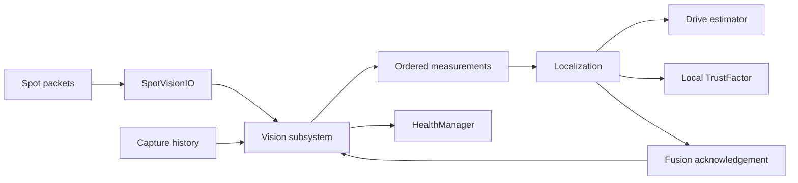
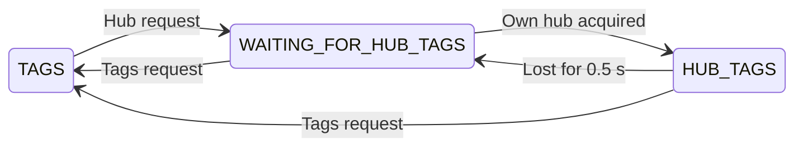
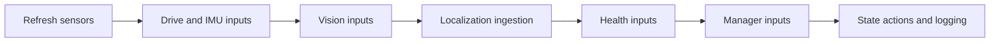

# Offseason Spot integration implementation plan

Status: software integrated locally on October 11, 2026. See [implementation results](Offseason%20Spot%20Integration%20Results.md) for changes and validation. Measured camera configuration and hardware qualification remain commissioning gates. Testing-framework work remains separate.

## 1. Scope and decisions

Put the complete robot-side Spot implementation under `offseason-bot/src/main/java/frc/robot/vision/` in `offseason-2026`. Reuse the existing subsystem folder rather than introducing a parallel Spot subsystem. Move the new shared implementation into that folder, simplify its ownership, and remove offseason Limelight integration.

**Use one `Vision` state-machine subsystem, with a few focused helpers in its folder.** Fold `VisionPipeline` into `Vision`; keep the substantial geometry/validation code in `VisionProcessor`, and keep transport separate from math. Combine diagnostics with the subsystem's cached observations and logging. This avoids both a collection of separately coordinated vision services and one enormous class containing networking, pose math, and robot behavior.

Other decisions:

- `Localization` remains the sole owner of estimator ingestion and localization trust. It consumes immutable measurements from `Vision` and acknowledges actual ingestion.
- Use one offseason `TrustFactor` implementation, based on the capture-time evidence model already introduced as `VisionTrust`. Preserve the public localization getters used by the robot. Remove the legacy/revised trust implementation switch.
- Use the existing immutable `VisionMeasurement` as the Spot result. Do not convert it into mutable Limelight `TagResult` objects.
- Keep unchanged shared results, camera utilities, and shared `TrustFactor` available to the other robots. Introduce local versions only where the offseason implementation actually needs different behavior.
- Configure four chassis-fixed cameras named `left`, `right`, `front`, and `back`. All four participate in localization and alliance-hub selection. There is no turret camera or moving-mount integration in this implementation.
- Preserve the existing `tagsRequest()` / `hubTagsRequest()` purpose: acquire broadly, then localize using the alliance's hub tags while available, with broad-tag fallback after loss. Remove Limelight transport details, not this scoring-oriented behavior.
- Keep fusion defaulting off and heading fusion suppressed. Removing hybrid support does not justify removing timestamp, identity, quality, or multi-camera ordering checks.
- Prepare constructor seams and readable observations for simulation. Use the existing JUnit infrastructure for new unit/subsystem tests. Do not implement the proposed scenario runner, new Gradle test tasks, reporting framework, or diagnostic entrypoint.

These decisions supersede the shared-first and hybrid robot integration portions of [the original Spot plan](Spot%20Robot%20Integration%20Plan.md). The Jetson transport and qualification requirements still apply.

## 2. Reviewed starting point

Reviewed the following local Git snapshots without switching branches:

| Repository/ref                                   | Snapshot   | Relevance                                                                         |
| ------------------------------------------------ | ---------- | --------------------------------------------------------------------------------- |
| `spot-2026/main`                                 | `7b1b1ee`  | Protocol, Python service, golden packets, Java example, integration documentation |
| `offseason-2026/spot-beta-integration`           | `55ce1972` | Current robot integration branch; clean working tree at review                    |
| `offseason-2026/origin/main`                     | `e429b593` | Existing unit tests and accepted subsystem ordering fix                           |
| `offseason-2026/simple-headless-sim-test-runner` | `f1e02117` | Updated simple testing plan and existing headless fixture                         |

The robot branch adds 28 changed files relative to its merge base with main. Most added lines are generated protobuf code. The architectural complexity comes from new shared helpers plus coordination in `Localization`, rather than generated code volume alone.

Specific findings that drive this plan:

1. `Vision` still owns four Limelights and the `TAGS` / `WAITING_FOR_HUB_TAGS` / `HUB_TAGS` states. The new Spot IO, processor, queue, diagnostics, and trust live alongside it inside `Localization`.
2. `Hardware` constructs four OFF placeholder Limelights with the same placeholder name. `HealthManager` uses them for camera health and fallback selection.
3. `RobotManager` repeatedly requests Limelight tag modes and sends heading/speed to `Vision`. `Turret` sends observations that currently serve Limelight IMU data. These call sites need actual cleanup.
4. The branch has not changed shared `TrustFactor` or the shared results classes. Shared `TrustFactor` still weights noisier observations more heavily, averages asynchronous poses, counts estimator corrections as travel, and bypasses trust checks in simulation.
5. `VisionPipeline` already provides useful bounded ordering and generation/reset handling. Multiple Spot cameras still require these behaviors.
6. The current Spot profile has no camera mounts. The planned hardware is four static cameras named `left`, `right`, `front`, and `back`; implementation includes their measured profiles. Tests can use clearly synthetic mounts before those measurements are available.
7. The branch also adds a three-line empty-results guard to competition `Localization` and exports protobuf from `shared`. Both should be removed from this integration's final diff once the offseason implementation is isolated.
8. This branch's shared schedulers iterate priority queues, which does not guarantee sorted traversal. Main already replaces them with sorted lists. Do not assume the current branch's priority values alone enforce input order.

## 3. Final folder layout and file migration

All Spot production files live beneath this one subsystem folder:

```text
offseason-bot/src/main/java/frc/robot/vision/
  Vision.java
  VisionState.java
  VisionIO.java
  SpotVisionIO.java
  SpotCameraProfiles.java
  SpotProtocol.java
  VisionProcessor.java
  CaptureHistory.java
  MeasurementQueue.java
  TrustFactor.java
  results/
    VisionMeasurement.java
  generated/
    SpotProtos.java

offseason-bot/src/test/java/frc/robot/vision/
  RobotContractTest.java
  VisionProcessorTest.java
  CaptureHistoryTest.java
  MeasurementQueueTest.java
  TrustFactorTest.java
  VisionIntegrationTest.java
  SpotVisionIOTest.java
  SpotRobotExample.java
  fixtures/                     # Only the small fakes used by these tests

offseason-bot/src/test/resources/spot-robot/
  ... existing golden packets and fixture documentation ...
```

The test class list describes coverage boundaries; create each class only when it contains useful tests. Production robot wiring remains in `Robot`, `Hardware`, `Localization`, and `HealthManager`; do not copy those entire subsystems into the vision folder.

| Current file                                                                                          | Planned disposition                                                                                                                                 |
| ----------------------------------------------------------------------------------------------------- | --------------------------------------------------------------------------------------------------------------------------------------------------- |
| Shared `VisionPipeline`                                                                               | Fold orchestration, reset, generation changes, release, and fusion acknowledgements into `Vision`                                                   |
| Shared `VisionDiagnostics`                                                                            | Fold cached camera counters/status into `Vision`; expose nested immutable status records and log them from `whileInState()`                         |
| Shared `VisionIO`                                                                                     | Move locally; change to one input read per loop returning samples and health together                                                               |
| Shared `SpotVisionIO`                                                                                 | Move locally; retain NT ownership, protocol parsing, bounded transport, and decision publishing                                                     |
| Shared `VisionProcessor`                                                                              | Move locally; retain explicit validation/math functions and decision reasons                                                                        |
| Shared `CaptureHistory`, `MeasurementQueue`                                                           | Move locally; preserve bounded storage and deterministic ordering                                                                                   |
| Shared `VisionMeasurement`                                                                            | Move to local `results/`; retain immutable pose/time/deviation/tag data                                                                             |
| Shared `VisionTrust`                                                                                  | Rename to local `TrustFactor`; make it the single offseason trust model                                                                             |
| Shared `VisionProfiles`                                                                               | Rename to local `SpotProtocol`; keep protobuf conversion and content hashing out of subsystem logic                                                 |
| Shared `VisionCamera`                                                                                 | Fold the small mount/policy record into `SpotCameraProfiles`; use fixed transforms and remove unused moving-mount providers from the offseason path |
| Shared generated `SpotProtos`                                                                         | Regenerate into local `generated/` with its Java namespace matching the folder                                                                      |
| Shared Spot tests/example/resources                                                                   | Move to offseason test sources/resources; revise coverage to match the single-robot architecture                                                    |
| Shared `LimelightVisionIO`                                                                            | Delete the branch-added adapter; no offseason replacement                                                                                           |
| Offseason `vision/limelight/`, `CameraConfigs`                                                        | Remove after deleting their live offseason references                                                                                               |
| Existing shared `TagResult`, `OptionalTagResult`, game-piece results, `TrustFactor`, camera utilities | Leave unchanged for their existing consumers                                                                                                        |

### Migration comments

Place this exact line at the top of every local production helper intended for later shared extraction:

```java
// Move to shared folder after offseason
```

Mark `VisionIO`, `SpotVisionIO`, `SpotProtocol`, `VisionProcessor`, `CaptureHistory`, `MeasurementQueue`, `TrustFactor`, and `results/VisionMeasurement`. If a separate reusable helper is justified during implementation, mark it too. `Vision`, `VisionState`, and the robot's camera profiles remain robot-specific and do not get a misleading extraction marker.

Add the marker to generated `SpotProtos` through the documented generation/copy step so regeneration preserves it. Tests belong to the corresponding module after extraction; they do not need migration comments on every fixture.

### Protobuf and build changes

Move protobuf runtime dependency `4.33.2` from `shared` to `offseason-bot` as `implementation`. Remove the branch-added `java-library` plugin from `shared` if no baseline code independently requires it. Audit actual consumers before reverting these build changes.

Set the proto's Java package option to `frc.robot.vision.generated` and regenerate Java and Python bindings with the documented compiler. That namespace change alone does not change serialized packets or profile hashes. Separately, the hub-selection work below requires a small additive runtime-policy extension to v2; keep topic names and existing field numbers, and document support detection. Preserve legacy golden packets and add new policy-aware fixtures with explicit expected bytes/hashes rather than treating intentional protocol additions as unexplained fixture changes. Do not hand-edit generated Java internals. The existing `**/generated/**` formatting exclusion still applies.

Update `proto/README.md`, the fixture copy destination, the compiled Java documentation example, and the operator Java integration page. Revise current overview/status text that describes the robot code as shared or hybrid. Preserve historical verification reports as records of the previous implementation.

### Four static camera profiles

`SpotCameraProfiles` owns exactly these logical names, in stable order `left`, `right`, `front`, `back` for deterministic profile hashing:

| Name    | Planned placement/view                 | Mount inputs                                      |
| ------- | -------------------------------------- | ------------------------------------------------- |
| `left`  | Fixed to chassis, covering robot left  | Measured robot-to-camera translation and rotation |
| `right` | Fixed to chassis, covering robot right | Measured robot-to-camera translation and rotation |
| `front` | Fixed to chassis, covering robot front | Measured robot-to-camera translation and rotation |
| `back`  | Fixed to chassis, covering robot back  | Measured robot-to-camera translation and rotation |

Supply each measured transform in robot NWU coordinates: +X forward, +Y left, +Z up, with actual yaw/pitch/roll. Outward-facing nominal yaw is +90° left, -90° right, 0° front, and 180° back, but these are placement intentions, not replacement measurements. Do not invent translation, height, tilt, optical mode, or calibration. Bind physical cameras to these names through the existing Spot naming workflow; the logical name does not encode a USB port or camera serial.

All four complete profiles use `moving_mount=false`, no joint name/history, their verified optical modes and controls, and `required=true` for commissioning health. Losing one required camera produces a fault while remaining usable cameras continue to contribute. Include four-camera throughput, simultaneous visibility/correlation, and partial-outage trials in qualification.

Define the names and a four-camera synthetic fixture immediately; add each production camera definition only when its mount and mode are measured. The existing validator requires valid mounts and optical modes even for disabled definitions, so do not publish four fake zero-transform placeholders. The completed production profile contains all four names; if measurements remain unavailable, record that specific configuration gate while completing the software work.

## 4. Subsystem responsibilities and APIs



### Vision

`Vision extends StateMachineSubsystem<VisionState>` remains the only scheduled vision component. Helpers do not register independently or own background polling threads.

Retain the meaningful `VisionState.TAGS`, `WAITING_FOR_HUB_TAGS`, and `HUB_TAGS` states. Their implementation controls a robot-owned tag selection shared by all four static cameras, rather than Limelight pipeline indices. Keep selection transitions in this single owner's `getNextState()` and outputs in `afterTransition()`; do not add separate per-camera state machines. Link health, calibration availability, and rejection reasons remain observations.

Suggested public API, with names finalized during implementation:

```java
List<VisionMeasurement> drainMeasurements();
Vision.Status getStatus();
void tagsRequest();
void hubTagsRequest();
void measurementFused(VisionMeasurement measurement);
void reset(double nowFpgaSeconds);
void close();
```

`drainMeasurements()` transfers the prepared batch once. A second drain in the same loop returns empty, and a batch cannot be replayed on the next loop. Use immutable values and avoid exposing the queue or NT subscribers.

`collectInputs()` reads inputs once, records capture history, evaluates observations, handles session changes, and prepares a bounded ordered batch. `whileInState()` logs the cached snapshot, updates/clears owned faults, and publishes decisions after localization has acknowledged the batch. Getters never poll NetworkTables or advance processing.

Fold existing diagnostics into a small cached model: overall link status/reason; configured/usable/required camera counts; per-camera last observation and acceptance times; acceptance/rejection counters; queue drops; last actual fusion; and generation identity. Expose only the observations that robot behavior and tests need. Keep `ACCEPTED`, queued, shadow-only, and actually fused distinct.

Keep deployment policy in `SpotCameraProfiles`: one `FUSION_ENABLED` setting defaults false and supplies both the manifest field and robot fusion policy. Remove the separate `FeatureFlags.SPOT_FUSION` gate so enabling fusion does not require finding two unrelated settings. The generic operator vision option can still suppress fusion and vision-assisted behavior at runtime. Continue collecting shadow diagnostics while suppressed, invalidate pending output on suppression, and publish the effective fusion state in decisions rather than only the manifest's configured value.

### A narrow IO seam

Replace the separate `drain(now)` and `health(now)` calls with `readInputs(nowFpgaSeconds, robotEnabled)`, returning one immutable `VisionIO.Inputs` record containing health and owned samples. Keep sample/health/input records nested in `VisionIO`, and processing decisions/reasons nested in `VisionProcessor`.

Pass enabled state into the transport rather than reading `DriverStation` inside it. Pass an NT instance and session identity into construction; the real composition creates the session once, while tests supply a fixed value. Use an injected FPGA clock at the subsystem boundary and take one time snapshot per tick.

Retain IO hooks for reporting decisions, marking fusion, reset, publishing, and close. Production uses `SpotVisionIO`; tests implement a small scripted `VisionIO` beneath test sources. The fake supplies raw observations plus current acknowledgement/health metadata, so it exercises the real processor rather than injecting already-approved poses.

### Preserve the hub-tag selection purpose

The current implementation requests hub tags in `RobotManager`'s `IDLE`, `PREPARE_SCORE`, `SCORE`, and `WARMUP_SCORE` states. Feed, force-score, fallback, and unjam paths request general tags. A hub request first enters `WAITING_FOR_HUB_TAGS`, with all known tags allowed. A trusted pose containing an alliance-hub tag on any tag camera switches all cameras to the alliance-hub filter. The existing 0.5 s falling debounce prevents brief occlusion from immediately switching back to all tags.

**Interpretation:** this intentionally favors pose evidence tied to the scoring target once the robot can see it, instead of allowing other field structures to dominate scoring localization. It also recovers broad field localization when the hub is unavailable. The code does not establish a measured accuracy gain, and `HUB_TAGS` is not currently a separate shooting-readiness gate; preserve the existing manager's trust/readiness checks.

Carry forward the exact existing robot-code tag sets, checking they exist in the configured field layout:

| Alliance | Own hub tag IDs                  |
| -------- | -------------------------------- |
| Red      | `2, 3, 4, 5, 8, 9, 10, 11`       |
| Blue     | `18, 19, 20, 21, 24, 25, 26, 27` |

These sets select the alliance's scoring structure, not whichever hub is active during the current match shift. Keep hub activity timing in `HubActivity`. Obtain alliance as an explicit cached/injected observation; if it is unknown, continue broad-tag acquisition and report that hub selection is waiting for alliance rather than silently choosing a hub. On alliance change, discard old selection evidence and reacquire.

| State                  | Effective tag selection on every camera | Transition                                                                                                                 |
| ---------------------- | --------------------------------------- | -------------------------------------------------------------------------------------------------------------------------- |
| `TAGS`                 | All tags in the configured field layout | `hubTagsRequest()` enters `WAITING_FOR_HUB_TAGS`                                                                           |
| `WAITING_FOR_HUB_TAGS` | All configured field tags               | A fresh accepted pose using at least one own-hub tag on any of `left/right/front/back` enters `HUB_TAGS`                   |
| `HUB_TAGS`             | Only own-alliance hub IDs               | Loss of qualifying hub evidence for 0.5 s returns to `WAITING_FOR_HUB_TAGS`; `tagsRequest()` returns to `TAGS` immediately |



Aggregate qualifying visibility across all four cameras; never assign a permanent scoring camera or require the front camera specifically. Only fresh, correctly identified frames accepted by the normal processor may refresh the acquisition/loss timer. Opponent-hub tags, raw rejected detections, duplicates, old selection/session frames, and heartbeat alone cannot do so. Camera handoff must not restart acquisition if another camera still supplies qualifying evidence. Repeated hub requests are idempotent and do not restart the waiting timer or increment policy generation every loop. Keep the 0.5 s timer separate from the current per-frame capture-age validity limit and evaluate it with the injected clock.

### Small runtime tag-policy extension on Spot

The current v2 contract has no runtime tag filter. Implement the selection before pose solving on Spot; dropping a non-hub ID from an already solved mixed-tag pose does not produce a hub-only pose.

Extend existing messages with a robot-session-scoped positive `tag_selection_generation` and explicit `allowed_tag_ids` in `RobotState`, echo the applied generation in `Observation`, and advertise `tag_selection_supported` in the configuration acknowledgement. Use a small nested IO policy record and `setTagSelection(...)`; a single global selection applies to all four cameras. This is an enabled-time processing request, not a calibration/mount/control mutation, and it must not relax existing disabled-only configuration rules.

In `ConfigurationService`, accept the policy only from fresh, increasing robot-state messages for the current robot session; validate sorted, unique IDs against the configured layout. Snapshot the policy at the frame's processing boundary. In `Runtime._detect`, detect once, filter detections by that snapshot before `PoseSolver.solve`, and publish the applied generation with the resulting observation. Keep excluded detections available in diagnostics with `used_for_pose=false` and a tag-policy exclusion reason. If the filtered set is empty, publish a normal no-pose observation with advancing sequence. Do not restart capture/detectors or reapply the manifest whenever the requested tag mode changes.

On a selection change, increment its generation, clear robot pending/prepared measurements from the previous policy, and preserve the ingestion watermark. Reject observations from an older selection, and in hub-only mode independently require every candidate's used tag ID to belong to the selected own-hub set. An in-flight broad-tag solve cannot be relabeled as hub-only. While awaiting application, expose pending selection and keep odometry/trust degradation working. On policy freshness loss, stop publishing policy-qualified robot pose candidates until a fresh current-session selection is available; preview and health can continue.

Require advertised tag-selection support before treating the new robot/service pair as ready for this behavior. An older service must produce a visible unsupported-policy condition, not silently run all-tag solves while the robot reports hub-only mode. Keep schema v2 for these additive fields, update both languages together, add matching protocol tests, and record required service/robot release versions in the operator guide.

### Avoid construction cycles

`Swerve` needs `HealthManager`, while `HealthManager` will need `Vision`. Therefore `Vision` must not depend on `Swerve` or `Localization` construction.

Inject a narrow capture source backed by the already-created drivetrain and IMU: current motion/tilt with timestamp, and optional historical pose at FPGA time. The real adapter converts time only where it calls CTRE history. Put this small interface/record inside an existing vision helper rather than adding a new general robot IO hierarchy.

Construct in this order: hardware/drivetrain → IMU → Vision → HealthManager → Swerve → Localization → remaining mechanisms/managers. `Localization` owns the single local `TrustFactor` instance. No second hardware graph or delayed setter wiring is needed.

## 5. Robot wiring and Limelight cleanup

### Hardware and Robot

- Remove the four placeholder Limelight fields and their camera/model imports from offseason `Hardware`.
- Construct one Spot IO and one `Vision` subsystem, supplying profile, capture source, clock, and enabled/fusion inputs explicitly.
- Construct `HealthManager` from `Vision` instead of four Limelights. Leave motor ownership and normal controller bindings with their existing owners.
- Remove unused offseason Limelight classes and old mount definitions. Check package imports, dashboard names, and tests before deleting files.

### Localization

Remove Spot transport, manifest construction, processors, queue ownership, diagnostics, latency tuning, source-name branches, and mutable `TagResult` conversion from this class.

Its vision-specific work becomes:

1. Drain the batch prepared by `Vision`.
2. Check capture age, reset/generation validity, and historical availability again at ingestion, because ordering can delay release. Use profile limits rather than repeating unrelated hard-coded thresholds.
3. Snapshot all eligible capture-time residuals before the first estimator update in that batch. Preserve the processor's pre-fusion residual evidence; do not recompute later measurements against an estimator already corrected by earlier ones.
4. Apply each eligible measurement in order, converting FPGA time with `Utils.fpgaToCurrentTime` exactly once for each estimator insertion.
5. Acknowledge only actual estimator submissions. Update trust only from measurements that were submitted, using their retained pre-fusion evidence.
6. Refresh the current pose cache directly from the drivetrain after ingestion; do not rely on a `Swerve` pose cache captured earlier in the loop.

Keep `getPose()`, `getLookaheadPose()`, `getTrustFactor()`, `isLost()`, and `isTrustworthy()` compatible for callers. The optional history path used for vision must never substitute the current pose when history is absent. Retain an unrelated public history convenience method only if existing consumers need its current behavior.

Pose reset and gyro reseed pass the same time to Vision and trust, invalidate queued and prepared measurements, clear capture history, and establish a new odometry baseline. Reset is not fresh camera evidence. A gyro zero without an independently known translation cannot make localization trustworthy.

### RobotManager and Turret

Keep `tagsRequest()` and `hubTagsRequest()` at their existing `RobotManager` state-entry call sites; they now select the four-camera Spot tag policy described above. Remove estimated-heading and camera speed sends that served Limelight IO. Preserve the scoring/feed request sequence and its existing trust/health gates.

Remove the turret-to-vision dependency, `addTurretObservation()`, turret camera buffer, and moving-mount integration. All four Spot cameras are chassis-fixed and use their constant measured transforms; this implementation has no turret camera. Preserve the turret's own aiming/control logic.

### HealthManager and fallback

Retain the existing health getters and dashboard indicators where useful, but derive them from the cached Spot status:

| Observation                                                                                | Meaning and behavior                                                                                          |
| ------------------------------------------------------------------------------------------ | ------------------------------------------------------------------------------------------------------------- |
| No configured/enabled Spot cameras                                                         | Localization camera capability unavailable; use existing fallback behavior                                    |
| Current synchronized link, matching config/calibration, fresh camera frames with zero tags | Camera operational; no new pose evidence; trust ages normally                                                 |
| One optional camera offline, another usable                                                | Continue localization with the usable camera; expose partial camera health                                    |
| A required camera offline or invalid                                                       | Raise its fault and mark all-required-camera health false; continue using another valid camera when available |
| No usable cameras or stale/invalid link                                                    | Localization capability unhealthy; use existing fallback request paths                                        |
| Pit functionality or operator vision disable                                               | Existing operational override disables normal vision-assisted behavior                                        |

`isLocalizationHealthy()` describes operational capability, while `Localization.isTrustworthy()` describes pose confidence. Do not equate tag visibility, camera heartbeat, and trustworthy pose.

Track operational freshness from authenticated, correctly timed frames with matching configuration/calibration even when the pose is rejected for ambiguity or innovation. A geometry rejection must not masquerade as an unplugged camera. Malformed packets, obsolete generations, and stale frames cannot refresh operational health.

Rename the offseason DS option `UseTagLimelights` to a generic vision option and update its consumers. `isAllCamerasHealthy()` must handle an empty configuration explicitly rather than reporting true from an empty all-match. Spot v2 provides AprilTags, not the old ground-camera cluster map; remove unused fuel-camera health surfaces after checking callers, or explicitly report that capability unavailable if a caller remains. Do not invent Spot fuel detection.

Audit camera-dependent fallback selection during both request entry and ongoing scoring/feed states. Preserve the manager's existing in-progress-shot policy; add regression checks for the resulting behavior rather than rewriting unrelated scoring logic.

## 6. One offseason trust model

Move the existing capture-time `VisionTrust` candidate into local `TrustFactor`, preserving its readable `get/isLost/isTrustworthy` surface and explicit reset/odometry/evidence operations. Shared trust remains untouched.

The model must:

- Consume immutable, actually fused measurements and their pre-fusion capture-time disagreement and uncertainty.
- Never average asynchronous camera positions at an average timestamp or increase trust from a rejected/shadow-only frame.
- Group near-simultaneous evidence conservatively across camera batches. Do not make trust depend on how the transport happens to split correlated frames across loops. Apply updates in capture order, and keep a new weaker correlated view from improving a group's score.
- Degrade with measured physical travel and elapsed time, plus a collision edge penalty. Compute travel from chassis motion and time, not the corrected estimator pose delta.
- Distinguish fresh fused evidence from explicit pose seeding. Keep evidence age separately observable.
- Give identical decisions in simulation and hardware for identical inputs. Remove the offseason use of simulation-forced trustworthy/healthy checks.
- Validate finite/nonnegative inputs and document the units. Treat trust as a heuristic, not a probability or estimator covariance.

Use the current candidate's worst-evidence approach as the starting policy, not as a measured accuracy claim. Keep its thresholds and degradation coefficients together in one local policy record. Retain current values as provisional defaults until reviewed robot trials justify tuning; do not couple a structural refactor to arbitrary new values.

The current candidate computes evidence as `innovationM + hypot(stdX, stdY)`, degrades by `distanceM * 0.05 + elapsedS * 0.01`, and adds `2.0` on a collision's rising edge. Its trustworthy/lost thresholds are `0.254` and `1.0` metres. Put these named constants and their units beside the formula. Keep a bounded correlation-group accumulator across released batches, using the same 0.02 s correlation interval as uncertainty handling; test its result at a common observation time so delivery delay and tick count cannot masquerade as better evidence. Do not create a second transport queue for trust.

Remove `FeatureFlags.SPOT_REVISED_TRUST` and the parallel legacy-trust object. Preserve the wire profile's `revised_trust_enabled` field for schema compatibility, document it as the installed model's advertised policy, and keep it consistent with actual runtime operation. Do not retain a second implementation merely to satisfy the old flag.

Shadow operation does not ingest poses or improve camera-derived trust. Explicitly seeded pose and normal odometry degradation still work. With no camera configuration, unseeded localization remains untrustworthy and camera capability remains unhealthy. This can expose failures previously hidden by simulation bypasses; affected tests must provide honest inputs or use the intended fallback path.

## 7. Preserve correctness while simplifying

Keep these existing protections and make their ownership explicit:

- Schema/version/size bounds; manifest, field, camera binding, calibration, optical mode, and session matching.
- FPGA capture time from the verified NT envelope; stale/future rejection; timestamp uncertainty; no local diagnostic timestamp substituted as FPGA time.
- Sequence deduplication, retired capture epochs, service/runtime/connection/sync generation transitions, and reset cutoffs.
- Bounded chassis capture history; missing history rejects rather than clamps. All camera mount transforms are static, so no joint/moving-mount history is needed.
- NWU coordinate transforms, inverse mount composition, single-tag ambiguity selection, field/tilt limits, residual checks, and innovation gates.
- Conservative multi-camera uncertainty, including correlated evidence released in different batches.
- Reordering across loops with a finite time window, stable equal-time ordering, bounded capacity/release budget, and drop counters. A disconnected camera must not stall release.
- Fusion acknowledgement only after ingestion, with frame identity preventing an old fused frame from marking a newer decision fused.

On a generation change, clear old pending and prepared output, retire obsolete diagnostic evidence, and preserve the chronological ingestion watermark. On reset, also clear capture history and reject pre-reset captures, including packets delivered after reset. On availability loss, withhold pending measurements rather than releasing stale queued evidence. Do not erase useful lifetime rejection counters during every transient fault.

Keep the current 0.25 s maximum age, 0.005 s future tolerance, and 0.02 s reorder window as existing engineering defaults unless a specific defect requires change. Heading fusion remains disabled. Avoid adding an automatic pose-relocalization state or innovation bypass; those are separate behavioral features.

## 8. Loop order and simulation compatibility

The updated headless plan calls for typed Java actions/observations, a nonblocking tick, constructor-provided capabilities/time, one hardware owner, explicit loop order, and evidence after the normal read/control cycle. The vision design should fit those contracts without depending on the proposed framework classes.

Required production input order:



Assign distinct offseason sensor input priorities where dependencies require them, for example IMU 10, Vision 11, Localization 12, followed by existing Health/manager input priorities. Verify both input collection and state-action phases; do not infer execution from constructor order. Vision decision publishing must occur after localization ingestion acknowledgements.

**Baseline prerequisite:** use the accepted scheduler ordering fix already on main before relying on these priorities in the final production integration. Do not implement another scheduler or modify the testing framework. Coordinate bringing that existing fix into the branch separately, then verify order with a focused trace/test. If the integration baseline has not incorporated it, record the dependency instead of claiming priorities solve the current priority-queue traversal bug.

For existing unit tests, provide explicit ticks and a test clock rather than sleeping. For future vendor-backed headless runs, retain the runner's current real-time physics/timing model; this refactor does not promise faster-than-real-time operation.

Prepare these seams now:

| Seam                       | Current implementation work                                                                                      | Future runner use                                                                                                                |
| -------------------------- | ---------------------------------------------------------------------------------------------------------------- | -------------------------------------------------------------------------------------------------------------------------------- |
| `VisionIO` inputs/policy   | Owned samples + current health/ack snapshot; injected session, enabled state, and versioned global tag selection | Script four-camera visibility, policy application delays, latency, duplicate packets, resets, calibration faults, and reconnects |
| Capture source/history     | Optional historical pose, motion/tilt, explicit timestamps                                                       | Fixed histories for math tests; real drivetrain history for headless integration                                                 |
| Public cached status       | Link/camera validity, evidence ages, queue depth/drop counts, last fusion                                        | Typed observations with source time and validity                                                                                 |
| Local trust getters/policy | No environment bypass; explicit evidence and degradation inputs                                                  | Readiness-loss/recovery checks through real manager APIs                                                                         |
| Lifecycle                  | Idempotent close/reset and one-shot drain                                                                        | Fixture cleanup without private-field reflection                                                                                 |

Do not add scenario catalogs, custom temporal assertions, `DiagnosticRobot`, new report writers, new test source sets, or CI changes now. The existing drive fixture directly constructs a drivetrain, not a full `Vision`/`Localization` graph; it does not automatically exercise this code. Document the future composition boundary and leave the framework work on its own branch.

Future full integration must also respect the test plan's warning that the existing drive `TestManager` idles normal managers each loop. A scoring action cannot simply be added to that callback. This refactor supplies inputs and observations; it does not fix or generalize that runner.

## 9. Tests to add using existing infrastructure

Move and adapt existing Spot contract tests first. Preserve Python/Java golden-packet, transform, ambiguity, timestamp-domain, ordering, reset, and uncertainty coverage. Replace the Limelight adapter ownership test with immutable Spot measurement ownership coverage; replace the two-robot example with a compiled offseason construction example and independent configuration checks.

Add focused regression tests with independently specified expectations:

| Area                      | Test cases and expected evidence                                                                                                                                                                                             |
| ------------------------- | ---------------------------------------------------------------------------------------------------------------------------------------------------------------------------------------------------------------------------- |
| Geometry/validation       | Known mount transform recovers a hand-computed robot pose; capture heading selects the expected IPPE candidate; missing history/mount and malformed pose reject                                                              |
| Four static cameras       | Exact `left/right/front/back` names; constant independent transforms; no joint history; identical known robot pose recovered from four differently oriented synthetic mounts; stable profile order                           |
| Hub acquisition/selection | Red/blue exact sets; unknown alliance stays broad; own-hub accepted evidence on any of four cameras acquires hub mode; opponent/rejected evidence does not; all four use the same selected set                               |
| Hub loss/handoff          | A brief gap retains hub mode; 0.5 s loss restores broad acquisition; another camera maintains visibility; repeated requests do not reset timers; tag request exits immediately                                               |
| Applied policy            | Spot filters before solving; mixed observations solve only from allowed tags; excluded tags remain diagnostic; old/in-flight policy generations reject; unsupported service is visible; empty selection result emits no pose |
| Time/history              | Interpolation endpoints, non-monotonic input rejection, capacity/time bounds, stale/future limits, reset cutoff, no current-pose fallback                                                                                    |
| Queue                     | Different camera delays reorder across ticks; an offline camera does not block release; stable ties; overflow counters; second drain cannot replay a frame                                                                   |
| Session/recovery          | New generation invalidates pending/prepared results; old packets arriving afterward cannot fuse; link loss blocks pending output; recovery requires fresh matching data                                                      |
| Trust                     | Seeded versus unseeded history; physical motion degradation; estimator correction adds no travel penalty; collision edge applies once; rejected/shadow evidence has no benefit                                               |
| Correlated trust          | Same synthetic evidence in one batch versus split batches gives the same conservative outcome; camera count alone does not improve confidence                                                                                |
| Fusion handoff            | A known capture timestamp and deviation reaches the ingestion boundary once; ineligible measurements never acknowledge fusion or improve trust; all residual evidence predates batch fusion                                  |
| Health/fallback           | Empty configuration, healthy zero-tag frames, optional/required failure, all cameras offline, operator/pit override, and recovery produce independently specified capability states                                          |
| Observation/logging       | Cached getters do not read IO; timestamps/validity remain honest; an old fusion acknowledgement cannot mark a newer rejected observation fused                                                                               |
| Lifecycle                 | Reset before/after collection invalidates output; repeated close is safe; test-owned NT resources and scripted inputs are cleaned up                                                                                         |

Use pure helpers for math/history/queue/trust tests. Subsystem tests inject fake IO and capture inputs, advance a manual clock, and exercise the production collection/handoff path through public lifecycle hooks. Reuse the project's native JUnit setup when HAL is needed. Do not construct a full `Hardware` graph merely to test trust or packet math.

Respect static subsystem registration: do not run global scheduler ticks against an accumulating collection of test fixtures. Use one owned composition with explicit lifecycle calls in subsystem tests, close native resources, and avoid adding framework-level registry reset/unregister machinery. Native/process isolation for future full robot fixtures remains owned by the runner branch.

A scripted IO test proves software reactions to observations, not physical localization accuracy. Hardware qualification remains necessary for mounts, capture timestamps, camera throughput, and trust tuning. Tests with no cameras must not pass camera/readiness checks via environment overrides.

## 10. Implementation sequence and review boundaries

### Step 1: Lock the migration boundary

Record baseline SHAs and confirm unrelated working changes. Check main's accepted scheduler fix as an integration dependency. Inventory imports and all offseason vision callers. Keep a short checklist of shared files introduced by the Spot branch versus pre-existing shared files.

Deliverable: a reviewed file mapping and explicit baseline dependency; no testing framework changes.

### Step 2: Move code, dependencies, and tests

Move the Spot-only helpers/tests/resources into the offseason folder. Add migration comments. Move protobuf dependency, regenerate its local Java namespace, update imports and generation instructions. Keep behavior temporarily equivalent while moving files; then remove the new shared Spot implementation after consumers compile.

Deliverable: an intermediate compiling move with golden packets intact and other robot modules no longer depending on Spot additions to shared.

### Step 3: Consolidate Vision and remove hybrid wiring

Introduce the single-read IO snapshot and capture-source seam. Fold pipeline and diagnostics ownership into `Vision`. Keep its three meaningful tag-selection states, remove Limelight pipeline hardware/adapters, and clean `RobotManager`/`Turret` callers while retaining hub/tag requests. Add the four fixed camera definitions from measured mounts/modes, plus four-camera synthetic profiles for tests. Retain ordering/history/math helpers.

Implement the small versioned runtime tag-policy extension in the existing Spot transport/configuration/solve path and both generated bindings. Prove pre-solve filtering, application-generation rejection, all-camera mode selection, and hub acquisition/loss with existing Python/JUnit tests. Keep this work separate from any testing-framework changes.

Deliverable: one scheduled vision owner, one IO owner, and no live offseason Limelight dependencies.

### Step 4: Simplify localization and trust

Replace the old localization vision block with batch ingestion and acknowledgements. Use one local trust model; remove mutable result conversion and revised/legacy switches. Implement atomic reset/reseed behavior, physical-motion degradation, and deterministic correlated evidence handling.

Deliverable: short readable localization integration and tests demonstrating actual fusion, time conversion, reset, and trust behavior.

### Step 5: Wire health and fallback honestly

Derive health from Spot observations, rename the DS option, handle empty/partial configurations, and remove simulation shortcuts in the offseason vision path. Check existing scoring/feed readiness and fallback transitions with the new observations.

Deliverable: hardware-independent input scripts can exercise healthy, unavailable, untrustworthy, and recovered behavior without bypasses.

### Step 6: Validate and update current documentation

Run the existing tests/checks, inspect the final diff, update operator examples and current architecture statements, and record hardware gates separately. Leave framework plans and test runner code unchanged.

Deliverable: reviewable implementation with evidence, a concise student-facing API example, and no new shared Spot behavior affecting the other robots.

Suggested commit boundaries are movement/build, subsystem consolidation, localization/trust, and regression/documentation. Keep each boundary compiling where practical; do not deploy as part of this refactor.

## 11. Validation and completion criteria

Existing Gradle commands after implementation, from the robot repository root:

```sh
./gradlew :offseason-bot:test --tests 'frc.robot.vision.*'
./gradlew :shared:test :offseason-bot:test
./gradlew :offseason-bot:compileJava :comp-bot:compileJava :new-member-bot:compileJava
./gradlew spotlessCheck
```

Check moved test filtering against actual class names. If protobuf's Java namespace option changes, run the existing relevant Python schema/contract/fixture tests in Spot as well. Do not regenerate binary fixtures merely to hide a mismatch. Run existing headless tasks only if the chosen integration baseline already includes them; do not add or change tasks for this work.

The implementation is complete when:

- Every Spot production helper, generated Java binding, and local trust/result variant is under the offseason vision folder; Spot tests/resources are in offseason test sources.
- `Vision` is the sole scheduled vision owner; `Localization` has a small explicit ingestion path and one trust object.
- No live offseason Limelight construction, result getter, adapter, pipeline-index control, IMU send, or camera-health dependency remains. The generic hub/tag request behavior is preserved.
- The completed profile has exactly four measured chassis-fixed cameras named `left`, `right`, `front`, and `back`, with no turret camera or moving-mount provider; missing measurement/mode inputs remain explicit commissioning gates.
- Alliance-hub selection works across all four cameras, falls back to broad tags after the specified loss interval, and applies before pose solving with an independently validated policy generation.
- Intended future shared helpers carry the exact migration comment; robot-specific wiring does not claim to be generic.
- Pre-existing shared trust/results behavior is unchanged. Branch-added competition edits and shared Spot build/code additions are absent from the final integration diff, apart from any separately agreed baseline updates.
- Empty configuration and simulation failures have honest behavior; no camera confidence is manufactured because the program runs in simulation.
- Golden protocol compatibility and the focused math/integration tests pass; other robot projects compile.
- Actual production input order is verified against the accepted scheduler baseline.
- Framework code, headless runner tasks, and CI configuration remain untouched.
- Current documentation reflects the offseason-only structure, and unperformed robot qualification remains explicitly listed.

## 12. Later extraction to shared

After offseason, review only the marked files for a second real robot consumer. Extract protocol transport, math/history/queue, immutable results, and trust policy with their tests when their interfaces are proven useful. Keep robot mounts, state requests, health/fallback wiring, and estimator ownership local.

Do not recreate the removed hybrid pipeline automatically. If another robot needs multiple vision products later, design that integration from its actual requirements and measurements. The local interfaces and immutable data are the extraction boundary; a speculative cross-robot framework is not a prerequisite for this offseason implementation.
