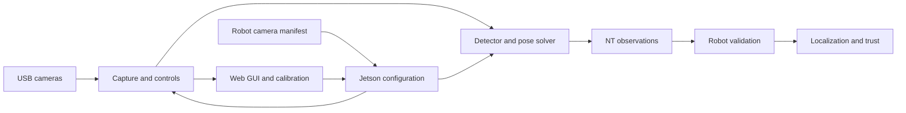
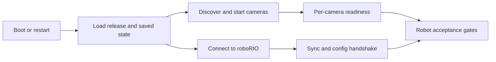
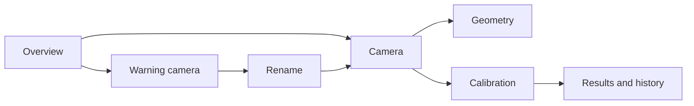

# Spot beta: real-robot integration plan

Historical October 4–7, 2026 planning record. Use the [documentation index](README.md)
for current code and operating instructions. The old local GUI mockup assets and
design-agent setup workflow have been retired; the interaction requirements below
remain a record of the original design.

**Review draft — October 4, 2026**

**Updated October 7, 2026:** explicit startup, boot-time, Ethernet/power recovery and roboRIO–Jetson timestamp-sync requirements; approved Penpot revision 3 UI/UX, detailed control behavior and design-to-code handoff added.

**Goal:** deploy Spot on the 2026 offseason robot, with reusable support for every Team 581 2026 robot. Students should configure camera names and mounts in robot code, name physical cameras through the GUI to match those definitions, calibrate them, and receive reliable vision measurements through the existing localization system.

This is an implementation specification for review. Proposed thresholds and behavior changes are called out so the team can edit them before handing this plan to an implementation agent.

## 1. Starting point and scope

Reviewed Spot at `61e0c50` and `offseason-2026` at `dd2544af`, including local working files. The Spot checkout's Git remote currently points to `team581/buddy-2026`; resolve naming in documentation without assuming a repository rename is required.

Keep the working Python service and C++/CUDA detector. Reuse capture, scheduling, pose solving, calibration math, frame sharing, replay tools, and regression fixtures. Beta does not need a language rewrite or a new detector.

The October 4 alpha report records 349 passing Python cases, eight passing JavaScript tests, CPU/CUDA image verification, and successful four-camera live operation. These are existing recorded results, not tests rerun for this plan. Real robot timing, measured physical accuracy, sustained operation, and failure recovery still need beta acceptance tests. The older project-status document is stale relative to that report.

Beta includes:

- Any configured camera count within the tested Jetson/USB resource budget; four cameras are the initial acceptance configuration.
- Plug-and-play discovery and capability-based setup, including the team's Swyft camera hardware, currently described as “Swift”/“Generic USB Camera” in alpha notes.
- Persistent camera assignment, calibration, operating settings, and robot configuration cache.
- Production GUI, offline student documentation, and accurate running/deployment information.
- Shared Java integration, chronological pose-estimator ingestion, robot-owned measurement quality, and compact DogLog reporting.
- Consistent automatic startup, minimized measured boot time, and defined Ethernet/power unplug/replug behavior.
- Reliable NT4 timestamp synchronization across startup, reconnects and independent roboRIO/Jetson restarts.
- Shadow rollout, fusion flags, and documented rollback.

Existing Limelight targeting, hub-tag behavior, and ground-camera cluster maps remain usable during migration. AprilTag localization and game-specific targeting are separate capabilities; a generic pose adapter must not pretend to replace cluster-map functionality. Moving camera mounts are supported by the interface and implemented/tested if a beta camera is actually mounted on the turret. Fixed mounts are the initial deployment default.

## 2. Module boundaries



**Jetson modules**

- `devices`: discover physical devices, group video nodes, expose identity and capabilities, watch disconnect/reconnect.
- `configuration`: validate complete robot manifests, resolve ownership, cache profiles, apply changes transactionally, publish acknowledgements.
- `persistence`: versioned state, camera bindings, calibration generations, operating settings, migrations, backup/export.
- `capture` / `camera_controls`: one capture owner per device, negotiated modes, verified controls, bounded reads and recovery.
- `scheduler` / `native` / `pose`: fair bounded processing, existing detector boundary, calibrated field-to-camera candidates.
- `transport` / `clock`: versioned observations, clock validity, independent health heartbeat.
- `calibration`: shared-frame sessions, background solves, quality reports, atomic save/apply.
- `web`: HTTP API, stream encoding, GUI assets, packaged documentation. No camera opens, pose solving, or direct state-file writes in request handlers.
- `health` / `deployment`: runtime readiness, faults, active build manifest and lifecycle.

These are responsibilities, not a requirement to build a framework or split every function into a package. Move reusable alpha code out of `tools/` into the installed package; retain tools as thin development clients. Headless operation remains available. GUI failure or a disconnected browser must not stop vision.

The installed service must also start with no assigned/enabled cameras, serving discovery, health and Docs. Isolate per-camera initialization errors. Use bounded per-camera result buffering or an equivalent fair output policy so a fast camera cannot evict every result from a slower one. Preview and calibration consumers receive safe shared-frame snapshots and never mutate buffers still owned by detection. Install one compatible OpenCV contrib distribution for ChArUco rather than conflicting standard/contrib wheels; verify CUDA distortion-model compatibility before applying a calibration.

**Robot modules, under `shared/src/main/java/com/team581/vision/`**

- `VisionCamera` / `VisionIO`: queued observations and health from Spot, Limelight, simulation, or recorded fixtures.
- `SpotVisionIO`: NT subscriptions, protobuf decoding, configuration publication and acknowledgements.
- `VisionProcessor`: validation, capture-time mount transform, single-tag candidate selection, uncertainty, rejection reasons.
- `VisionMeasurement`: owned pose/timestamp/deviation data with source identity. Queued measurements must not reference mutable `TagResult` or reused deviation vectors.
- `VisionDiagnostics`: standardized DogLog paths and active faults.

`offseason-bot` provides its robot profile and wires accepted measurements into `Localization`. Other robot projects reuse the shared implementation and supply different profiles. Limelight-specific settings stay inside its adapter.

## 3. Settings as code, with persistent memory

Separate a **logical camera role**, such as `front-left`, from a **physical camera**. `/dev/videoN`, product names, and GUI tile order are not role identities.

| Setting | Authority | Persistence and GUI behavior |
| --- | --- | --- |
| Robot ID/profile, camera roles, required/optional cameras | Robot code | Jetson caches the last accepted complete profile; GUI uses compact locked controls where required, with Reset to code defaults where allowed |
| Mount transform, image orientation, field layout and origin | Robot code | Cached for GUI visualization; robot applies mount transforms for fusion |
| Required capture mode or allowed operating modes; required controls | Robot code | Jetson negotiates only within declared constraints |
| Physical device assigned to a role | Jetson GUI | Stored by robot profile; independent of USB enumeration order |
| Intrinsics, lens model, calibration report/history | Jetson calibration | Bound to physical camera, optical setup and capture geometry |
| Exposure/gain and other allowed tuning | Robot defaults plus explicit policy | Persistent GUI values apply only where robot code allows overrides; pinned code values win |
| Fusion flags, validation thresholds, uncertainty and trust policy | Robot code | Logged and versioned; GUI displays the robot's reported values |
| Layout/overlay preferences | Browser | Local browser storage only |

The student API explicitly distinguishes a default from a pinned value. Do not create an unexplained global “GUI beats code” precedence rule. Show requested, saved and actually applied settings, including control readback and clipping/rejection reasons. Provide **Reset to code defaults** and **Copy settings as code** for allowed tuning. Calibration files and physical selectors do not belong in Java source.

**Manifest handshake:** the robot publishes one complete versioned profile containing `robotId`, a new robot-session ID, role definitions, field layout, and a hash of its content. The Jetson validates it, stages the configuration, commits the accepted snapshot to disk, applies it, and acknowledges the robot hash/session plus its effective runtime generation. Each frame identifies the exact manifest, binding, calibration and runtime generation used. Never acknowledge success before application completes.

The robot accepts runtime generations from coherent acknowledgement metadata for its current profile/session, subject to its calibration/mode requirements; it does not need to predict a GUI-generated calibration hash. Changes to assignments, intrinsics, orientation, mode or field configuration invalidate queued frames from the previous generation.

Fresh code is authoritative even if its content hash matches an older cached profile. Jetson restart can use cached settings for previews and calibration without a robot. Robot fusion requires a fresh session handshake and verified time synchronization. Network loss does not erase settings. A new robot profile must not inherit another robot's role bindings silently; device calibration may be reused only when physical identity and optical mode match.

Store writable state under `/var/lib/spot-vision/`, outside release/source directories. Use schema versions, immutable generation files, an atomically replaced active manifest, last-known-good backup, and directory/file durability appropriate to sudden power loss. Export/import a support bundle. A corrupt cache allows discovery and documentation with a clear fault; it does not create zero mount transforms or provisional production poses. Deployment must preserve this state.

Configuration mutations happen while the robot is disabled, or during an explicit standalone setup session with no robot connected. Losing NT while enabled must not automatically unlock setup: require a confirmed disabled state or an explicit standalone-session transition after the connection is known lost. Reject writes server-side when state is unknown. Recheck eligibility at commit time. Read-only viewing stays available while enabled.

## 4. Plug-and-play cameras and persistent naming

On connection, enumerate UVC/V4L2 capabilities, capture nodes, USB topology, vendor/product identifiers, serial if available, supported pixel formats/modes and controls. Group metadata/alternate nodes belonging to the same physical camera. Give unassigned devices short persistent display IDs, such as `USB-A3`, and previews through the same device manager used by the runtime.

GUI naming workflow (the persistent device binding is an internal assignment):

1. Plug in a camera; its preview and persistent short name appear directly in the Cameras sidebar with a warning if its name is not configured in robot code.
2. Open that camera. The **Camera name** panel offers available names from the current robot manifest, or clearly marked cached names if the robot is offline.
3. Select the matching code-defined name and preview-confirm the physical camera. Use **Rename**, not Assign. Display the corresponding code-provided mount/orientation and calibration state on the camera's pages.
4. Complete one acknowledged rename; the binding survives service restart and Jetson power cycle. Preserve compatible physical-camera calibration. Renaming does not create a definition in robot code.

Use unique physical serial identity when trustworthy. Duplicate/missing serials require persistent USB-port bindings and visible identification by preview. Never match identical cameras by discovery order or assign a new device merely because it is the only unfilled role. A unique-serial device can follow its role across ports; an indistinguishable device moved between port bindings requires reassignment.

A replacement with different observable identity invalidates the prior device calibration. Identical cameras with duplicate serials may be indistinguishable on the same port: software cannot prove a replacement occurred. Provide **Replace camera** to clear the old calibration association, and document that required operator step. Do not claim fully automatic replacement detection without hardware identity support.

**Capability-based operation:** use a generic UVC path first. Any hardware quirks belong in small tested profiles selected by actual identifiers/capabilities, not a hard-coded Arducam/Swyft branch in the service. Menus, units, ranges and read-only/inactive flags come from the device. Optional unsupported controls are unavailable in the GUI; required unsupported controls block production readiness with one clear reason. Verify control writes by readback.

Probe modes with bounded timeouts and verify actual dimensions, format and delivered cadence. Advertised modes are candidates, not proof they work. Alpha notes record that the generic camera's advertised high-resolution modes timed out, while 640×480 worked and its exposure minimum differed from the Arducams.

A new device can automatically choose a working preview mode. Production may automatically select only an allowed mode with matching validated calibration. Never quietly resize a calibrated pipeline or reuse intrinsics after crop, lens/focus, resolution, or relevant sensor-mode changes. Record timestamp quality and actual FPS when the driver supplies less than requested. Excessive USB contention must appear as a system problem, not be hidden by infinite retries.

Internal health distinguishes **Missing**, **Unassigned**, **Calibration needed**, **Configuration mismatch**, **Ready**, **No tags**, **Recovering** and **Disabled**. Required missing/unready roles fault on the robot; extra unassigned devices produce a setup notice, not a persistent match error. “No tags” is normal operation. These are backend state names; Section 8 defines concise GUI presentation and replaces user-facing Unassigned/Ready labels.

## 5. Observation contract and time

Keep protobuf as the atomic robot-consumption boundary. The robot must not reconstruct a measurement from separately updated pose, valid, tag-count and error topics. Typed pose topics remain useful for visualization, but the alpha's lowest-reprojection-error display choice is not the robot's candidate-selection policy.

Version the beta contract explicitly; use a distinct v2 topic/type during transition. Generate Python and Java from one authoritative schema, with checked-in generation instructions and cross-language fixtures. Package the schema with each release.

Each observation includes:

- Schema, robot/profile session, service session, camera capture epoch, connection/time-sync epoch and frame sequence.
- Logical role and physical binding identity/generation.
- Robot-manifest hash, applied field hash, calibration hash/status and effective runtime generation.
- Field-to-camera pose candidate(s), solve method, used tag IDs and reprojection errors with an explicit definition.
- Camera-to-tag distance and compact observable geometry, such as image tag spread/area, needed by the selected uncertainty policy.
- Timestamp source/quality and processing timing.

Keep IDs, corner/detector diagnostics and existing distortion displacement available for inspection and recorded troubleshooting. Do not automatically make every detector diagnostic a quality gate. Send no-tag frames with empty candidates and progressing sequence. Missing/calibration-invalid cameras can preview and publish diagnostics but cannot supply production-valid candidates. Enforce payload/candidate/tag-count limits.

**Time contract:** the roboRIO is the NT4 server in robot mode; the Jetson is its client. Publish with an explicit timestamp in the Jetson's local NT clock domain and let NT perform client-to-server conversion. Consume the verified server/FPGA-domain capture timestamp in seconds on the roboRIO, then call `Utils.fpgaToCurrentTime()` exactly once at the CTRE boundary. Do not add the NT clock offset twice. WPILib documents these local/server domains and the roboRIO server's FPGA epoch. [WPILib timestamps](https://docs.wpilib.org/en/stable/docs/software/networktables/networktables-intro.html#timestamps)

`ntcore._now()` is local NT time; its availability does not establish synchronization. Gate on actual connection/time-sync validity and invalidate observations across clock jumps and robot reboot. Java `TimestampedRaw` exposes local `timestamp` and `serverTime`; the adapter must handle documented local-value sentinel cases and prove the selected field on the real server, rather than assume two similarly named fields are interchangeable. [TimestampedRaw API](https://github.wpilib.org/allwpilib/docs/release/java/edu/wpi/first/networktables/TimestampedRaw.html)

**Synchronization readiness:** use NT4's built-in time synchronization rather than introduce a second clock-sync protocol. On the Jetson's publishing NT instance, require an actual connection to the expected roboRIO and an available server-time offset for that connection. NTCore's `getServerTimeOffset()` (or the installed RobotPy equivalent) supplies an offset only after client/server synchronization messages have been exchanged; time-sync events report subsequent updates. Track those updates and the connection generation. A valid offset is necessary, but does not by itself prove the required timing accuracy. [NTCore time-sync API](https://github.wpilib.org/allwpilib/docs/release/java/edu/wpi/first/networktables/NetworkTableInstance.html#getServerTimeOffset())

Startup, Ethernet reconnection, either computer's reboot, or an unexpected clock/offset discontinuity returns synchronization to **Waiting**. Discard queued observations from the prior connection/time-sync epoch and require a fresh configuration acknowledgement and newly captured frames after synchronization is re-established. Keep capture, previews and local diagnostics available while robot observations are withheld. Never publish robot-consumable frames using a monotonic fallback clock when NT synchronization is unavailable. Large offsets between unrelated boot epochs are normal; judge unexpected offset changes and timestamp consistency, not absolute offset magnitude.

Expose **Waiting / Synchronized / Invalid**, current offset, last synchronization-update age, sync epoch and discontinuity count in system diagnostics, with compact DogLog state changes. Define sync-update expiry and discontinuity thresholds against the installed NTCore update cadence and measured timing budget; test the chosen values under network load. Verify local NT → server/FPGA → CTRE conversion and capture-time bias separately. Changing Linux wall time or having no internet/NTP must not change fusion time. Resume only when post-reconnect timestamps are fresh, plausible and within the measured clock-error budget; never repair invalid timestamps by clamping them to now.

Current capture timestamps are taken after `capture.read()`, not verified exposure timestamps, and reconnect resets its sequence counter. Beta introduces explicit capture epochs. Prefer verified driver timestamps, preserving their clock and start/end-of-exposure semantics; otherwise characterize read-completion bias and jitter and report that source. A measured per-camera correction is acceptable; a guessed global latency correction is not. Timing uncertainty contributes to motion uncertainty or blocks fusion when excessive.

Publish service/camera heartbeat independently of observation production, at approximately 5 Hz. Report capture, detector and publisher progression separately so a live HTTP process cannot make a frozen pipeline look healthy. Health/status traffic uses modest rates; observation traffic is explicitly queued/bounded with `sendAll` and suitable subscriber capacity. An acknowledgement of robot consumption is telemetry, not processing backpressure.

## 6. Robot validation, fusion and trust

Keep the student integration small: one camera configuration table, one shared vision object, and one localization ingestion call. Intended API shape, with names finalized during implementation:

```java
var vision = SpotVision.create(RobotVisionConfig.OFFSEASON);
// In the normal robot/localization loop:
vision.drainMeasurements(localization::addVisionMeasurement);
```

Each camera configuration declares a name, a WPILib `Transform3d`, required/optional status, operating policy and optional device hints. No per-camera heartbeat timers, NT topic strings, protobuf handling or repeated fallback code in student configuration. Provide a complete compiling example, not only this sketch. Use WPILib +X forward, +Y left, +Z up and explicit angle units; do not carry a `right` field into WPILib transforms without conversion.

**Measurement processing:**

1. Decode bounded packets; require supported schema, known role, current session/configuration, validated calibration and correct field origin/hash.
2. Require fresh, synchronized capture time within explicit history bounds. Reject unreasonable future timestamps instead of clamping them to now.
3. Deduplicate by service session/capture epoch/sequence. Clear appropriate state on reconnect/reset; never replay an old retained sample as new.
4. Validate finite positions, normalized valid rotations, plausible geometry, positive-depth solver results, known tags and acceptable residuals.
5. Apply the role's robot-to-camera transform at capture time. Fixed mounts use the code transform; moving mounts use timestamped joint history. Missing history is a rejection, not substitution of the current angle.
6. Check robot field bounds and physically reasonable Z/roll/pitch, accounting for the robot's actual terrain and tilt. Avoid a blanket flat-floor assumption on a robot that traverses bumps.
7. Resolve single-tag IPPE alternatives only when capture-time heading/geometry distinguishes them by a documented margin. Reject undecidable candidates. Disabling heading fusion does not make an ambiguous translation safe.
8. Compute conservative standard deviations and evaluate capture-time innovation against pre-update estimator state. Separate normal tracking from explicit initialization/relocalization.
9. Deliver accepted observations in capture-time order and update diagnostic/trust inputs with the same accepted observations and pre-fusion comparisons.

Collect and sort across all cameras and across loop boundaries using a small bounded reorder window. Release by a time watermark/deadline, without waiting for an offline camera; reject and count observations older than the last fused watermark. Initial window: 20 ms, subject to measured delivery jitter. Do not confuse per-camera transport order with globally ordered fusion. Bound memory and per-loop work; count loss when overloaded. Clear queues/history eligibility around pose resets so pre-reset frames cannot pull the robot back.

CTRE accepts per-measurement X/Y standard deviations in metres and heading in radians, and requires its own time epoch. Its documentation confirms the existing FPGA conversion boundary. [CTRE vision API](https://api.ctr-electronics.com/phoenix6/stable/java/com/ctre/phoenix6/swerve/SwerveDrivetrain.html#addVisionMeasurement(edu.wpi.first.math.geometry.Pose2d,double,edu.wpi.first.math.Matrix))

**Uncertainty policy:** begin with translation-only fusion and retain gyro heading. A valid multi-tag solution does not automatically justify trusting its yaw. Enable independent vision heading only after ground-truth evidence and separate team review. Single-tag acceptance still requires decisive candidate selection.

Implement a robot-owned tunable model with positive floors, camera-specific coefficients, range, geometric conditioning, residuals and measured motion/timestamp uncertainty. Validate the model against held-out measured robot trials. A simple range-squared baseline with conservative tag-count benefit is sufficient initially; near-identical views and extra corners do not create independent measurements. Cap any tag-count improvement and account conservatively for simultaneous cameras viewing the same tags. Document the approximation because CTRE's three-axis deviations do not represent full cross-camera covariance.

Do not copy Limelight ambiguity numbers or rejection thresholds. Retaining two physically valid IPPE solutions is objectively useful; an invented Limelight-compatible scalar is not required. Raw-to-undistorted pixel displacement measures lens correction, not residual lens error. Keep it diagnostic unless field data supports an uncertainty penalty. The current Spot `distance² / tagCount²` formula is an experimental reference, not established confidence math. Prevent zero deviations and verify the CTRE-compatible way to suppress heading updates rather than assume infinity behaves safely.

**TrustFactor review:** preserve the public `get/isLost/isTrustworthy` API used by robot behavior, but treat its value as a heuristic, not a probability or estimator covariance. Proposed revision: update from each accepted measurement's pre-fusion capture-time innovation and its uncertainty; group correlated evidence so additional cameras do not automatically make the score better; track last accepted evidence and degradation from actual odometry travel, elapsed time and collision events. Pose-estimator corrections must not be counted as physical travel. Log evidence age separately. Rejections never improve trust. Reset explicitly establishes a new history baseline. Fit/review thresholds before enabling the revised score in aiming/readiness decisions.

## 7. Fallback ownership

| Failure | Jetson owns | Robot owns |
| --- | --- | --- |
| Camera disconnect, read timeout or bad frames | Per-device bounded retries/backoff; restore binding and verified settings; new capture epoch | Stop using stale observations from that role; continue remaining sources |
| Unsupported controls/mode or bad calibration | Report exact setup problem; preview/diagnostics where possible; no production-valid pose | Require current matching metadata; reject that role's measurements |
| CUDA recoverable failure | Validated, explicit CPU fallback when configured; report backend and degraded capacity | Accept only fresh quality-valid results; no second detector fallback |
| Native fatal error or dead worker | Watchdog/systemd recovery with restart limits; readiness requires worker progress | Mark Spot unavailable and continue healthy sources/odometry |
| CPU fallback overload or thermal throttling | Bounded queues and configured processing-rate reduction; preserve camera fairness | Reject excessive-age measurements; log degraded availability |
| NT disconnect/time-sync loss | Continue capture/setup, cache settings; reconnect; no backlog replay | Suspend Spot fusion until fresh synchronized handshake and frames |
| Ambiguous/physically implausible pose | Publish valid solver alternatives/diagnostics | Select or reject once, using timestamped robot context |
| GUI/stream failure | Isolate preview work and reconnect browser; keep vision running | No control-loop dependency on GUI |
| All vision unavailable | Report health | Continue odometry/gyro; degrade trust and dependent readiness normally |

A single missing camera or recoverable exception must not take down others, including failures during startup. Guard known native-invalid settings before calling C++; retain the alpha decimation protection. For an unrecoverable shared native crash, one supervised service restart is the baseline; do not add robot-driven restart loops. The watchdog must detect dead capture/detector/output workers, not merely ping from a live main thread.

Recoverable detector failures use one explicit state transition into CPU mode, with bounded GPU retry/recovery and a recorded backend generation; do not reconstruct a detector and emit a fault on every frame. Thermal/overload rate reduction may change processing cadence, but optical mode changes still require matching calibration and a new runtime generation.

Other healthy cameras and existing Limelights remain independent sources. Do not automatically turn every Spot rejection into a paired Limelight measurement or fuse the same exposure twice. If a paired primary/backup policy is later needed, define it once at robot source selection with recovery hysteresis. No stale-pose reuse, fake origin pose, or automatic estimator reset when vision disappears.

### 7.1 Consistent startup and minimized boot time

Power-on, application restart and recovery use the same installed service and readiness rules, without SSH, a browser, manual launch or internet access. Start correctly whether the Jetson or roboRIO comes first, whether Ethernet is absent, and whether cameras enumerate late. Do not block local capture, discovery, health or Docs on network-online waits, a reachable roboRIO, visible tags, or every configured camera being present. Resolve network connectivity asynchronously. Maintain one service instance and one capture owner per physical camera.



Use explicit startup stages and per-camera readiness. A camera is ready when its identity/binding, mode, controls, calibration and processing progression are verified; tag visibility is not required. Robot fusion additionally requires the current profile/session and synchronized timestamps. Missing optional cameras do not delay healthy ones. Missing required cameras report degraded system readiness while healthy roles remain available under the existing fusion policy. Repeated startup with unchanged hardware/configuration must produce the same bindings, applied settings and readiness decisions.

Minimize the critical path: install/build dependencies and native modules during deployment, keep model/layout/calibration assets local, overlap independent initialization where safe, and avoid fixed sleeps, unnecessary device reprobes, repeated control writes or heavyweight preview work before processing starts. Use bounded readiness checks and retry backoff. Do not weaken calibration/configuration/sync gates to meet a boot target.

Measure OS boot, service start, state load, camera enumeration, first processed frame, NT connection, synchronization, configuration acknowledgement and robot-side vision availability using monotonic durations. Report the bottleneck, p50/p95 and worst case for cold boots and warm service restarts separately. No-tag operation counts as vision availability once valid empty observations progress; first accepted pose depends on tag visibility and is a separate metric. Initial targets and repeated-cycle tests are in Section 13.

### 7.2 Defined Ethernet and power unplug/replug behavior

| Event | Required behavior while unavailable | Required behavior after restoration |
| --- | --- | --- |
| Ethernet unplugged; Jetson remains powered | Keep camera processing/previews and saved settings; mark robot link/sync unavailable, withhold robot observations, and discard unsent measurement backlog. Robot expires Spot measurements and continues other vision/odometry | Reconnect automatically without service restart; establish a new connection/time-sync epoch, refresh the profile handshake even if the robot session is unchanged, and deliver only fresh post-sync frames |
| Jetson power removed | Robot detects stalled Spot health and expires measurements; odometry/gyro and other sources continue. Incomplete settings/calibration writes cannot become the active committed generation | Jetson boots automatically into the installed release, restores the last complete committed state, creates a new service session, verifies devices/settings and syncs before robot use |
| roboRIO power removed or robot program restarted while Jetson stays on | Jetson keeps local operation but suspends robot observations and invalidates the previous robot connection/sync state | Accept the new robot session and FPGA epoch, reapply/acknowledge its current profile, clear old measurement queues and use newly synchronized frames |
| Both computers lose power, or Ethernet and power return in any order | Saved settings remain intact; no assumption about which device starts first | Each component retries its own dependency asynchronously and converges to the same ready/degraded state; no manual ordering or estimator reset is required |
| Camera/USB-hub power interrupted independently | Existing per-device recovery applies; unaffected cameras continue, and frames from the old capture epoch become ineligible | Rediscover the same persistent bindings, verify mode/control/calibration compatibility, create new capture epochs and recover only verified roles |

Short cable interruptions, extended outages and repeated flapping follow these same rules. Recovery may run while the robot is enabled using its already authorized profile; this does not unlock GUI configuration changes. In-progress local edits or unacknowledged live-control requests may be lost after power removal, but the last committed settings must survive; camera tuning has no saved-draft feature. The plan guarantees application-state recovery on a healthy filesystem; test sudden-power-loss boot reliability and report hardware/filesystem failures explicitly. Reconnect events never silently reseed the estimator or clear accumulated trust degradation. Active faults clear only after verified pipeline/connection recovery.

## 8. Production GUI and approved UI/UX

The original visual reference was **Spot Beta — GUI Reference**, revision 3, October 7, 2026, page **GUI reference · Beta**: [open Penpot](https://design.penpot.app/#/workspace?team-id=3e981c57-46d6-803d-8008-be904f2a7c48&file-id=fd558256-f8c8-8184-8008-c139acc14eb0&page-id=fd558256-f8c8-8184-8008-c139acc14eb1). The local editable mockups and manifests have since been removed. The [October 8 verification report](beta-verification/Software%20Verification.md) retains the dated visual review and captured evidence.

This section replaces the earlier GUI proposal. Follow the approved composition, terminology and interactions; preserve the configuration, timing, calibration and robot-safety contracts elsewhere in this plan. Penpot is a visual reference with illustrative data and navigation hotspots, not evidence that controls or backend behavior already work. Never copy its sample modes, ranges, mounts, network values, release hashes, rates or calibration results into production defaults.

### 8.1 Application shell, navigation and visual language

- Persistent left sidebar, in this order: **Overview**, **Cameras** and individual camera entries, **Calibration**, **Network**, **System**, **Docs**. Network and System are separate pages. Individual cameras are navigation entries even when unnamed, uncalibrated or disconnected; there is no separate Unassigned page/group.
- Add a consistent outline icon to each main navigation entry. Individual cameras have text names without decorative camera icons. Show a warning symbol beside a camera needing a code-defined name or calibration. Tooltip and accessible description identify the reason; multiple warnings must remain distinguishable. Preserve entries for configured missing cameras and show missing state rather than dropping them from navigation.
- Selected navigation uses a burgundy rounded background and white foreground. Use the actual [Blazing Bulldogs vector logo](https://logos.frc.sh/logos/581.svg), preserving its proportions/colors, with the Spot name. Package the SVG locally; do not fetch it during offline operation. Remove the old square containing 581.
- No GUI-wide top bar, top-right Docs button, Offseason label, Robot disabled pill or Overview quick-status strip. Page titles and page-specific tabs remain. Mutation eligibility/locks appear beside affected controls; connection, clock and deployment diagnostics live in Network/System. Removing a global pill does not remove server-side mutation eligibility checks.
- Use **Source Sans Pro** throughout, packaged locally for offline use. Use Fetch's restrained visual language: neutral backgrounds, white/light or dark surfaces, burgundy selection/primary actions, thin borders, modest rounding. No gradients, glow, decorative animation, marketing copy, welcome paragraphs or vague status cards. Copy should identify data, an action or a concrete fault; longer explanations belong in Docs or contextual help.
- The full reference boards are 1440×900: 216 px sidebar, content beginning at x=248, 32 px outer content gutter, 28 px page title, typically 18 px panel titles, 14–16 px body/control text, 12–13 px secondary data. Surfaces use roughly 8 px corners; controls roughly 5–6 px; main navigation 36 px rows. These are baseline measurements to inspect in Penpot, not a reason to absolutely position an entire app.
- The 1024×900 compact Camera board uses a 72 px icon sidebar, content at x=96, a 246 px Config panel and a 638 px feed. Use flexible grid/flex layouts and intrinsic sizing, retaining the left Config/feed relationship while space permits. Below that width, stack panels and provide a usable camera selector/navigation drawer. Avoid horizontal page overflow, clipped units and tiny controls. Do not hide required data or actions solely to imitate a screenshot.
- Use tabular numerals for changing telemetry and numeric controls. Keep unit suffixes visible. Keyboard navigation, visible focus, semantic buttons/inputs, accessible labels and meaningful text states are required. Icon glyphs can be visually small while their hit targets remain practical. Color cannot be the only indication of faults, selection or disabled state.

### 8.2 Light, dark and Auto theme

Default to **Auto** on a new browser. Auto follows `prefers-color-scheme` and reacts to OS preference changes without reloading. Persist Auto/Light/Dark in browser storage only; theme is not a robot or Jetson configuration setting. Apply the resolved theme at startup without a visible wrong-theme flash where feasible.

Use an icon-only trigger near the bottom of the sidebar: monitor for Auto, sun for Light, moon for Dark. Its compact popup has those three icons with selected styling, tooltips and accessible names; no visible text labels are needed. Support keyboard opening, radio-style selection, focus return and Escape dismissal. Changing theme preserves the current route, camera, scroll position, unsent local number edit and preview pause state. The Penpot popup links to Overview as a demonstration; do not reproduce that navigation side effect.

Use semantic CSS tokens instead of ad hoc per-page colors. Baseline tokens:

| Purpose | Light | Dark |
| --- | --- | --- |
| App background | `#F4F5F7` | `#10151C` |
| Panel/sidebar surface | `#FFFFFF` | `#171E27` |
| Main text | `#202226` | `#E6EDF3` |
| Secondary text | `#66696E` | `#A2ADB9` |
| Border/divider | `#DEE3E8` | `#303947` |
| Selected navigation/primary action | `#591616` | `#8C3D46` |
| Soft accent surface | `#F6EEEE` | `#342229` |
| Positive data | `#226844` | `#79D6A5` |
| Warning data | `#825A16` | `#E5BA72` |
| Visualization blue | `#255A86` | `#88B9ED` |
| Unavailable history icon | `#BFC5CC` | `#505B69` |

Dark contextual accent text uses the lighter `#E9ABB3`; selected navigation/primary actions retain white foreground. The original light/dark palette used additional surface colors in the historical mockups. Preserve camera pixels and logo colors; theme only the surrounding UI and vector visualization. Verify text/control contrast, hover/focus and disabled states in both themes rather than blindly mapping every white pixel to a dark color.

### 8.3 Overview: glanceable camera tiles

Reference **01 Overview** and its dark counterpart. Use a two-column grid at the full desktop size; adapt the column count to available width. Each tile contains camera name, small calibration indication, feed and one prominent row of metrics. Clicking its main area opens that camera, with accessible keyboard activation.

- Show detection throughput, current-frame tag count and time since the latest frame as **18 FPS**, **2 tags**, **48 ms**. Number and unit/label use the same size and weight, approximately 23 px semibold in the reference; do not put FPS/ms/tags in tiny labels or split them onto a second line. Define FPS as usable detector/solver output cadence, not browser stream cadence. Capture FPS belongs in deeper pipeline diagnostics. Use compact seconds when appropriate, e.g. **2.4 s**.
- Use **— FPS** and **— tags** for unavailable metrics, not zero masquerading as data. Zero tags on a current processed frame is normal, not a fault. Bind metrics/overlays to coherent frame data; keep last-frame age advancing during disconnect or stall.
- Calibration success is a tiny nonintrusive **✓ calibrated** marker, approximately 12 px. It means an active calibration compatible with this physical camera and optical mode. An incompatible/missing calibration produces a warning with a concrete reason. Connectivity and calibration are separate: a disconnected camera can still have a valid saved calibration.
- No Ready badges, LIVE feed overlays, global quick-status cards or duplicate counters. Missing/disconnected cameras keep a placeholder and name, with **Disconnected** and last-frame age. Stale/frozen frames are explicitly marked and stale detection overlays are removed. A retained last image must not appear current.

### 8.4 Camera page: live Config, feed, detections and 3D

Reference **02 Camera detail**, **08 Compact camera** and dark counterparts. Page title is the camera name; **Camera / Geometry** tabs sit below it. Config is on the **left** of the feed. At full width the reference has a 292 px Config panel and an 840 px feed region. Below the feed place a compact **Detections** table and a small 3D view. Remove the earlier three generic summary boxes and explanatory prose.

**Config** is the panel title, replacing Operating settings. Place exposure, gain and brightness first when supported, with live sliders and adjacent readable numeric readouts. Range, step, units, availability and readback come from device capabilities and robot policy. Capture resolution/rate are compact selectors; advanced supported controls expand on demand. Do not show fabricated universal controls or ranges. Make unsupported/pinned settings unavailable with a concise reason/lock indication. Retain **Reset to code defaults** where meaningful; put **Copy settings as code** in Advanced rather than adding another prominent Overview action.

Tuning has **no Save draft or Apply button**. Validate and send eligible changes at a bounded rate during slider manipulation; guarantee delivery of the final value when a gesture finishes. Track the local requested value, pending request and actual device readback separately. Show concise applied/readback data and inline clipping/rejection feedback. Persist acknowledged values automatically through the configuration service. Never indicate applied/saved success from optimistic browser state alone. Rejected requests preserve the previous acknowledged setting; the field shows the attempted value and actionable reason where appropriate. Capability changes during a drag require reconciliation.

Use **Show detection outlines** for the image overlay toggle: tag boundaries and IDs. Use **Pause image** for display-only freeze; processing and robot publication continue. A paused image shows paused state and the age/identity of the held frame. Resume uses a fresh image, not a backlog. Do not expose unexplained Tags, Corners, Axis or Freeze buttons; extra corner/axis diagnostics may live in Advanced with clear names. Hide overlays that do not belong to the shown frame.

The Detections table uses real IDs, range, reprojection error with units, and whether each tag was used. Show the robot's reported accepted/rejected state and fusion flag separately from Jetson solve/display selection. A valid Jetson pose is not proof of robot acceptance. With no robot, display unavailable robot decision, retaining useful local inspection. Candidate alternatives and detailed solver diagnostics can be expanded rather than filling the main page with cards.

Reuse the alpha orthographic 3D viewer's projection, orbit/zoom/reset, candidate colors and frame-validity handling from `tools/alpha_dashboard.html`. The small viewer shows robot/camera geometry and observed tags; it links to Geometry. Use actual accepted field layouts and manifest transforms, correctly label coordinate frames, and distinguish candidates/selected poses. Penpot wireframes are illustrations, not a new solver or measured mount source. Load heavier visualization lazily and keep preview/3D work within the throughput budget.

### 8.5 Geometry: compact number editing and mount visualization

Reference **09 Camera geometry** and its dark counterpart. Reach it from the selected camera's **Geometry** tab or its small 3D view. Retain the camera context and sidebar selection. There is no separate unexplained Geometry item in the global sidebar.

Use a compact left panel with **X, Y, Z** in meters and **Yaw, Pitch, Roll** in degrees, and **Reset to code defaults**. No position/angle sliders. At desktop size the reference has a 292×485 px panel, 42 px high number fields and a large adjacent viewer. The view is an isometric outline drivebase with a clear **Front** arrow and a camera body with a **Lens** direction arrow. Orbit/zoom/reset must work. Preview finite edits immediately in 3D and keep a concise transform readout. Calibration history is exclusively on Calibration.

Runtime transforms follow WPILib +X forward, +Y left, +Z up and the established rotation convention. Convert degree display to backend angle units explicitly, with known-transform tests; never infer angle order from drawing labels. Defaults come from robot code. The renderer must use actual camera transforms, not Penpot's sample coordinates. Geometry editing cannot silently change transform authority: if robot policy does not explicitly support overrides, production controls/history are locked and show the current code values. A permitted inspection-only preview must be labeled as such and cannot be presented as applied robot geometry.

**Number-field interaction contract:**

1. Keep a local string edit buffer (text input with decimal input mode), separate from parsed preview and acknowledged configuration. Normal click places the caret where clicked. **Never automatically select all on focus.** Do not remount the input on each update.
2. Preserve caret/selection and ordinary Backspace/Delete behavior, especially removal/replacement of final digits. Do not append zeros, normalize decimals, clamp or reformat on every input event. Background polling must not replace the focused edit buffer.
3. Accept intermediate empty text, a minus sign, trailing decimal and partial decimal while editing. A finite syntactically valid value updates the preview; incomplete or invalid text keeps the last valid visualization. Do not turn empty input into zero.
4. Enter or blur attempts one validated commit. Escape cancels the edit and restores the last acknowledged value. Invalid/out-of-range values retain their entered text with nearby feedback; do not silently fix them. Deduplicate Enter followed by blur. After acknowledgement, reconcile the committed value without moving an active caret unexpectedly.
5. Units are fixed suffixes outside the editable text. Subtle up/down steppers and ArrowUp/ArrowDown support deterministic adjustment. Initial UX steps: 0.01 m / 1°; Shift is coarse 0.1 m / 10°; Alt is fine 0.001 m / 0.1°. Validate against supported limits, document shortcuts and make keyboard/stepper changes follow the same acknowledged commit/history path. Wheel scrolling must not change numeric values accidentally.
6. Preserve native text undo/redo while editing. Toolbar history operates on acknowledged configuration changes, not partial keystrokes. Concurrency changes while focused are surfaced without discarding the buffer; a revision conflict requires reconciling current server values before committing or undoing.

### 8.6 Compact undo/redo and configuration state

Undo/redo are **borderless, icon-only buttons on the same row as the Config/Geometry panel heading**. The reference uses roughly 20 px icons spaced 32 px apart. No text labels or permanent outlines. Give them accessible names/tooltips and practical hit targets; use quiet hover treatment and a focus ring for keyboard users.

Grey and disable actions when their history stack is empty, the relevant operation is pending, policy pins the setting, or mutation eligibility is unavailable. The Camera reference shows Undo available and Redo unavailable; Geometry/locked compact references show both unavailable. These are sample states, not hard-coded initial availability. Tooltip/accessibility text explains why an action is unavailable.

A complete slider gesture is one history item; each acknowledged number-field commit is one item. Do not add entries for every drag sample or failed writes. Reset to code defaults is an acknowledged transaction that can participate in history when policy allows. Clear redo after a new acknowledged change. Undo/redo use the same server validation, revision, eligibility and acknowledgement path as ordinary edits; never update only the visible widget. History may be browser-session-local but must be reconciled/invalidate when another browser, a new manifest or a new runtime generation changes its base. Do not overwrite another client's configuration by replaying stale snapshots.

Mutations remain disabled-only or allowed in an explicit standalone setup session, rechecked on the server at commit. Unknown enabled/connection state does not unlock controls. Show **Robot enabled · locked**, no robot/cached configuration, pending, rejected and conflict states locally where they matter. Read-only viewing remains usable. Pending changes must not falsely enable history or imply durable persistence.

### 8.7 Cameras without a code-defined name

Reference **03 Camera name**. Do not use **role**, **assignment**, **Assign**, or **Unassigned** as GUI terminology. The user-facing action is changing the camera's **name** to match a camera configured in robot code. Internal stable bindings and logical identities remain unchanged in meaning.

An extra device appears directly in the sidebar under its persistent short name, e.g. USB-A5, with a warning. Its page shows a large identifying preview, a compact **Camera name** panel, **Not configured in code**, a **Name** picker and one primary **Rename** action. List available matching code-defined names; distinguish cached names if offline, reject duplicates and unavailable names. If none are available, say what is missing in robot code and provide a contextual Docs link. Do not invent production identities from arbitrary text or discovery order.

After acknowledged rename, preserve the physical-device calibration if still compatible, update the sidebar/route without losing camera identity, and show any remaining calibration warning. Rename binds this physical camera to the selected logical name; it does not create a robot camera definition or calibrate the camera. Retain preview confirmation, duplicate/missing serial handling, persistent USB-port bindings and the explicit Replace camera invalidation procedure from Section 4, with replacement tools kept out of the ordinary naming flow.

### 8.8 Calibration: compact alpha workflow with beta transactions

Reference **04 Calibration capture** and **05 Calibration results and history**. Follow alpha's **Board → Capture → Review → Save/apply** sequence with improved formatting. Reuse coverage particles, automatic diversity/duplicate rejection, board detection, responsive background solve and per-camera actions from `tools/calibration_ui.html`. Preserve beta's independent validation and atomic group apply in Section 9; do not copy alpha's sequential file saves/restart limitations.

Capture page uses a compact grid of selected camera cards and a narrow Board panel. Each card has name/selection, feed with registered coverage dots, concise view count/coverage/board-detection data, and Start/Pause, Capture and Calibrate actions. Allow one board to move between cameras; simultaneous visibility is not required. Global Pause all and Reset session are compact actions. Board controls include dictionary, square dimensions/count, marker size, lens model and minimum views; values come from validated persisted configuration. Clearly separate fitting captures and validation captures. Coverage percentage alone is not quality approval.

Results uses a compact table: camera, fit RMS, independent validation RMS, fit/validation view counts and pass/retry reason. **Apply selected** stays unavailable until the selected group passes validation and mutation eligibility. Offer explicit **Select passing** / retry to choose a smaller passing group; never silently drop failed members. During activation show pending generation and current active generation; **Applied** appears only after acknowledgement. Failure leaves the complete previous generation active.

History stays on this page and lists generation, camera group, optical mode, saved time and active state. **Restore** follows the same eligibility, compatibility and atomic activation rules as a new apply. If wall time is unavailable, retain identity/order and show unavailable time rather than inventing a date. Background activity and per-camera failure must not freeze other cards or navigation.

### 8.9 Network and System

**Network**, reference **06 Network**, is a small configuration/link page: configured/discovered robot endpoint, NT server, supported connection/discovery mode and Reset to code defaults where applicable. Show a few link facts: Ethernet/NT connection, actual local address, synchronization summary and reconnect count. Endpoint settings must respect robot authority and acknowledgement. Changing operating-system addresses from the GUI is outside beta scope. Detailed CPU/camera/USB/release diagnostics do not belong here.

**System**, reference **10 System**, owns compact diagnostic data: CPU/GPU/memory/temperature/uptime; per-camera capture and detection FPS, drop counters and frame age; running/deployed/source/native build identity; start/deployment time; startup stages and dependency wait; USB topology; faults; synchronization state/offset/update age/epoch/discontinuities; reconnect history. Use compact tables/panels rather than explanatory cards. Retain support-bundle export and bounded debug recording. Unknown telemetry is **—**/unavailable, not fabricated zero/green success. See Section 10 for accurate running-versus-deployed identity and unreliable wall time.

### 8.10 Docs: concrete, chronological and offline

Reference **07 Docs**. Take the grouped topic navigation, article column, **On this page** outline and previous/next pattern from [DogLog Docs](https://doglog.dev/getting-started/installation). The heading is **Docs**, never Student Docs or student-facing. Search and article navigation live inside Docs; the persistent sidebar keeps it reachable from every page, with contextual deep links where useful.

Getting started is chronological: **1. Connect to Spot → 2. Name cameras → 3. Set camera geometry → 4. Calibrate → 5. Verify detections**. Each topic states prerequisites, exact actions and observable results, using current GUI labels. For naming: plug camera into the powered hub, open its warning entry, identify the feed, choose the matching code-defined name, click Rename, confirm the sidebar name, then address the calibration warning. Explain how to configure missing names in robot code rather than suggesting Rename creates them.

Connection instructions must use the actual packaged installation/setup procedure. Include measuring mounts and coordinate frames, new/replacement cameras and duplicate serials, ChArUco dimensions/capture/quality/restore, control units/history/locks, Java integration with a compiling offseason example, robot rejection/fault meanings, logs, network/power recovery, deployment and rollback. Guides and Reference follow Getting started. Package one maintained documentation source with offline search and local assets; no internet dependency or second hand-edited guide. External reference links are supplemental, never necessary to complete setup.



### 8.11 Runtime, API and failure presentation

Use validated structured requests, session/CSRF control, same-origin checks and optimistic revision checking. Two browsers cannot silently overwrite each other. Bound live-control request rates, stream encoding/resolution/rate/client count and telemetry updates. Suspend unnecessary hidden-tab rendering/streams; on return fetch current state and fresh frames. GUI failure, a slow browser or a disconnected client must not stop detection. Do not expose an unauthenticated shell or arbitrary filesystem paths.

Use **11 States** and its dark counterpart as visual guidance: live requested/readback data, inline control rejection, no robot/cached geometry, stale image with overlays hidden, calibration awaiting acknowledgement, configuration conflict, missing calibration and unavailable wall time. Also cover empty discovery, unsupported capabilities, disconnect/recovery and service/stream reconnect. Keep meaningful data visible during a local failure and offer the specific next action. Backend Ready/Unassigned enums may remain in diagnostics/contracts, but do not render them as vague main-page badges or ordinary camera names.

## 9. Calibration save and apply

Reuse the team board defaults: 15×15 squares, 30 mm squares, 22 mm markers, `DICT_4X4_250`. Board configuration and distortion model remain explicit and persisted. Verify the real printed dimensions and image sharpness; a green coverage grid alone is not a passing calibration.

Keep automatic view diversity/duplicate rejection and outlier handling. Add an explicit separate validation capture set not used to fit intrinsics, plus physical pose checks in robot acceptance. Calibration is intrinsic/lens calibration; it does not determine robot mount position. Multi-camera capture does not require rigid inter-camera calibration for independently solved AprilTag poses.

Store physical device identity, optical-mode signature, board/model, fit and validation metrics, date, algorithm/build and content hash. Calibration compatibility depends on optical geometry, not just a logical name. Recalibrate after lens/focus/crop changes or an incompatible replacement; preserve earlier known-good generations.

**Save/apply is a transaction:** validate all selected results, write a complete staged generation, atomically activate its manifest, rebuild affected detector/solver state at a safe boundary, discard old-generation queued frames, and publish the applied generation. The GUI says **Applied** only after acknowledgement. If any selected camera fails, none of that selected group is activated; the operator may explicitly choose a smaller passing group. Solve, save, load and power-loss failures leave the previous complete active generation usable. Permit rollback while disabled.

The existing alpha implementation writes calibration files sequentially and its GUI saves one camera at a time. Individual atomic file replacement is not a group transaction. Its documentation also describes holdout validation that needs an explicit implementation/test in beta. Address these gaps rather than assume the documented behavior already exists.

## 10. Showing the last Jetson update

Every release has an immutable build manifest: source commit, source-tree/dirty-content fingerprint where applicable, application version, protobuf version, native detector build/hash and build time. Deployment records target, release ID, deployment time and verification outcome separately from compilation.

Startup loads the manifest from the actual installed release. Report running release/native build, deployment timestamp, process start time and rollback state through HTTP and NT; DogLog records them once/on change. Verify the native module loaded by the process, not just the checkout revision. A checkout can change without changing an installed package or running process.

Sidebar footer: **Updated Oct 4, 18:42 · abc1234**. System page distinguishes **Last successful deployment**, **Running release** and **Started**. Rollback displays the restored active release and the latest deployment attempt separately. If wall time is unreliable, show **Time unavailable** with release identity and monotonic uptime; do not fabricate a calendar time. Deploy readiness must allow realistic camera initialization time before declaring failure, reflecting the alpha's initial premature readiness rollback.

Update systemd for least-privilege writes to `/var/lib/spot-vision` while retaining read-only application/config assets. Test the real installed service and writable-state paths; the current unit makes `/etc/spot-vision` read-only. Provide a release activation/rollback procedure that preserves assignments/calibration and verifies installed Python/native artifacts, GUI, NT and required camera readiness.

## 11. Existing behavior requiring team review

These are specific code findings, not assumptions that Limelight behavior is inherently wrong. Preserve existing robot behavior behind flags until the edited plan authorizes changes to shared behavior.

| Finding | Risk / proposed treatment |
| --- | --- |
| `shared/.../localization/TrustFactor.java` weights by `std / totalStd`; the comment describes a different formula | Noisier observations get more weight. Fix the arithmetic under a reviewed model; inverse variance is appropriate only for independent, time-aligned data |
| Trust averages asynchronous camera poses and compares them with one average-timestamp pose | Motion and different latencies contaminate disagreement. Evaluate evidence at each capture time; do not average unaligned positions |
| Localization calls trust after estimator updates; travel uses changes in fused pose | Circular comparison can look artificially good; vision corrections can look like travel. Use pre-fusion residuals and actual odometry increments |
| Empty localization result lists still compute `0 / 0`, then sample pose at NaN | Add an early empty-list return; test no-vision operation |
| `Localization.getPose(timestamp)` substitutes current pose when history is unavailable | Unsafe for candidate selection and innovation. Use an explicit optional/history-availability boundary for vision |
| Fixed shooter/left/right ingestion order and one mutable result per camera | Intermediate frames are lost and ingestion is not chronological. Drain owned queued measurements |
| Global `StaticLatencyAdjustment` plus clamping timestamps to now | Can conceal clock mistakes. Spot uses measured capture timing and explicit rejection; audit any continued Limelight correction separately |
| Limelight validator rejects X=Y=0 and uses fixed ambiguity/angular-rate thresholds | Origin is a legitimate coordinate; explicit validity replaces sentinels. Retune rate/quality policy from Spot data instead of copying constants |
| Limelight MT1 is required before MT2; close-range path can combine MT2 translation/time with MT1 heading | Source/frame consistency and heading independence deserve review. Keep this policy inside the Limelight adapter; do not reproduce it for Spot |
| Existing camera config says `right`, but `getTransform3d()` uses that value directly as WPILib Y | Verify physical signs and handedness with measured fixtures before importing mounts |
| Offseason `Hardware.java` instantiates four OFF cameras named `placeholder` with zero mounts | These are not usable fallbacks or mount references. Use actual CAD/measurements and hardware inventory |
| Old Spot spec prescribes a native-daemon rewrite, extensive default logging and `tagCount²` confidence scaling | This beta plan supersedes those conflicting prescriptions; retain working modules and justify confidence experimentally |
| Alpha typed pose picks minimum image error for display; provisional calibration can still produce poses | Robot consumes candidate packets; production rejects provisional calibration |
| Alpha four-camera rates vary, result queues drop frames, and some short NT checks intermittently fail | Investigate output/preview bottlenecks and timestamp delivery; a retry passing is not production qualification |

**Review decisions to edit before enabling robot fusion:** approve the trust-policy revision; translation-only initial mode and later heading gate; fixed-camera scope versus actual turret installation; field-layout variant for the real test field; required camera roles/mounts/modes; correlated-camera policy; and the numerical beta targets below. Infrastructure implementation can proceed independently of tuning decisions, but fusion/readiness changes remain behind flags.

## 12. DogLog and faults

Centralize diagnostics in the shared adapter/processor. Use the installed DogLog API/version; do not upgrade dependencies solely to implement this plan. Existing code already supports `log`, `logFault` and `clearFault`; DogLog supports WPILOG and NT reporting. [DogLog usage](https://doglog.dev/getting-started/usage)

Default data:

- Startup/on change: running release, native build, robot profile/manifest, field, binding/calibration revisions and policy flags; startup-stage durations and connection/time-sync transitions.
- Every processed accepted measurement: source/session/frame identity, capture time, measured pose, used IDs, chosen deviations, pre-fusion residual and acceptance reason. Rejected-frame reasons use stable enums and counters; detailed rejected candidate records belong in debug capture.
- At 2–5 Hz: per-role health, last-frame/evidence age, capture/detection/accepted rates, latency and drop/rejection counters; system clock/backend/thermal summary.
- Trust: score, freshness, last accepted evidence, lost/trustworthy state and collision/reset events. Reuse existing estimated-pose logging.
- Fault transitions: required camera missing/unassigned/uncalibrated, config mismatch, stale pipeline, clock invalid, degraded detector and persistent overload. Clear automatically on verified recovery.

One owner raises each active fault; avoid duplicate Jetson and robot warning text for the same root problem. Jetson technical detail stays in its bounded structured logs/support bundle; robot DogLog records the actionable condition. No default corner arrays, image bytes, per-frame UVC controls, giant protobuf dumps or repeated stack traces. Provide a time-limited debug recording/export mode for detailed investigations.

## 13. Implementation order and acceptance

Implement in reviewable stages, each with targeted tests and a working installed artifact.

| Stage | Deliverable | Exit gate |
| --- | --- | --- |
| 1. Contract and fixtures | Profile ownership/schema, v2 protobuf, clock/session policy, Java API and golden packets | Python/Java agree on candidates, transforms, IDs, hashes and timestamps; numerical/frame semantics documented |
| 2. Device and persistent state | Discovery, role assignment, capability profiles, cached manifest, transactional generations and automatic startup | Swyft + Arducam startup/reconnect/reboot, duplicate identity and missing-role tests; measured cold/warm startup; no selector edits required for ordinary setup |
| 3. Production web/calibration | Installed GUI matching Penpot revision 3 in light/dark/Auto, API/docs and shared-frame multi-camera calibration | Section 14 visual/interaction checklist passes; GUI usable offline; concurrent-client conflicts handled; group apply/rollback and calibrated mode checks pass |
| 4. Shared robot integration | Spot IO/processor, Limelight adapter, owned queue, CTRE boundary and DogLog | Offseason tests plus all affected robot projects compile; malformed, stale, ambiguous, reset and reorder fixtures pass |
| 5. Robot shadow runs | Spot connected to real roboRIO; fusion disabled; robot-reported decisions visible in GUI | Ground-truth accuracy, timestamp conversion/sync recovery, load/thermal and Ethernet/power-cycle evidence meets targets |
| 6. Controlled fusion | One fixed camera, then multiple; reviewed trust policy and flags | Driving/no-tag/fault recovery tests pass; readiness behavior reviewed; rollback exercised |
| 7. Student handoff | Final documentation, support/deploy tools and second robot profile example | A student configures/names/calibrates a replacement camera and explains its robot integration without source spelunking |

**Proposed initial targets — engineering goals, not claims established by alpha:**

- Cold power-on to robot-side vision availability p95 ≤60 s with healthy preconnected cameras and an already available roboRIO; service restart to availability p95 ≤10 s. Local health/GUI responds within 5 s of service start even with no Ethernet or cameras. Test at least ten cold boots and ten warm restarts, recording worst case as well as p95. If the roboRIO/link arrives later, report dependency wait separately and enforce the reconnect target below. Establish a measured baseline first, then reduce the dominant delays; the team may edit these initial budgets after reviewing target-hardware results.
- Four enabled cameras each sustain at least 15 usable detections/solves per second when appropriate tags are visible, at approved camera modes; normal GUI viewing reduces each camera's throughput by no more than 10% versus its headless baseline. Calibrating may reduce throughput and is disabled-only; document that load separately.
- Capture-to-robot-consumption latency p95 ≤100 ms; production rejects frames older than 250 ms or outside verified estimator history. Future tolerance starts at 5 ms; apparent future times beyond it are rejected. Prove clock error ≤5 ms independently of the software's own reported offset.
- At fixed surveyed poses over the declared 1–5 m operating range: median planar error ≤0.10 m and p95 ≤0.20 m. Dynamic planar error p95 ≤0.25 m on surveyed repeatable paths. Evaluate each camera and combined estimator, tag geometries, tilt, lighting and robot speeds separately. Heading remains unfused until a separate accuracy target is reviewed.
- Detect a stalled required camera pipeline within 0.5 s; stale frames cease fusion at the age gate. Reconnect begins immediately with bounded backoff; under known-good hardware/settings, restore readiness within 5 s after device enumeration or NT reconnection/time sync.
- Thirty-minute four-camera thermal run with representative streams and motion: no uncontrolled memory/queue growth, no sustained starvation, no fatal failures and no timestamp discontinuities. Result/transport queue loss <1% under nominal load; intentional latest-frame overwrites are counted separately.
- Jetson/roboRIO independent reboot, USB unplug/replug, physical Ethernet unplug/replug, abrupt power loss/restoration, corrupt state, invalid calibration, profile mismatch, forced CPU fallback, unsupported modes, dead output worker and rollback all fail safely and recover as specified. No estimator reset, old-frame replay, fake origin or duplicate fusion. Test Ethernet outages of approximately 1 s, 30 s and 5 min; repeated link flapping; Jetson-first/roboRIO-first startup; Ethernet absent at boot; camera/hub power loss; and power removal during settings/calibration commit. Use a disabled robot for physical power-cycle qualification.
- Timestamp qualification covers initial startup, each reconnect/reboot ordering, CPU/GPU/network load and altered wall time. Verify synchronization is unavailable before the current connection's NT exchange, old-epoch frames cannot be accepted, and post-recovery error remains within the existing ≤5 ms clock budget. Record raw local/server/FPGA/CTRE timestamps and synchronization transitions in the qualification report; an NT connection or available offset alone is not a passing timing test.

These thresholds live in code/configuration with units and documented reasons. If hardware misses them, produce a measured bottleneck report and propose revised modes/budgets for team review. Do not silently lower gates or certify a 1 FPS liveness check as performance acceptance.

Tests must include cross-language serialized fixtures; known-transform geometry; independent clock tests on the actual roboRIO; deterministic startup state transitions; missing/delayed network and cameras; time-sync loss/expiry/discontinuity; Ethernet reconnect and independent power-cycle epochs; both IPPE alternatives; out-of-order arrivals across robot loops; packet bounds/unknown schemas; device reconnect epochs; reset histories; correlated observations; empty measurement lists; cache/session behavior; settings/calibration group power-loss recovery; web mutation eligibility; packaged assets; slow browsers; preview load; and installed artifact identity. Keep CUDA tests strict when certifying CUDA, so CPU fallback cannot hide a GPU failure.

Update `README.md`, the project-status document and the original design contract to point to this reviewed beta specification and remove contradictory operational claims. Keep the alpha test report as historical evidence.

## 14. Implementation-agent handoff

Use the team-edited version of this plan as the beta contract. Work in `spot-2026` and `offseason-2026`; put reusable robot code in `shared`, with offseason-specific wiring/configuration in `offseason-bot`. Preserve unrelated working changes. Do not copy competition mounts onto the offseason robot or replace OFF placeholder Limelights with invented hardware settings.

Start with protocol/configuration and acceptance fixtures, then device persistence, installed GUI/calibration, and shared robot integration. Preserve the tested alpha detector/pose pipeline and historical evidence. Maintain explicit review items and feature flags for trust/heading changes. Do not broaden this work into shooter, path-planning, drivetrain or ground-object rewrites.

For each stage, deliver changes in both relevant repositories, tests/results, schema/API docs, remaining hardware checks and rollback instructions. Software-only work may be complete before robot qualification; label unperformed hardware gates clearly. Do not mark beta robot-ready until the real offseason bot passes the required measurements and recovery tests.

Jetson validation uses the repository's dedicated SSH key and deployment procedure. Hardware deployment/fusion activation happens during the authorized implementation session with a disabled robot and measured mounts. This planning task performs no deployment or robot changes.

**Beta is complete when:** students can plug in supported cameras, name them to match code-defined cameras, calibrate multiple cameras, inspect streams/health, identify the running update, and obtain correctly timed, quality-controlled measurements in the offseason robot's estimator and reviewed trust system—with reusable configuration for the other 2026 robots.

### 14.1 Historical visual reference

The original implementation used [Spot Beta — GUI Reference, revision 3](https://design.penpot.app/#/workspace?team-id=3e981c57-46d6-803d-8008-be904f2a7c48&file-id=fd558256-f8c8-8184-8008-c139acc14eb0&page-id=fd558256-f8c8-8184-8008-c139acc14eb1),
October 7, 2026, file `fd558256-f8c8-8184-8008-c139acc14eb0`, page
`fd558256-f8c8-8184-8008-c139acc14eb1`. This external reference remains design history;
it is not a current agent setup or code-generation requirement. The local mockup
generator, portable exports, tokens, and native-board manifest have been removed.
Use the [dashboard development guide](../apps/dashboard/README.md) for the current
implementation and behavior checks, and the [dated visual review](beta-verification/Software%20Verification.md)
for the original comparison evidence.

| Implementation area | Original Penpot boards | Reuse and interpretation |
| --- | --- | --- |
| Shell and Overview | 01 Overview; Dark / 01 Overview | Inline metric typography, sidebar/logo/warnings; data from real camera state |
| Live camera tuning and inspection | 02 Camera detail; 08 Compact camera; dark equivalents | Reuse `tools/alpha_dashboard.html` controls/viewer concepts; replace draft tuning with acknowledged live mutations |
| Naming | 03 Camera name; dark equivalent | Preserve stable physical binding service; user action is Rename |
| Calibration | 04 Calibration capture; 05 Calibration results and history; dark equivalents | Reuse `tools/calibration_ui.html` capture/coverage behavior; implement Section 9's stronger validation/transaction guarantees |
| Network | 06 Network; dark equivalent | Config and a few link facts; actual endpoint values |
| Docs | 07 Docs; dark equivalent | Concrete ordered articles, local search and contextual links |
| Geometry | 09 Camera geometry; dark equivalent | Caret-friendly six-field editing, actual code transforms, alpha orthographic 3D |
| System | 10 System; dark equivalent | Compact runtime telemetry, faults and deployed/running identity |
| Failure/control states | 11 States; dark equivalent | Implement state transitions; sample text is not fixed telemetry |
| Theme popup | 12 Theme menu · Auto; Dark / 12 Theme menu · Auto | Three icon choices; preserve current route rather than following the prototype's Overview link |

### 14.2 Design-to-code sequence and review evidence

Build reusable application components rather than separate hard-coded screenshots: semantic theme tokens, Source Sans Pro/local logo, sidebar/main layout, navigation and theme popup, camera tile, Config panel, number field, history actions, stream/overlay presentation, 3D viewer, compact data table, calibration card/results/history and Docs layout. Reuse working alpha algorithms and visualization behavior while adapting presentation. Keep service ownership outside UI components. The number editor needs explicit local edit/pending/acknowledged/conflict states; a generic slider/number-input library is acceptable only if it satisfies Section 8's exact editing contract.

Implement shell/theme first, then Overview and Camera/Geometry/naming, Calibration, Network/System and Docs. Build deterministic UI fixtures for actual empty/pending/failure states so screenshot review does not rely on having every camera connected. Fixture data stays in development/test paths and must never supply production health values or acceptance gates. Integrate each page with real APIs before declaring it complete.

For each page, capture the running app at the reference viewport in light and dark, compare alongside the corresponding Penpot export, and fix material differences in hierarchy, alignment, panel placement, metric typography, icon style, spacing, wrapping and density. Include compact Camera at 1024×900 and a narrower stacked layout. Allow content-driven height/scroll differences for real data; match the visual hierarchy rather than crop away extra rows. Check keyboard/focus/hover/error/pending/disabled states as well as the idle screen. Document any intentional differences with their practical reason.

The GUI implementation PR must link the Penpot file/page, identify reference revision and board names, list the reused alpha files, summarize ownership/API behavior and include representative side-by-side screenshots or equivalent local comparison artifacts. Include all pages in the visual checklist, with detailed screenshots for Overview, Camera, Geometry, Calibration, theme popup and compact layout. Report functional checks separately from visual review; Penpot hotspots do not prove runtime behavior. Keep UI screenshots free of credentials and use deterministic fixture values when sharing externally.

### 14.3 GUI acceptance checklist

Section 13's web stage cannot pass until these checks have evidence:

- **Shell:** all routes and camera entries are reachable; logo and Source Sans Pro load without internet; main sidebar icons and camera warning reasons are correct; no old global bar, Unassigned group, combined Network & System item, Ready badge, LIVE overlay, Assign terminology or draft tuning controls remain. Locks/faults are still clear where relevant.
- **Themes:** a fresh browser defaults to Auto; changing OS preference updates Auto; manual Light/Dark survives reload; popup works by keyboard and pointer, has accessible selected state, and keeps current page/camera/edit context. Camera pixels/logo retain colors; active icons, text and focus remain legible in both themes.
- **Overview/data:** units share metric typography; detection FPS/tag count/age have defined sources and unavailable values; zero tags is normal; disconnect/stale/pause is obvious; age advances without new frames and overlays never attach to the wrong image.
- **Live Config:** supported ranges/readbacks are used; a drag sends bounded updates and its final value; successful values persist across restart; rejection/clipping is inline; pinned/unsupported/unknown/enabled states prevent writes server-side. No success appears before acknowledgement. Ordinary preview load stays within the headless throughput budget.
- **Number editing:** click at a specific digit without select-all; delete/replace final digits; enter empty/minus/trailing-decimal text; paste a valid/invalid number; receive polling while focused; commit on Enter/blur without duplicate requests; cancel with Escape; use fine/coarse steppers; scroll without modifying values; preserve local text undo. Invalid text stays repairable and does not corrupt visualization/configuration.
- **History/concurrency:** header icons have no visible labels/outline; empty/locked/pending stacks grey out; one drag/committed field makes one item; undo/redo/reset apply and acknowledge real configuration; new edits clear redo; another browser or manifest update cannot be overwritten with stale history.
- **Geometry/3D:** Camera/Geometry navigation and viewer link work; number edits preview with correct units/axes/angle convention; Front/Lens directions match known-transform fixtures; orbit/zoom/reset work; code authority/policy locks remain explicit; no placeholder mount reaches robot fusion.
- **Naming:** extra device warning opens its preview/name page; available code names and cached state are accurate; Rename persists stable physical binding across restart/re-enumeration and preserves compatible calibration; duplicate names, unavailable definitions and replacement identity are handled.
- **Calibration:** automatic/per-camera/multi-camera actions remain responsive; fit and validation sets are independent; failed groups cannot apply; explicit smaller passing selection works; Applied waits for acknowledgement; failed activation keeps the old generation; history restore is compatible/atomic/eligible. Hardware/power-loss qualification remains a separate gate.
- **Network/System:** pages contain their specified data rather than duplicates/fluff; clocks, connection/recovery and unavailable values are accurate; running/deployed/native identities are truthful; support export/debug recording are bounded.
- **Docs:** offline search/local assets work, topics are chronological, actions match current labels, previous/next/context links work, and a new operator can complete naming/calibration/verification using the guide and real results. Java example compiles.
- **Responsive/accessibility:** full and compact layouts avoid overlap/overflow; narrow screens retain required actions; keyboard, tooltips/accessibility names, focus return, units and color-independent faults work; hidden-tab and slow-client work is bounded and vision continues through browser failure.

Use focused interaction/integration tests for the stateful input, API, concurrency and calibration behaviors, plus manual screenshot review for layout. Do not substitute static image matching for these behavior checks. List any missing hardware checks explicitly; a polished GUI is not robot qualification.

### Review references

- Robot source: [team581/offseason-2026](https://github.com/team581/offseason-2026). Key reviewed paths: `offseason-bot/src/main/java/frc/robot/{Hardware.java,vision/,localization/Localization.java}`, `shared/src/main/java/com/team581/{localization/TrustFactor.java,config/CameraConfig.java,vision/}`.
- Historical GUI design: [Spot Beta — GUI Reference, revision 3](https://design.penpot.app/#/workspace?team-id=3e981c57-46d6-803d-8008-be904f2a7c48&file-id=fd558256-f8c8-8184-8008-c139acc14eb0&page-id=fd558256-f8c8-8184-8008-c139acc14eb1); [October 8 visual verification](beta-verification/Software%20Verification.md) retains the captured review evidence.
- Spot remote reviewed at this checkpoint: [team581/buddy-2026](https://github.com/team581/buddy-2026). Key reviewed paths: `src/spot_vision/`, `proto/vision.proto`, `tools/{prototype_daemon.py,prototype_stream.py,alpha_calibration.py}`, `deploy/`, and `docs/Alpha Verification.md`.
- The existing specifications, calibration plan and project-status document provide historical intent; observed implementation and the October 4 verification report take precedence when those documents disagree.
