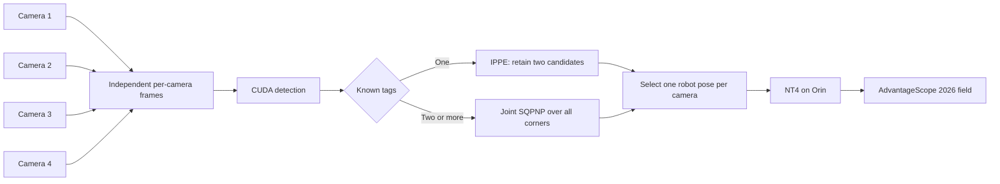

# Spot Vision Project Status

Last updated: September 29, 2026

Last target hardware verification: September 15, 2026

Overall status: **The two-camera alpha service is deployed on the target Jetson, jointly solves multi-tag observations, and publishes independent typed robot poses over NT4. Both camera pipelines and the AdvantageScope connection are hardware-validated. A live field-relative pose has not yet been observed because no known tag was visible during the latest verification; measured calibration, physical extrinsics, pose accuracy, endurance, and robot integration remain pending.**

The complete design requirements are in [Vision Solution (Spot) Specs.md](./Vision%20Solution%20(Spot)%20Specs.md). The current implementation intentionally overrides the original native-daemon recommendation: service orchestration is written in Python, while Team 766's detector remains in C++20/CUDA behind a pybind11 extension.

## Executive Summary

The first-pass Spot vision service has been implemented and deployed. It includes the imported Team 766 CUDA AprilTag detector, multi-camera Python capture and scheduling, single- and joint multi-tag pose solving, protobuf diagnostics, typed WPILib `Pose3d` NT4 output, health reporting, replay and benchmark commands, and a persistent systemd service.

The raw-detection hardware checkpoint passed earlier. On `orin-1`, the service captured frames from the attached Arducam OV2311 and repeatedly detected a visible 36h11 tag. One observed result reported tag ID 8, hamming distance 0, decision margin approximately 105.45, no frame overwritten before processing, and approximately 6.43 ms total processing time. Corners were also returned correctly.

The alpha deployment checkpoint has now also passed. On the latest target verification, both camera pipelines (now `1` and `2`) captured and detected concurrently, the NT4 server announced all 44 `/Spot` fields, AdvantageScope connected from the development Mac, and both per-camera `robot_pose` topics were recognized as `struct:Pose3d`. The built-in 2026 field loaded in both 2D and 3D views.

No pose sample was expected during that verification: the left image contained wiring and the ceiling, while the right camera was facing a close obstructing surface. Neither image contained an AprilTag, so both cameras correctly published `robot_pose_valid=false` without replacing the last pose with an artificial origin.

This proves the deployed two-camera capture, processing, and NT4 visualization path. It does not yet prove live field-relative pose accuracy or production reliability.

## Current Target Configuration

| Item | Current state |
| --- | --- |
| Compute | NVIDIA Jetson Orin Nano 8 GB, device name `orin-1` |
| Jetson software | L4T R36.4.3, CUDA 12.6 |
| Python | 3.11.16 in `/home/team581/spot-2026/.venv311` |
| OpenCV | 4.11.0 headless wheel; direct V4L2 fallback is active because this wheel has no GStreamer support |
| Cameras | `1`: Arducam OV2311 UC621; `2`–`4`: Arducam OV9281 UC762. Cameras 1 and 2 were previously validated concurrently; all four are enumerated on the Jetson |
| Camera selectors | Camera 1 uses `/dev/v4l/by-id`; cameras 2–4 use distinct stable `/dev/v4l/by-path` USB-port selectors |
| Configured modes | Camera 1: MJPEG 1280×720 at 50 FPS; cameras 2–4: MJPEG 1280×720 at 120 FPS |
| Observed capture/detect rates | Approximately 25 FPS left and 48–50 FPS right during the latest check |
| Exposure | Manual, 1000 µs; correctly converted to UVC `exposure_time_absolute=10` |
| Gain | 20 |
| Tag family | 36h11 |
| Calibration | Provisional 1280×720 intrinsics for all four cameras; startup warning and NT status are active |
| Camera extrinsics | Camera 1 uses `[0, +0.1, 0]`; cameras 2–4 currently use `[0, -0.1, 0]`; all use `[0, -20, 0]` degree RPY and remain provisional |
| Field layout | Vendored WPILib 2026.2.2 welded REBUILT layout |
| NT4 | Enabled as a server on the Orin; NT4 port 5810 and NT3 port 1735 |
| Deployment | At the latest target check, `spot-vision.service` was enabled and active; checkout in `/home/team581/spot-2026`; `/opt/spot-vision` symlinks to it |

The camera mode and exposure values are working first-pass values, not final production tuning.

## Implemented

### Native detector

- Team 766's CUDA detector core is imported and pinned with provenance in `cpp/team766/UPSTREAM.md`.
- The imported code includes thresholding, connected components, point collection, quad fitting, and AprilTag decoding rather than only the top-level CUDA file.
- A pybind11 module exposes CUDA and pinned CPU detectors to Python.
- NumPy input validation covers type, shape, dimensions, continuity, and row stride.
- Python retains the input frame during detection and releases the GIL while native detection runs.
- The Python-to-C++ boundary does not clone the image. The required host-to-device CUDA transfer remains.
- Detection results include IDs, canonical corners, hamming distance, decision margin, and timing information.

### Python service

- Headless camera probing and format/control reporting.
- Explicit GStreamer/OpenCV capture pipelines.
- Direct V4L2 capture fallback with BGR-to-packed-YUYV conversion for OpenCV builds without GStreamer.
- Correct conversion from configured microseconds to the UVC control's 100 µs exposure units.
- One capture thread and latest-frame slot per camera.
- Fair round-robin detection scheduling.
- Bounded result queues and overwrite/drop accounting.
- CPU comparison and fallback support.
- Single- and multi-tag pose-solving paths using OpenCV PnP routines.
- WPILib/OpenCV coordinate conversion, joint all-corner multi-tag solving, and
  configured per-camera robot extrinsics for alpha visualization.
- Calibration and WPILib field-layout loading and validation.
- Protobuf diagnostics plus one typed WPILib `Pose3d` NT topic per camera for
  AdvantageScope, with validity, solve method, tag count, and reprojection error.
- Health state, structured logging, temperature reporting, reconnect behavior, and revision reporting.
- Live probe, daemon, replay, CUDA/CPU comparison, benchmark, and calibration-validation CLI modes.
- Disposable alpha multi-camera terminal observation and browser MJPEG viewing are implemented for bring-up; they are not enabled by systemd or part of the production interface.
- systemd service and installation assets.

### Build and deployment support

- CMake, pybind11, and scikit-build-core packaging.
- Jetson-specific CUDA build adjustments.
- NVIDIA CCCL is fetched at its pinned revision by CMake. An explicitly supplied `SPOT_CCCL_ROOT` remains available for offline builds.
- Local CCCL checkouts and Python wheelhouses are treated as regenerable build caches and excluded from source control.
- Deployment uses the checked-in, credential-free `deploy/install.sh`; the temporary credential-bearing deployment helper has been removed.
- The Orin has an offline-installed CPython 3.11.16 runtime and compatible 2026.2.2 RobotPy NT/wpimath packages.
- The deployed service runs as the unprivileged `team581` user with access to the `video` group and restarts under systemd supervision.
- `/opt/spot-vision` is a stable symlink to the active checkout for operator convenience.

## Validated So Far

- The host-side suite now covers 30 tests, including synthetic single/multi-tag
  recovery, all-corner joint solving, extrinsics, and typed NT pose delivery.
- The full host test suite and Ruff checks pass.
- The non-CUDA package build and CLI paths were exercised on the development machine.
- Local protobuf and NT-related tests passed during the initial implementation.
- The target Jetson can load and run the CUDA detector.
- The Arducam capture pipeline supplies frames in a form accepted by the detector.
- Both Arducam devices run concurrently through stable `/dev/v4l/by-id` selectors.
- The portable V4L2 fallback runs on the deployed OpenCV wheel and maintains active capture and detection loops for both cameras.
- A known 36h11 tag is detected with the expected ID, zero hamming errors, strong decision margin, and valid corners.
- The observed live result showed no pending-frame overwrite before processing.
- The production service operates headlessly without requiring an OpenCV window or browser. The optional prototype viewer is a LAN-only debug aid that reuses captured frames and has no authentication.
- `spot-vision.service` is installed, enabled, starts successfully, and has survived deliberate service stop/restart cycles.
- The NT4 server listens on port 5810, and an external NT4 subscriber enumerated all 44 `/Spot` topics.
- AdvantageScope connected to `192.168.69.170`, recognized both per-camera `robot_pose` topics as typed `Pose3d`, and loaded the 2026 2D/3D field.
- Per-camera status, FPS, provisional calibration, pose validity, pose method, tag count, and reprojection-error values were read successfully from NT4.
- With no visible tag, both cameras published invalid status and did not publish an artificial zero pose.
- The UVC exposure conversion was verified on hardware: 1000 µs is applied as `exposure_time_absolute=10`, eliminating the earlier 100 ms overexposure.

The raw live tag-detection, two-camera alpha deployment, and NT4 topic-delivery milestones are therefore complete.

## Incomplete or Not Yet Validated

- None of the four cameras has been intrinsically calibrated for its exact resolution, format, focus, and mounting configuration.
- Provisional camera-to-robot transforms are configured but have not been physically measured and validated.
- Known-field-tag pose accuracy has not been checked on the Jetson with measured camera and robot poses.
- Single-tag IPPE dual candidates and joint multi-tag SQPnP/refinement have comprehensive synthetic tests but have not been validated with physical targets.
- A valid `Pose3d` sample has not yet been observed in AdvantageScope because no known tag was visible during the deployment check.
- Capture timestamps are used for pose and companion values, but timestamp accuracy and fixed camera bias have not been measured against robot time.
- The systemd service has passed deliberate restart checks but has not yet completed a reboot/autostart acceptance test.
- Camera disconnect/reconnect behavior has not been tested on the target.
- Sustained capture FPS and p50/p95 latency have not been measured over a representative run.
- Detection quality has not been characterized for range, angle, motion blur, exposure, partial occlusion, and field lighting.
- The 30-minute thermal/reliability run and a formal four-camera fairness/endurance benchmark have not been completed.
- Direct Ethernet and NT4 connectivity worked at `192.168.69.170`; the Orin has no Wi-Fi, so field networking and stable address assignment still need an explicit deployment plan.
- RoboRIO integration, fusion, uncertainty tuning, Limelight fallback, and production rollout remain explicitly deferred.
- Imported dependency licensing and distribution details should receive a final review before release.
- The temporary browser viewer has not yet been hardware-validated for sustained CPU/JPEG load, network reachability, or multi-camera thermal impact.
- The latest captured views contained no usable target: the left camera saw wiring/ceiling and the right camera appeared physically obstructed or aimed at a nearby surface.

## Recommended Next Steps

### Priority 0: Make the current proof reproducible

- [x] Remove the temporary credential-bearing deployment helper.
- [x] Review the intentional Jetson build/configuration changes.
- [ ] Commit the reviewed implementation and deployment changes.
- [x] Keep CCCL checkouts and wheelhouses out of Git as regenerable local caches.
- [ ] Record the exact supported V4L2 modes and controls for the attached camera.
- [ ] Run a 2–5 minute probe and save structured output with detection FPS, processing latency, overwrites, and errors.
- [x] Confirm clean service shutdown and restart.
- [ ] Confirm automatic camera recovery after a deliberate unplug/replug acceptance test.

### Priority 1: Establish trustworthy pose output

- [ ] Calibrate all four cameras in their final focus and exact operating modes.
- [x] Validate the provisional calibration files with the CLI and confirm camera identity and dimensions.
- [ ] Measure all four camera mounts and replace the provisional camera-to-robot transforms.
- [x] Load WPILib 2026.2.2's official welded REBUILT layout and derive its revision hash.
- [ ] Test a known tag at measured poses and compare translation, rotation, and reprojection error.
- [x] Verify both single-tag IPPE candidates and joint multi-tag pose refinement synthetically.
- [x] Confirm synthetically that unknown tags remain in raw observations but do not affect field-relative pose.
- [ ] Repeat the single-tag and multi-tag checks with physical 2026 targets on the Orin.

### Priority 2: Validate transport and service operation

- [x] Enable the Orin NT4 server and inspect every announced `/Spot/...` topic from an external subscriber and AdvantageScope.
- [x] Verify revisions, latency fields, FPS, drops, state, errors, and invalid-pose behavior over NT4.
- [ ] Measure capture timestamp accuracy and exercise ordered, duplicate, and empty-frame behavior with a robot-like queued subscriber.
- [x] Install and restart the systemd service under the unprivileged account.
- [ ] Verify systemd startup after a full Orin reboot.
- [ ] Test camera unplug/replug and network interruption without restarting the whole device.
- [ ] Run the 30-minute thermal and reliability test and record p50/p95 timing and frame-drop results.

### Priority 3: Prepare for robot shadow testing

- [ ] Freeze a repeatable camera mode and exposure profile based on field-like measurements.
- [ ] Validate the physical camera mount and transform on the robot.
- [ ] Publish observations in shadow mode without using them for control.
- [ ] Compare Spot output with the robot's existing vision and odometry logs.
- [ ] Begin roboRIO integration and fusion only after the Jetson pose and transport gates pass.

## Milestone Gates

| Milestone | Status | Completion evidence |
| --- | --- | --- |
| Build native extension on Jetson | Complete | CUDA detector loads and runs on `orin-1` |
| Capture frames from original two target cameras | Complete | Camera 1 OV2311 and camera 2 OV9281 frames concurrently reach their detection pipelines; cameras 3 and 4 still need capture validation |
| Detect a known raw tag | Complete | Correct ID, zero hamming, strong margin, valid corners |
| Reproduce and benchmark raw detection | In progress | Sustained probe log and latency distribution needed |
| Produce calibrated camera pose | Software complete; hardware pending | Provisional intrinsics/extrinsics require measured replacements and live single/multi-tag pose tests |
| Publish and receive alpha NT4 contract | Complete | Orin announced all 44 topics; external client and AdvantageScope recognized both typed `Pose3d` topics |
| Display live robot pose on 2026 field | Pending physical target | 2026 field and sources are visible; no pose sample exists until a known tag enters a camera view |
| Survive deployment/reconnect/endurance tests | In progress | Service restart passed; unplug, reboot, network-interruption, and 30-minute tests remain |
| Robot shadow validation | Deferred | Begins after Jetson-side gates pass |

## Updating This Document

Update the date and overall status whenever a milestone changes. For each completed gate, link or name the relevant configuration, calibration, test log, replay dataset, or benchmark result. Keep implementation claims separate from hardware-validated claims so this document remains a reliable handoff and readiness record.
