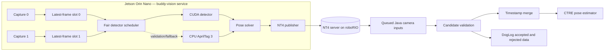

# Buddy Vision System Design Specification

Status: proposed implementation design  
Primary target: Jetson Orin Nano 8GB with one or two prototype cameras  
Primary function: FRC AprilTag localization  
Design priority: reliability and observability before peak frame rate

## 1. Goal and scope

Buddy will replace Limelight AprilTag localization with a team-owned coprocessor while retaining the existing robot localization architecture. Version 1 includes:

- capture from one or two global-shutter cameras, with support for adding more later;
- AprilTag 36h11 detection on the Jetson GPU;
- single-tag and multi-tag camera-pose estimation;
- timestamped result transport over NetworkTables 4 (NT4);
- roboRIO-side candidate selection, validation, uncertainty, logging, and pose-estimator ingestion;
- calibration, deployment, health reporting, replay, and benchmark tooling.

Game-piece detection, visual odometry, stereo reconstruction, and neural inference are out of scope for version 1. The pipeline should allow another detector to be added later without changing capture, transport, or supervision.

## 2. Executive recommendation

Build Buddy as a native C++20 service with five boundaries:

1. V4L2/GStreamer camera capture.
2. A replaceable fiducial detector interface.
3. OpenCV pose estimation.
4. A versioned NT4 protobuf interface.
5. A generic Java `VisionCamera` interface that lets Buddy and Limelight run in parallel.

Use the [Team 766 standalone fork of Team 971's CUDA detector](https://github.com/Team766/apriltags_cuda) as the first GPU backend, but do not adopt its full demo application or build graph. Its build currently pins old OpenCV and WPILib versions and builds several large dependencies from source. Extract or fork the detector behind a team-owned interface, pin the exact revision, and complete a license review before incorporating it. Keep [AprilTag 3](https://github.com/AprilRobotics/apriltag) as a CPU backend for golden-result comparison, development without CUDA, and degraded operation.

Run one `systemd`-supervised daemon. A single daemon shares one CUDA context and avoids multiplying GPU memory use as cameras are added. A capture failure must only restart that camera's pipeline; an unhandled process failure is recovered by `systemd`.

Do not allow backlog to become latency. Each camera owns a one-frame pending slot. If a new frame arrives before the pending frame starts detection, replace the old frame and increment a dropped-before-processing counter. Publish every completed result; the roboRIO drains all published results and processes all cameras in capture-time order.

## 3. Research conclusions

### 3.1 Northstar and GompeiVision

[6328 Northstar](https://github.com/Mechanical-Advantage/RobotCode2026Public/tree/main/northstar) is the strongest reference for the overall system shape:

- camera settings and field configuration travel over NT;
- observations use their original capture timestamp;
- the roboRIO uses `sendAll`, `keepDuplicates`, and `readQueue()` so multiple frames between 20 ms loops survive;
- multi-tag estimates contain one pose while single-tag estimates preserve both ambiguous poses;
- the roboRIO performs field-bound checks, ambiguity resolution, uncertainty calculation, logging, and chronological fusion.

Northstar's current detector is Python/OpenCV ArUcoMax, so borrow its structure independently of its detector. Its [Java NT reader](https://github.com/Mechanical-Advantage/RobotCode2026Public/blob/main/src/main/java/org/littletonrobotics/frc2026/subsystems/vision/VisionIONorthstar.java) is the direct reference for queued NT4 ingestion.

[190 GompeiVision](https://github.com/Team-190/GompeiVision) reinforces these choices:

- separate capture, detection, pose, configuration, and output layers;
- multi-tag `SQPNP` and single-tag `IPPE_SQUARE`;
- dynamic settings and an explicit initialization gate;
- independent processing and NT output work;
- setup-only image streaming rather than permanent competition streaming.

GompeiVision uses process-per-camera isolation with CPU detection. Buddy should instead share one CUDA-owning daemon on the 8GB Orin Nano while isolating camera errors within the daemon.

### 3.2 Existing competition robot integration

The local `offseason-2026/comp-bot` code establishes the robot-side compatibility target:

- three Limelights produce AprilTag localization results;
- each result crosses the subsystem boundary as `TagResult(Pose2d, timestamp, standardDevs)`;
- `Localization` converts FPGA time to CTRE time and calls `addVisionMeasurement`;
- vision inputs run before localization;
- validation rejects excessive angular rate, no targets, high single-tag ambiguity, invalid zero poses, inconsistent MT2 rotation, and duplicate timestamps;
- health distinguishes `GOOD`, `NO_TARGETS`, and `OFFLINE`;
- DogLog records poses, timestamps, health, and filter events.

Buddy should preserve `TagResult` after validation. The necessary change is cardinality: the current code exposes at most one optional result per camera per robot loop. Buddy must expose a drained list so 60–120 FPS sources can deliver multiple frames during a 20 ms loop.

### 3.3 Current prototype camera

`UC-844 Rev.B` identifies the Arducam B0332: a monochrome OV9281 global-shutter UVC camera. The [B0332 specification](https://cdn.robotshop.com/media/A/Adu/RB-Adu-256/pdf/arducam-1mp-ov9281-usb-camera-120fps-global-shutter-uvc-low-distortion-m12-lens-manual.pdf) lists:

- USB 2.0, not USB 3.0;
- 1280×800 monochrome global shutter with 3 µm pixels;
- MJPEG at up to 100/120 FPS depending on firmware documentation;
- YUY2 at only 10 FPS at 1280×800 or 1280×720;
- an M12 manual-focus lens and approximately 70° horizontal FOV for the documented lens;
- no IR-cut filter.

This conflicts with the preferred uncompressed high-rate path. The B0332 is suitable for prototyping but must be tested in high-rate MJPEG and every enumerated uncompressed mode. MJPEG can damage small tag edges and adds decode work; full-resolution YUY2 cannot meet the 60 FPS production gate.

The likely production direction is a USB3 monochrome global-shutter camera supplying uncompressed GRAY8 or YUYV at the desired resolution and at least 60 FPS. Select it from recorded accuracy and latency, not advertised sensor rate.

## 4. Architecture



### 4.1 Camera discovery and capture

Each camera has a logical ID such as `front`, `left`, or `right`. Resolve the device in this order:

1. Unique UVC serial number.
2. Persistent `/dev/v4l/by-id` symlink.
3. Configured `/dev/v4l/by-path` USB-port mapping.

Never depend on `/dev/video0` numbering. At discovery, enumerate V4L2 formats, resolutions, frame rates, and controls and compare them with configuration. A mismatch prevents `RUNNING` and reports the exact reason.

Use GStreamer's `v4l2src` for UVC capture, consistent with [NVIDIA's Jetson guidance](https://docs.nvidia.com/jetson/archives/r36.3/DeveloperGuide/SD/TestPlanValidation.html#capturing-video-from-a-usb-web-camera). Prefer direct GRAY8. For YUYV, consume luminance without converting to RGB. For MJPEG, benchmark hardware-supported and software decode and select the lower measured capture-to-grayscale latency.

Capture requirements:

- request four V4L2 buffers to tolerate jitter without creating a long pipeline;
- set exposure, gain, auto-exposure, resolution, format, and FPS explicitly;
- stamp each frame with `nt::Now()` as soon as it leaves the capture driver;
- preserve the V4L2 frame sequence when available;
- write to the one-frame pending slot;
- count driver drops, overwritten frames, decode failures, and timestamp discontinuities separately.

The capture timestamp approximates exposure time. Measure its fixed bias and retain an optional per-camera static correction, default zero. Do not silently estimate capture time from processing latency on the roboRIO.

### 4.2 Scheduling and backpressure

Service ready cameras round-robin. A continuously ready camera cannot take a second turn while another waits. Begin with one GPU operation in flight for deterministic behavior and to establish detector thread safety. Add CUDA streams only if profiling proves they improve two-camera latency without starvation.

- Pending capture capacity: one frame per camera.
- Processed-result capacity: 32 frames total.
- If results fill, discard the oldest result and increment a counter; never block capture or detection on NT.
- Expose all drops through counters and sequence gaps.

### 4.3 Detector interface

Use a backend-neutral interface equivalent to:

```cpp
struct Detection {
  int id;
  std::array<cv::Point2d, 4> corners;
  int hamming;
  double decisionMargin;
};

class FiducialDetector {
 public:
  virtual DetectionBatch Detect(const GrayFrame& frame) = 0;
  virtual DetectorMetrics GetMetrics() const = 0;
  virtual ~FiducialDetector() = default;
};
```

Both backends must produce identical corner ordering. A known upright-tag test must verify ordering before pose tests. Do not crop frame edges in version 1; add per-camera crop masks only after recordings show the region has no useful tags and measurements demonstrate a benefit.

### 4.4 Pose estimation

Use the WPILib field layout selected by robot code. The Jetson receives layout JSON plus a revision/hash and publishes the applied revision. Without a valid matching layout, Buddy may publish raw detections but must not publish field-relative poses.

For two or more known tags:

1. Gather all 2D corners and corresponding field-relative 3D corners.
2. Run OpenCV `solvePnPGeneric` with `SOLVEPNP_SQPNP`.
3. Refine the solution with iterative PnP using it as the initial guess.
4. Publish one field-relative camera pose with per-corner RMS reprojection error.

For one known tag:

1. Run `solvePnPGeneric` with `SOLVEPNP_IPPE_SQUARE` using the [required corner ordering](https://docs.opencv.org/4.x/d5/d1f/calib3d_solvePnP.html).
2. Preserve both physically valid solutions and reprojection errors.
3. Do not disambiguate using a stale Jetson-side robot heading.
4. Let the roboRIO select against timestamped estimator/gyro state.

Publish raw detections even when pose solving fails. Unknown IDs are excluded from solving but retained with `UNKNOWN_TAG_ID` status.

## 5. NetworkTables contract

### 5.1 Topics

```text
/Buddy/config/schema_version
/Buddy/config/field_layout_json
/Buddy/config/field_layout_revision
/Buddy/config/enabled

/Buddy/<camera>/config/revision
/Buddy/<camera>/config/exposure_us
/Buddy/<camera>/config/gain
/Buddy/<camera>/config/fps_limit
/Buddy/<camera>/config/setup_stream_enabled

/Buddy/<camera>/output/observations
/Buddy/<camera>/status/state
/Buddy/<camera>/status/applied_config_revision
/Buddy/<camera>/status/applied_field_revision
/Buddy/<camera>/status/last_consumed_sequence
/Buddy/<camera>/status/fps_capture
/Buddy/<camera>/status/fps_detect
/Buddy/<camera>/status/latency_ms
/Buddy/<camera>/status/dropped_*
/Buddy/<camera>/status/temperature_c
/Buddy/<camera>/status/error
```

Configuration originates on the roboRIO. Deployment defaults allow capture/calibration before NT connects, but global pose output remains gated until the robot's field revision is applied.

### 5.2 Observation protobuf

Use protobuf because each frame has variable-length detections and one or two candidates and needs compatible C++/Java evolution.

```protobuf
message VisionFrame {
  uint32 schema_version = 1;
  string camera_id = 2;
  uint64 sequence = 3;               // Monotonic per camera, including empty frames.
  uint64 camera_frame_sequence = 4;  // V4L2 sequence when available.
  uint64 config_revision = 5;
  uint64 field_revision = 6;
  repeated PoseCandidate candidates = 7;
  repeated TagObservation tags = 8;
  ProcessingTiming timing = 9;
}

message PoseCandidate {
  enum Method {
    METHOD_UNKNOWN = 0;
    MULTI_TAG_SQPNP = 1;
    SINGLE_TAG_IPPE_SQUARE = 2;
  }
  Method method = 1;
  double x_m = 2;
  double y_m = 3;
  double z_m = 4;
  double qw = 5;
  double qx = 6;
  double qy = 7;
  double qz = 8;
  double reprojection_error_px = 9;
  repeated uint32 tag_ids = 10;
}

message TagObservation {
  uint32 id = 1;
  repeated double corners_xy_px = 2; // x0,y0,...,x3,y3 in canonical order.
  int32 hamming = 3;
  double decision_margin = 4;
  bool used_for_pose = 5;
  string rejection_reason = 6;
}

message ProcessingTiming {
  double capture_to_detect_ms = 1;
  double detect_ms = 2;
  double solve_ms = 3;
  double total_ms = 4;
}
```

The NT value timestamp—not a payload field—is authoritative for fusion. Publish with the explicit `nt::Now()` capture time. NT4 synchronizes client time to server time; with the roboRIO as server, the received server timestamp shares the FPGA domain. See [WPILib NT timestamps](https://docs.wpilib.org/en/latest/docs/software/networktables/networktables-intro.html#timestamps).

### 5.3 Delivery

Use these PubSub settings:

- `keepDuplicates(true)` so identical and empty frames arrive;
- `sendAll(true)` so intermediate frames are not coalesced;
- 5 ms network periodic interval;
- `pollStorage(16)` per camera on the roboRIO.

The Java reader calls `readQueue()` once per loop. Sixteen updates hold over 100 ms at 120 FPS, while stale rejection prevents delayed fusion. [WPILib documents](https://docs.wpilib.org/en/stable/docs/software/networktables/publish-and-subscribe.html) the queue and bounded storage behavior.

The roboRIO publishes `last_consumed_sequence` for dashboards and drop diagnosis. Buddy does not retain an acknowledgement-indexed result map: NT already supplies bounded queues, and another retention layer risks unbounded memory during disconnects.

## 6. roboRIO integration

### 6.1 Interchangeable cameras

Add an interface equivalent to:

```java
interface VisionCamera {
  String name();
  CameraHealth health();
  List<VisionFrameResult> drainResults();
  void setMode(VisionMode mode);
}
```

Wrap current code in `LimelightVisionCamera` and add `BuddyVisionCamera` around the protobuf subscriber. `Vision` owns a collection instead of named Limelight fields. This supports shadow comparison, per-camera fallback, staged rollout, simulation, and replay.

Accepted candidates remain `TagResult(Pose2d, FPGA timestamp, standardDevs)`. Replace the `OptionalTagResult` boundary with a reusable drained collection so the robot loop does not discard camera frames.

### 6.2 Validation and logging

Give every frame exactly one terminal status, evaluated in this order:

1. `SCHEMA_MISMATCH`: unsupported protobuf version.
2. `CONFIG_MISMATCH`: wrong field or camera revision.
3. `DUPLICATE_OR_OUT_OF_ORDER`: non-increasing sequence or timestamp.
4. `STALE`: over 50 ms old, or implausibly in the future.
5. `NO_TAGS` or `NO_POSE_CANDIDATE`.
6. `HIGH_ANGULAR_RATE`: retain the tunable threshold, initially 100°/s.
7. `UNKNOWN_TAG`: no usable tag in the selected layout/mode.
8. `HIGH_REPROJECTION_ERROR`: tunable, initially 2.0 px RMS.
9. `AMBIGUOUS_SINGLE_TAG`: choose the closest timestamped odometry heading only when decisive; otherwise reject.
10. `OUTSIDE_FIELD`: X/Y outside the field plus margin.
11. `INVALID_Z`: derived robot Z outside a physical range.
12. `ESTIMATOR_DISAGREEMENT`: more than a tunable 1.0 m from timestamped estimator pose.
13. `ACCEPTED`.

Apply the timestamped robot-to-camera transform on the roboRIO before robot-pose checks. This keeps mechanical configuration in robot code and permits future moving mounts.

Log raw candidates, chosen/rejected candidates, corners and IDs, terminal status, latency, sequence gaps, standard deviations, and final `TagResult`. Rejections are data, not exceptions.

### 6.3 Uncertainty and fusion

Begin with an explicitly tunable model:

```text
xyStdDev = cameraFactor × xyCoefficient × averageTagDistance² / tagCount²
thetaStdDev = cameraFactor × thetaCoefficient × averageTagDistance² / tagCount²
```

Use infinite `thetaStdDev` for unresolved single-tag rotation. Use finite heading uncertainty only for well-constrained multi-tag or decisive close-range single-tag results. Fit coefficients from recorded trials rather than copying another team.

Collect accepted results from all cameras, sort by FPGA capture time, convert using the existing CTRE time conversion, and call `addVisionMeasurement` chronologically. [WPILib pose estimators](https://github.wpilib.org/allwpilib/docs/release/java/edu/wpi/first/math/estimator/PoseEstimator.html) support latency timestamps and per-measurement deviations.

## 7. Health and deployment

### 7.1 Per-camera states

```text
DISABLED → DISCOVERING → CONFIGURING → RUNNING
                    ↘ RETRY_WAIT ↗
RUNNING → NO_TARGETS
RUNNING/NO_TARGETS → RETRY_WAIT on capture failure
any state → CONFIG_MISMATCH when required revisions differ
```

Retry discovery with exponential backoff from 100 ms to 5 s. A disconnected camera must not stop another camera. Reset backoff after 10 seconds of successful capture.

Map recent valid tags to existing `GOOD`, running without targets to `NO_TARGETS`, and discovery/capture failure beyond three seconds to `OFFLINE`. Keep the 30-second no-tag warning separate from offline state.

### 7.2 Service

Deploy a native release under `systemd` with:

- `Restart=on-failure` and a short restart delay;
- a dedicated unprivileged user with video-device access;
- journald logs and a watchdog heartbeat;
- CPU, memory, GPU, temperature, and restart metrics;
- pinned JetPack, CUDA, compiler, OpenCV, WPILib/ntcore, protobuf, detector, and field versions.

A reproducible build container is appropriate for CI, but Docker is not required on the competition robot. Use a documented Orin power mode, active cooling, and robot electrical power; verify throttling in the 30-minute test. See [NVIDIA's Orin power-mode documentation](https://docs.nvidia.com/jetson/archives/r36.4.4/DeveloperGuide/SD/PlatformPowerAndPerformance/JetsonOrinNanoSeriesJetsonOrinNxSeriesAndJetsonAgxOrinSeries.html).

### 7.3 Setup stream

Stream only for setup/debug. Enable over NT, cap resolution/FPS, and stop when no client connects. Overlay corners, IDs, acceptance status, exposure, and latency. Streaming consumes post-detection copies and never blocks capture.

## 8. Calibration

Calibrate every physical camera at every production resolution, format, and crop. Store:

- camera matrix and distortion coefficients;
- calibration resolution and pixel format;
- mean and per-image reprojection error;
- camera serial/identity and lens identity;
- focus-lock record, date, and tool version.

Use a rigid ChArUco board and sample the full FOV, distance, and tilt range. [WPIcal](https://docs.wpilib.org/en/stable/docs/software/wpilib-tools/wpical/index.html#camera-calibration) recommends MRCal where available and documents compatible JSON. Hold back validation images; reject a calibration that only fits training frames.

Measure robot-to-camera transforms from CAD and verify experimentally. Record a transform revision. At startup, camera identity, capture mode, calibration, and config revision must agree or pose output is blocked.

## 9. Verification

### 9.1 Automated tests

Detector:

- golden images across range, blur, exposure, angle, and occlusion;
- CUDA/CPU agreement on IDs and bounded corner differences;
- no-tag/false-positive scenes and canonical corner ordering;
- corrupt input and unsupported stride handling.

Pose:

- synthetic projection with known intrinsics/poses;
- both IPPE candidates preserved;
- multi-tag SQPNP with noise and one bad corner;
- coordinate/quaternion round trips;
- unknown/duplicate IDs and reprojection error.

Transport and robot:

- protobuf round trip between C++ and Java;
- supported/unsupported schema versions;
- explicit timestamp arrives in FPGA time;
- identical frames retained and multiple frames drained per loop;
- duplicate, out-of-order, missing, stale, and future frames;
- global timestamp sort before fusion;
- disconnect/reconnect with bounded memory;
- shadow mode never calls `addVisionMeasurement`.

Failure:

- unplug/reconnect either camera while the other continues;
- changing `/dev/videoN` enumeration;
- invalid controls, detector exception, and service restart;
- config mismatch, thermal throttling, and roboRIO reboot.

### 9.2 Benchmark matrix

| Dimension | Cases |
| --- | --- |
| Detector | Team 766/971 CUDA; CPU AprilTag 3 |
| Format | B0332 MJPEG; every enumerated uncompressed mode |
| Resolution | 1280×800 and useful lower modes |
| Cameras | one; two on same USB controller; separate controllers where possible |
| Exposure | bright-field and dim-field manual settings |
| Decimation | 1.0 and any optimized candidate |
| Motion | stationary, translating, high angular velocity |
| Tags | zero, one, multiple, near, maximum useful range |
| Thermal | cold start through 30 minutes in the configured power mode |

Measure capture/processed FPS, stage latencies, end-to-end latency, drops by cause, resource use, temperature, recall, false positives, corner error, and field-pose error.

### 9.3 Acceptance gates

- At least 60 processed FPS per production camera with the planned camera count.
- P95 capture-to-NT-publish latency no greater than 25 ms.
- No frame older than 50 ms reaches fusion.
- No unbounded queue or memory growth.
- A two-camera 30-minute run without daemon restart, capture lockup, or unexplained gap.
- Camera reconnect does not disrupt the other camera.
- No accepted localization outlier above 25 cm in the representative Limelight/Buddy comparison.
- Held-out calibration validation passes.
- Every rejected pose has a logged reason.
- Shadow/fused logs replay through the same Java validation path.

The B0332 full-resolution YUY2 mode is exempt from 60 FPS only as a prototype comparison; it cannot be the production mode if it remains limited to 10 FPS.

## 10. Rollout

1. **Offline detector prototype:** record B0332 video, compare CUDA/CPU, validate corner ordering, and measure MJPEG effects.
2. **Single-camera bench:** exercise capture/detect/solve/NT, time sync, and reconnect.
3. **Robot shadow mode:** mount Buddy beside Limelight and log without fusion.
4. **Single-camera fusion:** enable Buddy behind a feature flag with Limelight fallback.
5. **Two-camera shadow/stress:** validate fairness, USB topology, thermals, and ingestion.
6. **Two-camera fusion:** enable cameras independently and inspect all rejections.
7. **Production camera decision:** retain B0332 only if its measured mode passes; otherwise test/calibrate a USB3 uncompressed camera.
8. **Additional cameras:** add only after measuring USB bandwidth, scheduling, memory, thermals, and latency at the new count.

## 11. Risks

| Risk | Mitigation |
| --- | --- |
| CUDA fork is hard to maintain/license | Pin a reviewed fork behind `FiducialDetector`; keep CPU AprilTag 3; avoid fork-specific application types. |
| MJPEG damages long-range accuracy | Record MJPEG/YUYV comparisons; prefer USB3 GRAY8/YUYV hardware. |
| Multiple cameras accumulate latency | One-frame slots, fair scheduling, bounded results, drop telemetry, and stale rejection. |
| Clocks disagree | Use NT synchronized explicit timestamps; gate until synchronized; log offset changes. |
| Wrong field/calibration creates plausible poses | Revision/hash handshake and hard output gate. |
| Single-tag mirror pose is selected | Send both IPPE candidates; resolve with timestamped state or reject. |
| Camera unplug crashes all capture | Per-camera recovery boundaries; `systemd` handles process failures. |
| Filters hide useful data | Log every candidate, corner, terminal reason, and accepted measurement. |
| Peak benchmark hides throttling | Require the full 30-minute robot-power stress test. |

## 12. Sources

- [Team 766 CUDA AprilTags](https://github.com/Team766/apriltags_cuda)
- [Team 971 robot code](https://github.com/frc971/971-Robot-Code)
- [AprilRobotics AprilTag 3](https://github.com/AprilRobotics/apriltag)
- [Mechanical Advantage Northstar](https://github.com/Mechanical-Advantage/RobotCode2026Public/tree/main/northstar)
- [Mechanical Advantage roboRIO vision code](https://github.com/Mechanical-Advantage/RobotCode2026Public/tree/main/src/main/java/org/littletonrobotics/frc2026/subsystems/vision)
- [Team 190 GompeiVision](https://github.com/Team-190/GompeiVision)
- [WPILib NT concepts and timestamps](https://docs.wpilib.org/en/latest/docs/software/networktables/networktables-intro.html)
- [WPILib queues and PubSub options](https://docs.wpilib.org/en/stable/docs/software/networktables/publish-and-subscribe.html)
- [WPILib pose estimators](https://github.wpilib.org/allwpilib/docs/release/java/edu/wpi/first/math/estimator/PoseEstimator.html)
- [WPILib WPIcal](https://docs.wpilib.org/en/stable/docs/software/wpilib-tools/wpical/index.html)
- [OpenCV `solvePnP`](https://docs.opencv.org/4.x/d5/d1f/calib3d_solvePnP.html)
- [NVIDIA USB camera capture](https://docs.nvidia.com/jetson/archives/r36.3/DeveloperGuide/SD/TestPlanValidation.html#capturing-video-from-a-usb-web-camera)
- [NVIDIA Orin power modes](https://docs.nvidia.com/jetson/archives/r36.4.4/DeveloperGuide/SD/PlatformPowerAndPerformance/JetsonOrinNanoSeriesJetsonOrinNxSeriesAndJetsonAgxOrinSeries.html)
- [Arducam B0332/OV9281 specification](https://cdn.robotshop.com/media/A/Adu/RB-Adu-256/pdf/arducam-1mp-ov9281-usb-camera-120fps-global-shutter-uvc-low-distortion-m12-lens-manual.pdf)

## 13. Final decisions

- C++20 native daemon, not a Python-first or runtime-container-first system.
- Team 766/971 CUDA behind a replaceable interface; CPU AprilTag 3 retained.
- One shared daemon/CUDA context with per-camera capture and recovery.
- One-frame pending queues with oldest-frame replacement.
- Multi-tag SQPNP and two-candidate single-tag IPPE_SQUARE.
- Robot-owned field layout and camera transform with revision handshakes.
- Versioned NT4 protobuf and NT value timestamps as capture time.
- Queued chronological robot ingestion; acknowledgements are telemetry only.
- Parallel Buddy/Limelight rollout through a generic camera interface.
- UC-844 Rev.B/B0332 remains prototype hardware pending measurement.
