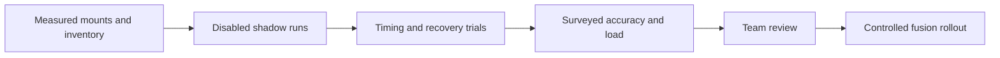

# Deferred beta hardware qualification

Status: **not performed**. The user authorized software implementation and deferred hardware qualification. No beta deployment, measured mounts, timing certificate, fusion activation, heading activation or revised trust activation has occurred.

Use Section 13 of the [beta contract](../Spot%20Beta%20Robot%20Integration%20Plan.md) as the acceptance authority. Engineering defaults in software are not substitutes for measurements. Keep the robot disabled during physical power-cycle and configuration trials.

## Equipment and records

Supply actual offseason camera inventory and robot-code mounts, the measured ChArUco print, surveyed field poses and repeatable paths, an independent clock/capture reference, and robot WPILOG recordings. Use the shared maintenance key and the NixOS test/verify/switch procedure in `nix/README.md`. Confirm the carrier board, storage layout and firmware compatibility before installation. Preserve the previous NixOS generation and configuration export.

Record robot/source/profile hashes, NixOS system/package paths and configuration revision, schema/dependency versions, physical camera identities/topology, negotiated modes, actual capture/detection rates, readback controls, calibration hashes, timestamp-qualification signatures, lighting/tag geometry and motion conditions. Save raw samples alongside plots and summaries; do not replace failed members with an undocumented smaller group.

## Required trials

| Trial | Required evidence and unchanged target |
| --- | --- |
| Startup | At least ten cold boots and ten warm restarts; OS boot, service/state/enumeration/first processed frame, NT connection/sync/ACK and robot availability. Report p50/p95/worst and dependency wait separately. Cold p95 ≤60 s, warm p95 ≤10 s, local GUI/health ≤5 s without USB/Ethernet |
| Capture and preview | Swyft and Arducam advertised candidates versus actual delivered dimensions, format and cadence. Four cameras each ≥15 usable solves/s; GUI throughput reduction ≤10% from the headless baseline. Measure calibration load separately |
| Independent timing | Local NT, NT server/FPGA and CTRE values plus external timing reference; startup/reconnect/reboots, altered wall time and CPU/GPU/network load. Prove ≤5 ms clock error. Qualify the 30 s NT sync expiry and each camera's measured read-completion correction/uncertainty. At least 100 capture cycles per timing record |
| Latency and ordering | Capture-to-consumption p95 ≤100 ms; reject age >250 ms, future >5 ms, missing history, old/reset epochs, duplicates and late arrivals. Empty/no-tag frames must advance without fake poses |
| Surveyed accuracy | Declared 1–5 m range, each camera and combined estimator, varied geometry/tilt/light/speed. Static planar median ≤0.10 m and p95 ≤0.20 m; dynamic planar p95 ≤0.25 m. Heading remains off pending a separate reviewed target |
| Pipeline recovery | Detect required-camera stalls within 0.5 s; fresh recovery ≤5 s after known-good enumeration or NT synchronization. USB/hub loss, unsupported controls/modes, invalid calibration, profile mismatch, forced configured CPU fallback, dead output worker and native supervisor restart |
| Network and power | Ethernet outages near 1 s, 30 s and 5 min; repeated flapping; either boot order; no Ethernet at boot; independent/both computer power cycles; camera/hub power cycles; power removal during settings/calibration commit. No backlog replay, duplicate fusion or estimator reset |
| Endurance | Thirty minutes with four streams and representative motion; bounded memory/queues, camera fairness, thermal/fallback recovery, no fatal failures or time discontinuities. Nominal result/transport loss <1%; count intentional latest-frame overwrites separately |
| Deployment and operator handoff | Verify actual CUDA process/artifacts, installed offline GUI, automatic startup and previous-generation rollback on Jetson. A new operator names/calibrates/replaces a camera using the guide and real results |

## Suggested raw sample columns

Startup CSV: `trial_id,kind,robot_boot_order,ethernet_present,os_boot_s,service_start_s,state_load_s,enumeration_s,first_processed_frame_s,nt_connection_s,synchronized_s,acknowledged_s,robot_available_s,dependency_wait_s,package_path,manifest_hash,result`.

Frame CSV: `trial_id,camera_identity,logical_name,capture_epoch,sequence,connection_epoch,sync_epoch,runtime_generation,local_nt_us,server_fpga_s,ctre_s,external_capture_s,consume_fpga_s,uncertainty_s,correction_us,decision,fused,tag_ids,range_m,reference_x_m,reference_y_m,estimated_x_m,estimated_y_m,temperature_c,capture_fps,detect_fps,result_drops,latest_overwrites`.

Failure CSV: `trial_id,event,outage_s,old_release,new_release,old_service_session,new_service_session,old_capture_epoch,new_capture_epoch,fault_observed_s,dependency_restored_s,fresh_ready_s,old_frames_rejected,estimator_reset,rollback_verified,result,evidence_path`.

If a target is missed, retain the failed evidence and produce a bottleneck report for team review. Do not silently reduce acceptance gates, use a liveness check as performance proof, or enable the rollout flags to make qualification look complete.
