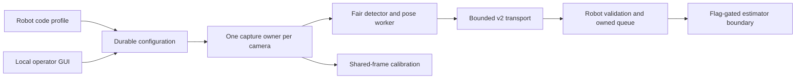

# Beta software verification — October 8, 2026

Software implementation is complete for the user's authorized scope: **software
now; hardware qualification deferred**. Work is present in `spot-2026` and
`offseason-2026`. It has not been deployed. This report records the pre-commit
verification checkpoint. Beta is not robot-ready.

The [beta plan](../Spot%20Beta%20Robot%20Integration%20Plan.md) remains the contract.
The [hardware qualification checklist](Hardware%20Qualification.md) records the
unperformed trials and unchanged acceptance targets. The historical alpha report
does not qualify this beta release.

## Delivered behavior



Robot code defines profile identity, camera names, mounts, policy and field
geometry. Cached profiles permit offline setup while current robot session and
disabled eligibility gate mutations and publication. Settings use immutable,
checksummed, fsynced generations with transactional native apply/readback and
last-known-good recovery. Physical serial/topology identity survives normal
re-enumeration; replacement, duplicate identity and incompatible modes fail
explicitly.

The runtime owns USB handles, fresh capture epochs, immutable shared frames,
bounded previews/results and a fair detector/solver worker. Calibration consumes
those frames rather than opening a second device. Fit and holdout sets are
independent; selected group apply and history restore are atomic and acknowledge
only after native validation and durable activation. Invalid members cannot be
silently skipped.

V2 keeps alpha compatibility separate. Candidates, camera transforms, hashes,
units, packet bounds and timestamp domains have cross-language serialized
fixtures. Current NT exchange, connection/sync epochs, expiry/discontinuity and
capture qualification gate valid output. Unchanged offset polling does not renew
sync. NTCore 2026.2.2's initial-exchange behavior is handled by a bounded reconnect
at the configured 30 s expiry; actual FPGA error still requires independent
hardware evidence.

The Java implementation owns Limelight and Spot measurements through validation,
capture history, ambiguity selection, bounded arrival reordering, correlation
handling and the CTRE estimator boundary. Decisions identify the exact frame;
an older queued fusion cannot label a newer rejected frame as fused. DogLog
records current faults/transitions, reasons, rate/latency, synchronization,
innovation, trust and build identity with bounded routine telemetry.

Offseason wiring includes an empty Spot camera list awaiting actual measured
mounts. Fusion, heading and revised trust default off. Existing OFF placeholder
Limelights and unrelated shooter/path/drivetrain code remain outside this work.
The competition robot uses the shared owned Limelight adapter. The documented
second robot profile is synthetic example code and compiles in the contract suite.

The GUI is installed with local Source Sans Pro, the team logo, light/dark/Auto
tokens, offline searchable documentation, real status APIs, acknowledged live
tuning/history, naming/replacement, code-authority geometry inspection,
calibration and separate Network/System pages. Mutations use same-origin/Host
checks, CSRF sessions, bounded jobs and server-side profile/eligibility/revision
validation. Browser failure does not own the vision pipeline.

Release installation verifies the module actually loaded plus packaged application
hashes, records source/native/dependency identity and keeps state outside immutable
release directories. Activation switches atomically, verifies the running process
and readiness, and restores/verifies the previous release on failure. No service
or network configuration has been deployed to the Jetson during this work.

## Automated and installed checks

| Check | Result | Retained evidence |
| --- | --- | --- |
| Source Python full suite | 421 passed, 33.67 s | [Source test log](evidence/python-source.log) |
| Final isolated installed CPU wheel full suite | 421 passed, 23.04 s | [Installed test log](evidence/python-installed.log) |
| JavaScript state/theme, alpha tuning and pose viewer | 17 passed | [Node test log](evidence/javascript.log) |
| Java `BetaContractTest` | 12 tests, no failures/errors/skips | [JUnit XML](evidence/java-contract.xml) |
| Existing offseason robot regression suite | 24 passed, no failures/errors/skips | [Gradle log](evidence/offseason-tests.log), [JUnit summary](evidence/offseason-tests.json) |
| `shared` tests and offseason/competition/new-member compilation | Build successful | [Gradle log](evidence/java-build.log) |
| Ruff on beta implementation/tests/tools and activation | Passed | Re-run command below |
| Wheel build/install and native/application identity | Passed, CPU only | [Build log](evidence/wheel-build.log), [installed identity](evidence/installed-identity.json) |
| Installed local health and offline assets, no USB/NT | 0.806 s; docs JSON, JS, CSS, font and SVG served | [Startup/asset results](evidence/installed-startup.json) |
| Artifact tamper and strict CUDA guard | Altered packaged docs rejected; restored assets verified; CPU build rejected for CUDA verification | Release verifier exercised during packaging checks |
| Release activation/rollback | Three simulated release/service tests passed | Included in Python suite; no target deployment |

The installed artifact is **`dd447aa1719e28d1`**, version **0.2.0**, Mac arm64
Python 3.11 CPU wheel. Source base commit:
`6f8a566a02090e4e6cb50984a50f9a5162571704`; source tree SHA-256:
`1db9b073df7e3949c3a6f579611ad5b39a3c20651afc5eea22e921c1482663ab`.
Native module SHA-256:
`8de228c5663a4dd9ca702c8c5e3c86fad75b9586d96c3559ca389290f915a6d1`.
The verified artifact records a dirty tree because it was built before the
implementation changes were committed.

Declared isolated runtime dependencies were used: NumPy 2.4.6,
opencv-contrib-python-headless 5.0.0.93, protobuf 7.36.2, pyntcore 2026.2.2 and
WPIMath 2026.2.2. The full installed suite does not import an editable source
installation. Startup time is one host smoke measurement, not p95 hardware boot
acceptance. Verified wall time was unavailable, so the GUI reported that truthfully.

Focused regressions cover clock loss/expiry/jumps, connection and capture epochs,
bounded malformed packets, both IPPE alternatives, transform composition, reset
history, out-of-order/correlated measurements, empty frames, cached profile/session
eligibility, stable/duplicate physical identities, failed settings/calibration
activation and recovery, readback conflicts, history integrity, pending HTTP jobs,
cross-session job access, two-client stale revisions, bounded previews, pipeline
stalls and installed identities. Deterministic storage fault tests are software
evidence; they do not replace power removal during real disk commits.

Configured processing reduction is explicit: default CUDA is strict; CPU fallback
is opt-in, faults identify backend generations, retries are bounded, and thermal
hysteresis/measured worker cost reduce shared targets fairly without changing
optics. The defaults (30 normal / 5 degraded / 10 thermal FPS; 80/75 °C entry/exit)
are engineering settings. Actual four-camera cadence, USB behavior and load budgets
remain unqualified on hardware.

Reproduction from the Spot checkout:

```sh
PYTHONPATH=src .venv/bin/python -m pytest
node --test tools/tests/test_beta_ui.cjs tools/tests/test_camera_tuning.cjs tools/tests/test_pose_viewer.cjs
.venv/bin/python -m ruff check src/spot_vision/beta_*.py tests/test_beta_*.py --no-cache
```

In the robot checkout:

```sh
./gradlew :shared:test --tests com.team581.vision.BetaContractTest :offseason-bot:compileJava :comp-bot:compileJava :new-member-bot:compileJava
./gradlew :offseason-bot:test
```

Build a CPU wheel with `SPOT_BUILD_CUDA=OFF` for host verification. Install it in
an isolated environment with the declared NT/test/systemd extras, then run
`spot-vision verify-release --backend cpu` and that environment's `python -m pytest`.
The production installer builds CUDA and requires CUDA verification.

## Design inspection and visual review

Inspected baseline: **Penpot revision 3**, October 7, 2026,
[Spot Beta — GUI Reference](https://design.penpot.app/#/workspace?team-id=3e981c57-46d6-803d-8008-be904f2a7c48&file-id=fd558256-f8c8-8184-8008-c139acc14eb0&page-id=fd558256-f8c8-8184-8008-c139acc14eb1).
File `fd558256-f8c8-8184-8008-c139acc14eb0`, page
`fd558256-f8c8-8184-8008-c139acc14eb1`. Native bridge inspection/export and
repository SVG/JSON/tokens informed the implementation. The approved reference
was read, not overwritten. No newer manual revision was identified in the
inspection. At that checkpoint, the original plan and editable design working
files were preserved. The local mockup generators and portable exports have
since been removed; the dated screenshots and native exports below remain.

[Local comparison gallery](Visual%20Comparisons.html) retains light/dark fixture
captures, with the native reference exports available for the detailed checks.
Other original mockups remain linked through the historical Penpot file above.
Native exports used for those checks are retained under [references](references/). Screenshots are deterministic
development fixtures, visibly marked **SYNTHETIC GUI FIXTURE** and
`development-fixture`; camera imagery/geometry are not physical acceptance data.

| Named reference boards | Light/dark captures | Review |
| --- | --- | --- |
| 01 Overview | `overview-light/dark.png` | Sidebar, tiles, inline metrics, warning reasons and normal zero-tag state |
| 02 Camera detail | `camera-light/dark.png` | Config/feed/detections/viewer hierarchy, units/readbacks and history icons |
| 03 Camera name | `naming-light/dark.png` | Physical preview, available code names, explicit identity confirmation and Rename |
| 04 Calibration capture | `calibration-light/dark.png` | Multiple cards, coverage overlays, fit/validation actions and Board panel |
| 05 Calibration results and history | `calibration-results-light/dark.png` | Failed group, explicit passing subset, acknowledgement and compatible history |
| 06 Network | `network-light/dark.png` | Actual endpoints/configuration and concise link facts |
| 07 Docs | `docs-light/dark.png` | Local search, topic hierarchy and article/navigation density |
| 08 Compact camera | `camera-compact-light/dark.png` | 1024×900; no horizontal overflow; required actions retained |
| 09 Camera geometry | `geometry-light/dark.png` | Six fields/units, code lock, NWU viewer and preview/reset |
| 10 System | `system-light/dark.png` | Runtime metrics, faults, backend/output progress and installed identity |
| 11 States | Overview mixed/empty; `camera-locked-light/dark.png`, `camera-paused-dark.png` | Missing/unnamed/calibration warnings, enabled/unknown locks and explicit paused image |
| 12 Theme menu · Auto | `theme-popup-light/dark.png`, `theme-popup-auto-light.png` | Three selected accessible choices, legibility and route-preserving popup |

The narrower [600 px full-page capture](screenshots/camera-narrow-light.png) retains
actions with stacking and no horizontal overflow. Full/reference captures are
1440×900; content can scroll instead of hiding real extra rows. The Cameras list
also has light/dark captures, though it has no separate numbered mock board.

Intentional differences from illustrative boards:

- Camera count, names, frames, metrics and failures come from runtime inventory.
  Sample image/tag drawings and sample release/calendar text are never health data.
- Capture resolution/rate/format is one advertised-pair selector, preventing
  unsupported cross-products. Per-control readbacks and inline rejection explain
  acknowledged hardware values instead of a generic illustrative Applied line.
- Code-pinned geometry has an explicit inspection-preview switch. Local edits
  preview known axes; they cannot replace authoritative robot mounts. The drivebase
  outline is labeled schematic rather than presented as measured CAD.
- Calibration adds a selected-camera row, independent fit/validation phase controls
  and a group automatic-capture action. Results expose the failed member and
  require explicit selection of a passing subset. History selects a specific
  compatible record before restore. These rows may increase height/scroll.
- System reports unavailable wall time and actual loaded identity, plus per-camera
  backend/output progress. Robot fusion policy and actual frame ingestion are
  displayed separately. Offline/unknown robot state locks controls explicitly.

Reused alpha behavior comes from `tools/alpha_dashboard.html`,
`tools/calibration_ui.html`, `tools/alpha_calibration.py`,
`tools/prototype_daemon.py`, `tools/prototype_stream.py` and the existing
`src/spot_vision/pose.py`/native detector. Viewer and tuning concepts were adapted
into reusable installed JS; the calibration detector/coverage and fitting
algorithms retain the existing implementation with stronger beta transactions.

## Functional GUI evidence

This evidence is separate from screenshot review. Pointer/keyboard browser checks
used the running synthetic fixture; integration tests used real service classes,
temporary state, fake hardware and local NT/HTTP servers.

| Section 14 checklist | Verified software behavior | Hardware remainder |
| --- | --- | --- |
| Shell/routes | All routes reachable; local logo/font; correct reason tooltips; separate Network/System; no old global readiness/draft controls | Actual connected inventory |
| Themes | Fresh Auto; VM OS preference transition; manual preference reload; keyboard/pointer popup and Escape focus return; route preserved | None for software theme behavior |
| Overview/frames | Missing/calibration/unnamed and empty fixtures; zero tags; pause retained across route revisit; image/overlay frame IDs and advancing ages | Preview throughput budget |
| Live Config | Gain 30→31, acknowledgement, Undo→30; real readback/rejection; server locks; persisted generation/restart tests | Physical driver clipping/cadence |
| Number editing | Digit caret edit 0.31→0.38 through polling/theme; intermediate/invalid text, Enter/blur deduplication, Escape, fine/coarse step and stale revision tests | None for software editor behavior |
| History/concurrency | Pending/empty stacks disabled; one coalesced drag; failed write leaves no success/history; two HTTP clients cannot overwrite a stale revision | None for software revision gates |
| Geometry/3D | Known-transform unit/NWU fixtures; locked production mount; local inspection preview; keyboard orbit/zoom/reset and route links | Actual measured mounts |
| Naming | Preview-match checkbox gates Rename; code-name availability; replacement/stable binding/re-enumeration tests | Student physical replacement trial |
| Calibration | Shared frames and responsive jobs; failed group blocked; Select passing enables explicit subset; Applied follows job acknowledgement; compatible history enables Restore; atomic failure/rollback tests | Real ChArUco results and power-loss trials |
| Network/System | Runtime link/clock/epoch/identity/unavailable values; bounded support/debug operations; enabled/unknown controls disabled | Real recovery/timing/load |
| Docs | Offline bundled articles/search/context links; chronological guide; compiled Java example | New student completing real setup |
| Responsive/accessibility | 1440, 1024 and 600 px review; focus/accessible button names, disabled/error/pending states; hidden/slow preview work bounded by tests | GUI versus headless measured budget |

Physical timing, CUDA, startup percentiles, surveyed accuracy, recovery and student
handoff are intentionally deferred. Proceed through the hardware checklist before
calling beta robot-ready or enabling any rollout flag.
