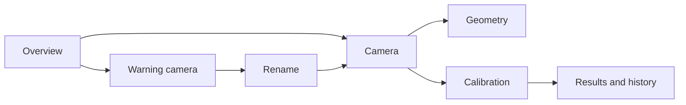

# Spot beta GUI reference

Revision 3 · October 7, 2026. [Open the editable Penpot file](https://design.penpot.app/#/workspace?team-id=3e981c57-46d6-803d-8008-be904f2a7c48&file-id=fd558256-f8c8-8184-8008-c139acc14eb0&page-id=fd558256-f8c8-8184-8008-c139acc14eb1).

Page: **GUI reference · Beta**. Source Sans Pro, Blazing Bulldogs vector logo, Fetch-style white sidebar and burgundy selections. The beta plan remains the backend contract; the user's revision below replaces the earlier GUI interaction/layout proposal. This is a design reference, not running GUI software.

| Board | Design |
| --- | --- |
| 01 Overview | Camera feeds with large detection FPS, tag count and frame age; tiny calibrated check; disconnected placeholder |
| 02 Camera detail | Live Config sliders on the left, undo/redo, reset to code defaults; feed, compact detections and 3D view |
| 03 Camera name | Warning camera in sidebar; preview, name picker and Rename |
| 04 Calibration capture | Alpha-style four-camera cards, coverage dots, capture/pause/calibrate, compact board controls |
| 05 Calibration results and history | Holdout metrics, selected group apply and calibration history/restore |
| 06 Network | Endpoint/discovery configuration and a few link/synchronization stats |
| 07 Docs | Ordered setup topics, Guides/Reference, article outline and next-page navigation |
| 08 Compact camera | Icon sidebar and compact left controls; enabled-state lock inside Config |
| 09 Camera geometry | Camera/Geometry tabs, six compact number fields, isometric drivebase, front arrow and camera lens arrow |
| 10 System | CPU/GPU/memory/thermal, per-camera rates/drop/age, software identity, USB and faults |
| 11 States | Live readback, rejected control, no robot, stale image, pending apply, concurrency, missing calibration, unavailable time |

## Agreed interaction changes

Remove the entire GUI-wide top bar: no Offseason label, Robot disabled pill, help button or Overview quick-status strip. Remove vague Ready badges and Live feed badges. Failure/stale/frozen states must still be explicit. Calibration is a small `✓ calibrated` marker, not a major metric card.

All camera entries appear as cameras. A camera without a name present in robot code has a warning beside its current device name; an uncalibrated camera also has a warning. Tooltips/accessibility labels distinguish the reason. Do not use “role” or “assignment” in the GUI. Naming binds the physical device to the matching code-defined camera name internally; stable identity, duplicate-serial handling and persistence still apply. Renaming must not erase calibration or pretend it creates a camera definition in robot code. The GUI shows matching available names, not arbitrary production identities.

Config uses live sliders and numeric readouts. There is **no draft/save/apply workflow for tuning**. Apply validated changes during manipulation at a bounded rate, show the actual device readback, and persist acknowledged settings automatically through the configuration service. Group a drag gesture into one undo entry. Undo/redo and Reset to code defaults use the same eligibility, validation, revision and acknowledgement rules as ordinary control changes. Reject unsupported/clipped controls visibly beside the control. Another browser's changes require reconciliation before undo; do not silently overwrite them. Mutations remain disabled-only or explicit standalone setup, with eligibility rechecked by the server. Pinned values have compact disabled controls/lock indicators, without “code-owned” prose.

Geometry uses number fields, not sliders. Geometry is reachable from the **Geometry tab on each camera page**; the small 3D view also opens it. Controls immediately update the visualization. Use actual mount defaults from robot code, not the mock numbers. Persist/apply geometry overrides only if the robot's explicit policy supports them; otherwise controls are locked for production configuration. Reset restores supplied code defaults. This revision does not silently make the robot use a browser-only transform. Robot transform authority remains explicit. Calibration history belongs exclusively on Calibration.

“Show detection outlines” replaces the ambiguous Tags/Corners controls. It shows tag boundaries and IDs on the image. “Pause image” freezes only the displayed inspection frame; processing continues. A paused image needs an explicit paused state and frame age. Axes are optional advanced inspection controls, not unexplained main-page buttons.

Use the alpha orthographic 3D viewer's projection, keyboard/pointer orbit, zoom, reset, candidate colors and frame validity handling. The geometry view shows an outline drivebase, front direction and camera lens direction. The small Camera viewer includes observed tags. Use real accepted manifests/layouts and correctly labeled coordinate frames at runtime. The static Penpot sketches are illustrative, not measured geometry or an interactive 3D implementation.

Calibration follows alpha's **Board → Capture → Review → Save/apply** workflow with improved spacing and less prose. Keep automatic capture, registered coverage particles, background solves and per-camera actions from `tools/calibration_ui.html`. Beta still adds explicit independent validation, atomic group activation and Applied only after acknowledgement. Preserve the current generation on failure; a smaller passing group requires explicit selection. Move history and restore to Results/history. Do not copy alpha's sequential save/restart limitations into beta.

Network has endpoint/discovery configs and a small link summary. OS address changes remain outside scope. System owns all detailed performance, USB, thermal, faults, startup and deployment diagnostics. When wall time is unreliable, show Time unavailable and monotonic uptime.

Docs takes its navigation structure from [DogLog Docs](https://doglog.dev/getting-started/installation): grouped topics, a readable article, an On this page outline, and previous/next navigation. Setup order is Connect → Name cameras → Geometry → Calibration → Verify. No “student” heading. The example article now gives concrete naming actions and expected results. Connection instructions must be filled from the installed local documentation; internal network details were not added to the cloud Docs example. Maintain one packaged source, offline search and contextual links.

## Theme, number editing and history controls

Overview values are single-line groups: **18 FPS**, **2 tags**, **48 ms**. The unit/label stays at the same size and weight as its number. Missing values use **— FPS** and **— tags**; the last-frame age retains its unit.

Theme defaults to **Auto**, follows the OS color scheme, and updates when the OS preference changes. The sidebar trigger is an icon only: monitor for Auto, sun for Light, moon for Dark. Its popup contains three icon choices with selected styling and tooltips/accessibility names. Persist only the browser preference; do not put theme in robot configuration. Keyboard focus, Escape dismissal and radio-style selection must work. Light/dark counterparts exist for all eleven reference boards, plus two theme-popup boards. The prototype popup uses Overview as its representative context; the implementation must preserve the user's current page when changing theme.

Geometry fields separate the editable number, fixed unit suffix and small increment/decrement controls. X/Y/Z use meters; angles use degrees. Use a text input with decimal input mode and a local edit string, rather than eagerly normalizing a number input on every keystroke. Normal click places the caret at the clicked position. **Never auto-select on focus**. Preserve the caret/selection across readback updates and do not replace a focused local edit with polling data.

Allow empty text, a sign, trailing decimal and partial decimal while editing. Do not append zeros, clamp, reformat or jump the caret on input. Backspace/Delete and edits to the final digits must behave normally. Preview finite valid values in 3D; incomplete/invalid text keeps the previous valid visualization. Commit on Enter or blur through the validated configuration API; Escape restores the last acknowledged value. Display invalid/out-of-range feedback beside the field, preserving the text so it can be repaired. Unit suffixes are not editable. Arrow keys/stepper controls change by a documented step; modifiers can provide fine/coarse adjustment. Wheel scrolling must not change values accidentally. Preserve ordinary local text undo while editing; toolbar history represents acknowledged configuration changes. These interaction requirements need implementation verification; Penpot demonstrates the visual states only.

Undo/redo are small **borderless, text-free icons on the panel-title row**. The Camera mock has an available Undo and unavailable Redo; Geometry and the locked compact mock show both unavailable. Disable and grey an action when its stack is empty or configuration cannot be changed. Enabled icons have a quiet hover background; keyboard focus may have a focus ring. Give each an accessible name and a tooltip, including the reason an action is unavailable. Enable/disable state must reflect acknowledged history, not whether a slider or field currently has focus.

Dark theme values are in `dark-tokens.json`; dark reference primitives are in `dark-boards.json`. Recolor app surfaces, text and vector UI controls. Preserve logo colors and camera pixels. Dark selected navigation and primary buttons use burgundy with white foreground; contextual burgundy text becomes a lighter accent for readable contrast.

## Reference assets and verification

`boards.json`, numbered SVGs and `tokens.json` are generated by `build_design.py`. Penpot is authoritative for subsequent manual edits. The logo source is [logos.frc.sh](https://logos.frc.sh/logos/581.svg); preserve its colors and proportions. Sidebar icons are editable outline vectors, absent on individual camera entries.

The mock numbers, modes, limits, names, calibration metrics, tags, poses, release IDs and network values are illustrative. Populate them from real capabilities, configuration and telemetry. The feed drawings are not valid AprilTags or real footage. Widget rendering does not establish acceptance thresholds.

Native renders inspected for this revision: Overview, Camera, Geometry, Calibration capture and Docs. Revision 3 adds dark variants and a theme popup, with updated Overview and Geometry renders checked in both styles. Navigation hotspots connect the main pages, Camera/Geometry, and Capture/Results. Live sliders, undo/redo, rename persistence, calibration actions, orbit/zoom and documentation search are implementation requirements; the Penpot prototype does not execute them. No application code or Jetson deployment was changed.

Reuse references: `tools/alpha_dashboard.html` (viewer, overlays and controls), `tools/calibration_ui.html` (capture UI), and `docs/Spot Beta Robot Integration Plan.md` (state/configuration/activation contracts).
