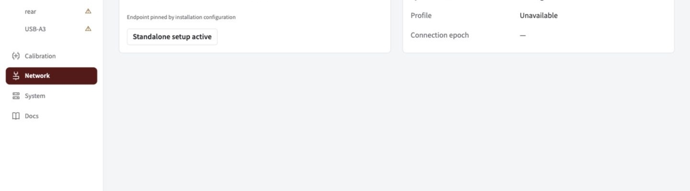

Title: 1. Connect to Spot
Group: Getting started

# Connect to Spot

Open the dashboard, check the robot link, and find your cameras. Start here when Spot is already installed on the Jetson.

## Open the dashboard

1. Make sure the Jetson is on, then connect to the robot.
2. Open [spot.local:5800](http://spot.local:5800). If the hostname does not resolve, use the Jetson's local IP address and port.
3. Select **Network** to check the connection, then **Cameras** to find the physical feeds.



*Network shows the robot endpoint, local addresses, clock and profile. This example is disconnected; screenshots in these guides use demonstration data.*

## Check you are ready

| Check | What to look for |
| --- | --- |
| Robot endpoint | Team 581 discovery, or the explicit server configured for this installation |
| NetworkTables | Connected to the roboRIO, which runs the NT4 server |
| Synchronization | A current synchronized clock |
| Profile | The current robot profile |
| Cameras | A live feed for each connected USB camera |

> **Editing locked?** Disable the connected robot. For bench work with the link known disconnected, click **Begin standalone setup** on Network. Unknown robot state never unlocks edits automatically; connecting a robot ends standalone setup.

## Choose your next task

- [Name cameras](#docs/name) to bind physical feeds to robot-code names.
- [Tune a standalone camera](#docs/tuning) or [calibrate](#docs/calibrate) without a robot profile.
- [Deploy Spot](#docs/deployment) if the Jetson has no installed beta service.
- [Recover a connection](#docs/recovery) if a camera or robot link disappears.

<details>
<summary>Maintenance connection and endpoint settings</summary>

For the dedicated Jetson maintenance link:

```sh
ssh -i ~/.ssh/spot_jetson_ed25519 team581@192.168.69.170
```

For direct Ethernet, the development Mac uses `192.168.69.171/24` on its connected adapter. These maintenance addresses are separate from the robot NT endpoint.

Installation settings live in `/etc/spot-vision/beta.json`. Defaults use team 581 discovery and HTTP port 5800. Set `nt.server` instead of `nt.team` for an explicit robot endpoint. The GUI does not change operating-system addresses. The UI and saved calibration remain accessible without cameras or a robot; alpha development commands do not start this GUI.

</details>
