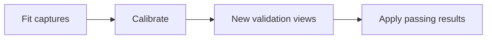
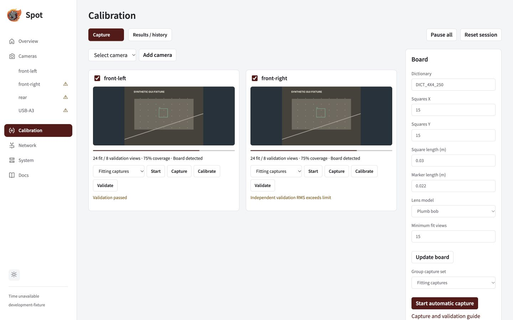
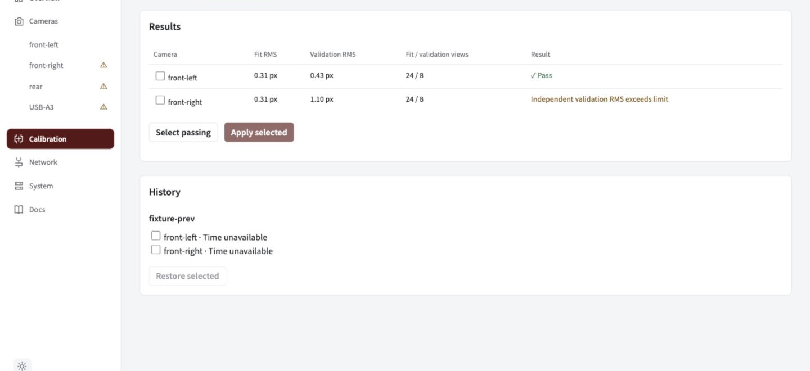

Title: 4. Calibrate
Group: Getting started

# Calibrate

Fit the lens model, test it on new views, then apply the passing result. Intrinsic calibration does not measure the robot mount.

## Prepare the board

Verify a live preview. A robot profile or name is optional: choose **Open standalone camera setup** on the camera page, or add the connected camera on Calibration.

| Board setting | Measured printed board |
| --- | --- |
| Squares X × Y | 15 × 15 |
| Square length | 0.030 m (30 mm) |
| Marker length | 0.022 m (22 mm) |
| Dictionary | `DICT_4X4_250` |

Confirm the actual print scale, enter these values in **Board**, and choose the lens model and minimum fit views. The production CUDA path supports the five-coefficient model.

## Capture and fit

1. Select a camera and click **Add camera**.
2. Choose **Fitting captures**, then **Start**.
3. Move the board across the image. Vary distance and tilt while keeping it sharp. Collect at least **15 diverse views**.
4. Click **Calibrate** for each camera. Other cameras stay usable while it solves.

*Capture controls are below each feed; board dimensions are on the right. Coverage particles guide where to move the board, but do not certify calibration quality.*

## Validate on new views

1. Switch to **Validation captures** and click **Start**.
2. Collect at least **5 new, diverse views** (up to 20). Keep them separate from the fitting captures.
3. Click **Validate**, then open **Results / history**.
4. Check the view counts, independent validation RMS and pass/retry reason. The configured RMS limit is at most **0.8 px**.

*Review each camera's result before applying. This demonstration includes both a pass and a retry.*

## Apply or restore

Select the intended group and click **Apply selected**. Every selected camera must pass; **Select passing** chooses a smaller passing group. Wait for **Applied** before using the result.

To recover a previous result, select compatible records in history and click **Restore selected**.

> **Recalibrate after optical changes.** Replacement, focus, crop, flip or an incompatible optical mode can invalidate calibration. Use a freshly disabled robot or explicitly authorized standalone setup for application and restore.

Group capture and application guarantees

In Board, choose **Group capture set** and **Start automatic capture** to start the selected group; **Pause all** stops it. One board can move between cameras. **Capture** explicitly accepts a new frame; duplicates are rejected.

Validation holds intrinsics fixed and solves board extrinsics on held-out views; reused frame identities are rejected. Failed fits retain the active calibration.

Application validates the whole group, stages an immutable generation, rebuilds detector/solver state, discards old-generation frames and atomically activates the result. A failed member or write activates none of that group. **Applied** requires durable runtime acknowledgement. Restore checks identity and optical compatibility using the same rules. Earlier complete generations stay available.

Next: [verify detections and robot decisions](#docs/verify).
