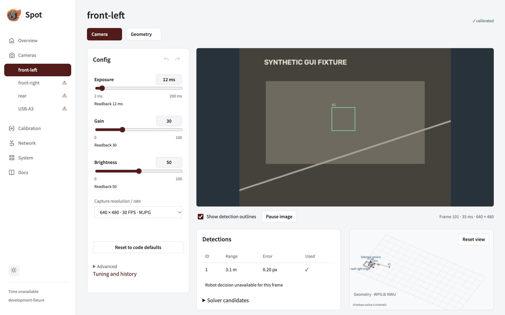

Title: Camera tuning
Group: Guides

# Camera tuning

Adjust the live image and check what the camera actually accepted. Eligible slider changes apply immediately.

## Open a camera

For a configured camera, disable the connected robot. Without a profile, open the USB feed and click **Open standalone camera setup**. After a service restart, use **Enable standalone setup** to authorize edits again.

*Config shows the available controls beside the feed. Demonstration values are examples, not recommended presets.*

## Tune and confirm

1. Check **Capture resolution / rate** matches the intended optical mode.
2. Adjust an eligible slider while watching the image.
3. Wait for the pending request to finish and check the actual device readback.
4. Use undo/redo to compare changes, or **Reset to code defaults** to restore the robot policy.

| Setting | Useful first check |
| --- | --- |
| Exposure | Shorter reduces motion blur; longer collects more light. Values are in µs. |
| Gain | Brightens the image but can increase noise. Use the device's advertised scale. |
| Automatic controls | Disable the relevant automatic mode before setting manual values. |
| Policy lock | Robot code decides which controls can be overridden. |
| Rejected or clipped request | Read the reason; the previous acknowledged setting stays active. |

There is no tuning **Save** or **Apply** button. For exact control names and values, see [Cameras in Java](#docs/camera-configuration).

> **Optical changes affect calibration.** Focus, zoom, crop, rotation and flip can invalidate intrinsics. Capture mode and control readback also affect measured timing. Revalidate the applicable evidence before robot use.

Exposure limits

Exposure must fit one configured capture interval and the driver's supported range and step. At 120 FPS with 100 µs steps, the maximum is 8,300 µs. The driver maximum remains in the tooltip. This limit follows capture FPS, not detection or preview FPS. Requests above it are rejected; if the minimum is too long, choose a lower supported rate.

History, standalone settings and other browsers

One acknowledged slider gesture is one undo entry; reset is one transaction. Failed writes add no history, and a new change clears redo. Another browser's revision invalidates local history: click **Reconcile current values** before editing again.

Standalone settings persist by physical identity. **Reset setup values** returns to the values captured when setup first opened. Its 3D origin is an inspection reference. Connecting a robot ends standalone authorization; robot bindings, transforms and policy remain authoritative. Enable, unknown state or link changes can reject a pending write.

Advanced **Copy settings as code** produces policy helpers for review; it does not create camera definitions.

