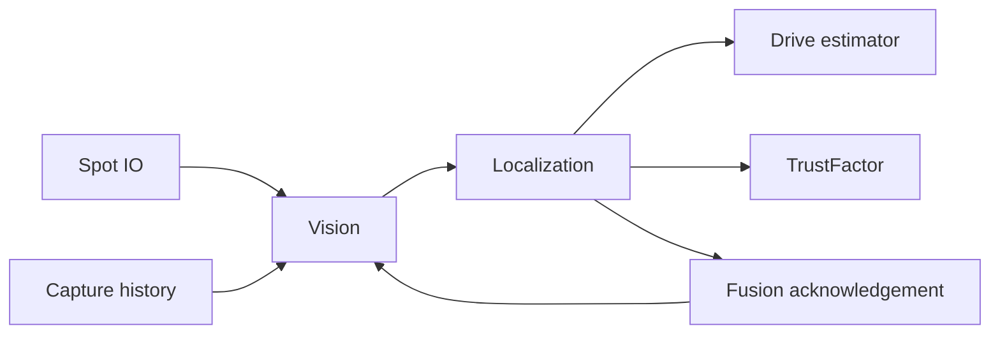

Title: API / Java integration
Group: Reference

# API and Java integration

## Offseason implementation

Production Spot code lives in `offseason-bot/src/main/java/frc/robot/vision/`.
`Vision` is the sole scheduled owner of transport, processing, capture history,
ordering, tag-selection states and cached camera status. `Localization` drains
immutable `results/VisionMeasurement` values once, checks history and age, inserts
each pose with one FPGA-to-CTRE time conversion, and acknowledges actual fusion.
Only fused evidence updates the local `TrustFactor`. Simulation uses the same
health and trust rules as hardware.

Four chassis-fixed roles are `left`, `right`, `front`, `back`. The production
profile remains empty until their NWU mounts, optical modes and controls are
measured. No placeholder transforms or turret camera are published. Set the
single `SpotCameraProfiles.FUSION_ENABLED` only after qualification; its default
is false and heading fusion remains suppressed. The DS `UseVision` option and
pit mode can suppress fusion while preserving shadow diagnostics.



The compiled offseason example supplies one NT instance/session, a capture
source, a clock and explicit capabilities. `poseAt` returns empty outside
available FPGA-time history. Robot construction is drivetrain → IMU → Vision →
HealthManager → Swerve → Localization; helpers do not schedule themselves.

```java-example
```

## Alliance-hub selection and release compatibility

Use Spot service **0.2.1 or later with `tag_selection_supported=true`** and the
matching offseason local integration (namespace `frc.robot.vision.generated`).
An older service is reported as unsupported rather than silently applying a
broad-tag solve. Deploy both sides together after review; this refactor does not
deploy either side automatically. Transport remains schema v2.

`tagsRequest()` selects all configured field IDs. `hubTagsRequest()` first
acquires broadly, then selects red `2,3,4,5,8,9,10,11` or blue
`18,19,20,21,24,25,26,27` after fresh accepted own-hub evidence from any camera.
Unknown alliance or incomplete hub layout stays broad. Loss for 0.5 seconds
restores broad acquisition. Repeated requests do not restart timers. Each
selection change invalidates queued old-policy output; service filtering occurs
before pose solving, and applied generations are independently checked on robot.

Inputs run IMU 10 → Vision 11 → Localization 12 → Health 28 → managers 29.
The accepted sorted-list scheduler implementations from main are required;
priority-queue iteration cannot enforce this order. State actions use descending
priority, so Vision publishes decisions after Localization's acknowledgements.

Camera health and pose evidence are separate. Valid zero-tag frames can keep a
camera healthy while trust ages. Required-camera failure faults the camera while
other usable cameras continue localization. With no configured cameras,
localization camera capability is unavailable; Spot has no fuel-detection capability.

## Commissioning and future simulation

Measure all four mounts/modes/controls; qualify USB/compute throughput, simultaneous
visibility, correlation, partial outages, FPGA timestamps and provisional trust
coefficients. Fusion and heading remain off pending robot trials. Historical
verification reports describe the earlier shared/hybrid implementation.

The future headless runner can compose this subsystem using scripted `VisionIO`
raw samples and health, a manual clock, capture-source history and public cached
status. This change adds no scenario runner, Gradle tasks, diagnostic entrypoint,
CI changes or registry reset/unregister mechanism. Full scoring simulation must
account for the existing TestManager idling normal managers each loop.

## Timestamp and observation contract

Production topics use `/Spot/v2` with `proto:spot.vision.v2.*` raw packets. The schema is installed under `spot_vision/schemas` and checked in as `proto/vision_v2.proto`. Coherent observations carry session, generation, binding, calibration, mode, sequence and capture epoch. The NT sample timestamp is robot-facing FPGA time after built-in translation; the internal Jetson local-NT timestamp is diagnostic and is never treated as an FPGA timestamp.

The receiver rejects stale, future, conflicting-domain, pre-reset, duplicate, old-epoch or mismatched packets. Bounds are 64 KiB per observation, 32 cameras, 64 tags and two candidates. Timestamp sentinels 0/1 are handled only on a verified NT server; actual roboRIO timing remains a hardware qualification gate. Max age starts at 250 ms, future tolerance 5 ms and reorder watermark 20 ms; no timestamp clamping is allowed.

## HTTP boundary

Get `/api/session` to establish the HttpOnly SameSite browser cookie and CSRF token. Mutations POST JSON to `/api/operations` with matching Origin, X-Spot-CSRF, `operation`, `payload`, and a unique bounded `request_id`. The response is a job ID; poll `/api/jobs/ID` for applied/rejected acknowledgement. Handlers enqueue work and never open cameras, solve calibration or write state.

Ordinary bodies are bounded to 64 KiB, imports to 2 MiB, sessions to eight, HTTP workers to sixteen and live mutations to five per second with a burst of two. Revisions prevent concurrent overwrite. Theme is browser storage and never goes through this API.

A measured `qualify-timing` payload contains revision and record: identity, System timing signature, timestamp_source `read-completion-local-nt`, nonpositive correction_us, positive uncertainty_s at most 0.02, measured_cycles at least 100, and explicit evidence/conditions. Synthetic unit-test timing records are not qualification evidence.
