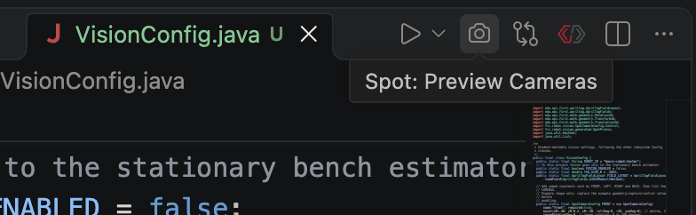
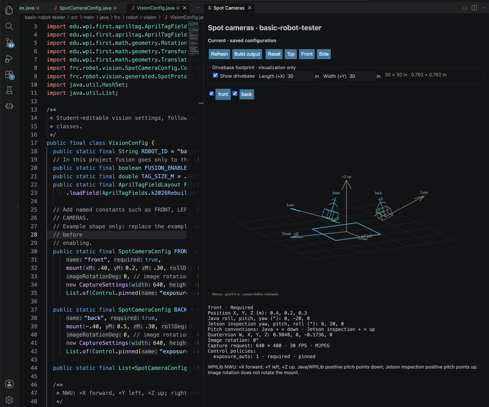
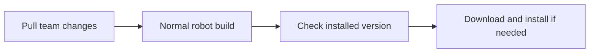

Title: VS Code camera preview
Group: Reference

# VS Code camera preview

Inspect camera mounts beside `VisionConfig.java` before deploying robot code. The preview runs offline and reads the actual compiled Java configuration. It does not connect to or change the Jetson.

## First use

1. Install desktop VS Code (including WPILib VS Code), the team's WPILib Java toolchain, and GitHub CLI. Obtain access to the private `team581/spot-2026` repository.
2. Run `gh auth login` once if GitHub CLI is not authenticated. Git clone access alone does not authenticate release downloads.
3. Open the robot project and trust the workspace. Run its normal Gradle `build` task. In offseason-2026 use `./gradlew :offseason-bot:build`; in basic-robot-tester use `./gradlew build`. On Windows use `gradlew.bat`.
4. The build installs the approved private extension. Reload VS Code if requested.
5. Open `src/main/java/frc/robot/vision/VisionConfig.java` in the robot project. The preview opens beside it. Alternatively click the camera icon, right-click the file, or run **Spot: Preview Cameras** from the Command Palette.

Click the camera icon in the `VisionConfig.java` editor title bar to open **Spot: Preview Cameras**.

The first preview may take longer while Gradle resolves dependencies and compiles code. No separate Python environment or web server is needed.

## Verify a mount

Keep camera definitions open on the left and inspect the resulting mounts on the right. The preview includes camera visibility controls and an adjustable drivebase footprint. The values shown here are illustrative, not measured production mounts. This screenshot shows an earlier version with positive-up Jetson pitch labels; version 0.1.2 and later use WPILib pitch on both sides: positive points down, negative points up.

- Register measured camera constants in `CAMERAS`. An empty list intentionally shows no cameras; a named constant alone does not register one.
- Save a measured translation or rotation change. The panel builds the saved configuration and refreshes automatically.
- Select a camera using its name. Check its position, lens direction and local axes against the physical mounting measurements. Toggle visibility to isolate cameras.
- Drag to orbit and scroll to zoom. Arrow keys orbit; plus/minus zoom. Use Top, Front, Side or Reset for standard views.
- Inspect translation, quaternion, native roll/pitch/yaw degrees, capture request, image rotation, required status and control policies below the scene.

Positions use metres. Robot axes are WPILib NWU: +X forward, +Y left, +Z up. Positive native WPILib pitch points the forward lens axis downward. The Jetson geometry controls use the same native WPILib convention. The preview shows both **Java roll, pitch, yaw** and **Jetson inspection yaw, pitch, roll**: for example, Java pitch -20° is Jetson inspection pitch -20°, and both point the camera up. Image rotation is separate from physical mount rotation. Grid spacing is 0.4 m; camera bodies are schematic. The optional drivebase footprint defaults to 30 × 30 inches (0.762 × 0.762 m), centered on the robot origin. Toggle **Show drivebase** or adjust **Length (+X)** and **Width (+Y)** in inches. These settings persist across refreshes and change only the visualization, never robot configuration. The outline is a footprint at Z=0, not a measured chassis model. No calibrated field of view is inferred.

**Current** means the saved code exported successfully. **Unsaved changes** means the scene still reflects an earlier saved version. **Building** means a new export is running. **Stale preview** retains the last successful geometry after an error; it is not validation of the current code. Use **Build output** to inspect errors, fix the Java code, then save or click Refresh.

## Automatic updates

The extension is distributed through private GitHub releases, not the public Marketplace. Each robot project pins an approved version and checksum in `camera-preview-release.json`.

Pulling team changes can advance the approved version. The next normal robot build checks the installed version locally and installs the approved version if missing or older. It does not downgrade a newer installation. Cached, checksum-verified packages can install offline; a first download requires GitHub authentication and connectivity. Packages are cached under the Gradle user home's `spot-camera-preview` directory.

Saving camera code refreshes geometry; it does not install extensions. Preview exports never trigger the installer. CI and SSH builds skip automatic installation. An installation problem warns without failing the robot build.

To retry explicitly, run `./gradlew installSpotCameraPreview` in the tester or `./gradlew :offseason-bot:installSpotCameraPreview` in offseason-2026. This explicit task reports installation errors. To opt out, add `-PskipSpotCameraPreviewInstall=true` to the build. To specify VS Code, add `-PspotCameraPreviewCode=/path/to/code` or set `SPOT_CAMERA_PREVIEW_CODE`.

For manual installation, download the VSIX asset from the pinned private release and select **Extensions → … → Install from VSIX**. Alternatively run `code --install-extension /path/to/spot-camera-preview-0.1.2.vsix --force`. Reload VS Code if requested.

## Troubleshooting

- **No preview:** run **Spot: Preview Cameras**. Closing the panel suppresses automatic reopening for that session. Check **Spot Camera Preview: Auto Open** in settings and workspace trust.
- **VS Code CLI missing:** set the executable override above, or install VS Code's `code` command on PATH. For an alternate VS Code profile, manually install the VSIX into that profile.
- **Private download fails:** run `gh auth status` and verify access to the private Spot repository. Sign in using `gh auth login`. Retry the explicit installation task when online.
- **Release not published/pinned:** the team maintainer must publish the private VSIX and update both project manifests before automatic installation is available.
- **Java or build errors:** use Build output and verify the project's WPILib Java toolchain. This tool compiles the project, so unrelated compile failures can prevent refresh.
- **Invalid configuration:** resolve the Java validation exception, such as duplicate names, invalid capture dimensions, or image rotation other than 0/180, and save again.
- **Empty scene:** populate `CAMERAS` with measured definitions; do not copy demonstration mounts as production measurements.

This checks configuration geometry and software bounds. Confirm physical camera identity, calibration, delivered FPS, USB capacity and applied controls on the Jetson before commissioning. Continue with [camera configuration](#docs/camera-configuration).
